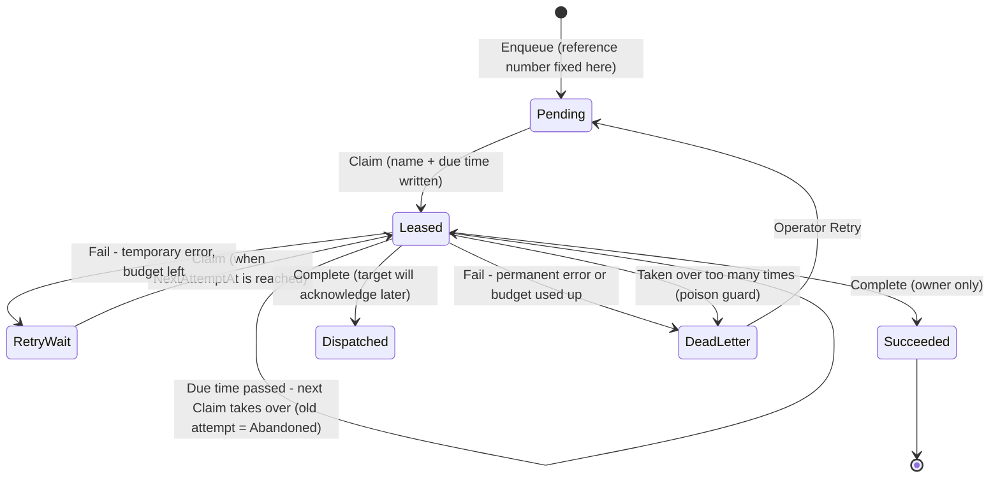

# Work-Item Lease (Claim + Time Limit): T-SQL Implementation Guide

**Audience:** developers who build or maintain workers (SSIS packages, SQL Agent jobs, .NET services) on the `integ` work-item ledger
**Companion to:** `Concurrency_OCC_vs_Lease_Developer_Guide.md` (that document explains *why*; this one shows *how*)
**Runnable script:** `Lease_Implementation_Reference.sql` (all code blocks from this guide, in deployment order)

---

## How to read this guide

Each code block carries one of three labels:

| Label | Meaning |
|---|---|
| **[REF]** | Same logic as the reference scripts (`02_integ_core_procs.sql`), reformatted and commented |
| **[FIX]** | Reference logic with a fix from the design review applied (each fix is named, e.g. *Fix L9*) |
| **[NEW]** | Proposed pattern that does not exist in the reference scripts yet |

> **Teaching version.** The table definitions in §3 contain only the columns the lease mechanism needs. They are aligned with the column names used in the developer guide, but they are **not** a copy of `01_integ_tables.sql`. Before you deploy anything, compare against the real schema.

**Fixes applied in this version**

| Fix | Problem in plain words | Where |
|---|---|---|
| L9 | A late "Fail" from an old worker could overwrite the new owner | `usp_WorkItem_Fail` |
| D1 | The "is the earlier item finished?" check could read a slightly old copy of the row | `usp_WorkItem_Claim` |
| D2 | Lease times used local server time, which shifts with daylight saving | All procedures (`SYSUTCDATETIME()`) |
| D3 | The reference number (idempotency key) must never change between attempts | `usp_WorkItem_Enqueue` |
| D4 | A task that crashes the worker every time was retaken forever | `usp_WorkItem_Claim` (poison guard) |
| L8 | Two threads of the same run could not be told apart | `@AttemptNo` fencing token on Complete / Renew / Fail |

---

## 1. The lease in one picture

A work item is a **job card**. A worker takes the card, writes its name and a due time on it, does the job, and hands it back.



**The five steps every worker follows**

| Step | Procedure | Plain meaning |
|---|---|---|
| 1. Claim | `usp_WorkItem_Claim` | Take up to N free cards; your name and a due time are written on them |
| 2. Work | your adapter / HTTP call | Do the job. **No database lock is held while you work** |
| 3. Renew *(if slow)* | `usp_WorkItem_RenewLease` | "I'm still on it" - push the due time out. Refused if you're already late |
| 4. Report | `usp_WorkItem_Complete` or `usp_WorkItem_Fail` | Hand in the result. Accepted **only** if the card still has your name and attempt number |
| 5. Recover *(automatic)* | inside `usp_WorkItem_Claim` | If a worker never reports, the card becomes free after its due time; the next claim takes it |

---

## 2. Six rules that make the lease safe

Remember these and the code below will make sense.

1. **Taking a card is one statement.** Find + mark happens in a single `UPDATE`, so two workers can never take the same card.
2. **Every report checks ownership inside the write itself.** `UPDATE ... WHERE LeaseOwner = @me AND AttemptCount = @myAttempt`. Never "check first, write later".
3. **Renewal can't bring back an expired lease.** Once you're late, someone else may already be taking the card.
4. **Complete does not check the time, only ownership.** If you're late but nobody took over, your work is still the only work done, so it's accepted.
5. **The reference number is created once, at enqueue.** Every attempt sends the same number, so the target can recognize repeats.
6. **All times are UTC** (`SYSUTCDATETIME()`). One clock, no daylight-saving jumps.

---

## 3. The tables

### 3.1 Work item (the job card) **[REF + FIX]**

```sql
-- [script] 3.1 integ.WorkItem (teaching subset)
IF SCHEMA_ID('integ') IS NULL EXEC ('CREATE SCHEMA integ');
GO
CREATE TABLE integ.WorkItem
(
    WorkItemId       bigint IDENTITY(1,1) NOT NULL CONSTRAINT PK_WorkItem PRIMARY KEY,
    OperationCode    varchar(50)    NOT NULL,          -- what to do, e.g. 'OMSI.ShipmentUpsert'
    TargetSystem     varchar(30)    NOT NULL,          -- where, e.g. 'OMSI', 'LT_API'
    OrderingKey      nvarchar(200)  NOT NULL,          -- which business object, e.g. 'Shipment:4171753'
    Priority         tinyint        NOT NULL CONSTRAINT DF_WI_Priority DEFAULT (5),
    IdempotencyKey   nvarchar(200)  NOT NULL,          -- reference number: set ONCE, never changed (Fix D3)
    PayloadJson      nvarchar(max)  NULL,

    -- State
    Status           varchar(20)    NOT NULL CONSTRAINT DF_WI_Status DEFAULT ('Pending'),
    StatusReason     nvarchar(400)  NULL,
    NextAttemptAt    datetime2(3)   NOT NULL CONSTRAINT DF_WI_Next DEFAULT (SYSUTCDATETIME()),  -- UTC

    -- Lease (the name + due time on the card)
    LeaseOwner       nvarchar(128)  NULL,              -- '<Process>#<RunId>[.<Thread>]'
    LeaseExpiresAt   datetime2(3)   NULL,              -- UTC

    -- Counters
    AttemptCount     int            NOT NULL CONSTRAINT DF_WI_Attempt DEFAULT (0),  -- also the fencing token
    AbandonCount     int            NOT NULL CONSTRAINT DF_WI_Abandon DEFAULT (0),  -- [NEW] Fix D4
    RetryBudgetBase  int            NOT NULL CONSTRAINT DF_WI_Budget  DEFAULT (0),  -- reset point after manual retry

    -- Results
    ExternalRef      nvarchar(200)  NULL,
    DispatchedAt     datetime2(3)   NULL,
    CompletedAt      datetime2(3)   NULL,
    CreatedAt        datetime2(3)   NOT NULL CONSTRAINT DF_WI_Created DEFAULT (SYSUTCDATETIME()),
    RowVer           rowversion,

    CONSTRAINT CK_WI_Status CHECK (Status IN
        ('Pending','Leased','RetryWait','Dispatched','Succeeded','DeadLetter','Superseded','Cancelled')),
    CONSTRAINT CK_WI_LeaseShape CHECK (
        (Status =  'Leased' AND LeaseOwner IS NOT NULL AND LeaseExpiresAt IS NOT NULL) OR
        (Status <> 'Leased' AND LeaseOwner IS NULL     AND LeaseExpiresAt IS NULL)),
    CONSTRAINT UQ_WI_Idem UNIQUE (IdempotencyKey)
);
GO
-- Finds claimable cards quickly (small: only open rows)
CREATE INDEX IX_WI_Claim ON integ.WorkItem (Priority, WorkItemId)
    INCLUDE (Status, NextAttemptAt, LeaseExpiresAt, OrderingKey, TargetSystem)
    WHERE Status IN ('Pending','RetryWait','Leased');
-- Answers "is an earlier card for the same object still open?" (the in-order check)
CREATE INDEX IX_WI_Ordering ON integ.WorkItem (OrderingKey, TargetSystem, WorkItemId)
    INCLUDE (Status)
    WHERE Status IN ('Pending','Leased','RetryWait','DeadLetter');
GO
```

`CK_WI_LeaseShape` is a cheap safety net: a card is either leased *with* an owner and due time, or not leased and *without* them. Any code that forgets to clear the lease fails immediately.

### 3.2 Attempt history, retry policy, process runs

```sql
-- [script] 3.2 Supporting tables
CREATE TABLE integ.WorkItemAttempt          -- [REF] one row per claim
(
    WorkItemId    bigint         NOT NULL,
    AttemptNo     int            NOT NULL,
    RunId         bigint         NOT NULL,
    LeaseOwner    nvarchar(128)  NOT NULL,
    StartedAt     datetime2(3)   NOT NULL,
    EndedAt       datetime2(3)   NULL,           -- NULL = still open
    Outcome       varchar(20)    NULL,
    ErrorClass    varchar(20)    NULL,           -- 'Transient' | 'Permanent'
    ErrorCode     int            NULL,
    ErrorMessage  nvarchar(2000) NULL,
    CONSTRAINT PK_WorkItemAttempt PRIMARY KEY (WorkItemId, AttemptNo),
    CONSTRAINT FK_WIA_WorkItem FOREIGN KEY (WorkItemId) REFERENCES integ.WorkItem (WorkItemId),
    CONSTRAINT CK_WIA_Outcome CHECK (Outcome IS NULL OR Outcome IN
        ('Succeeded','Dispatched','Duplicate','Failed','Abandoned'))
);
CREATE INDEX IX_WIA_Open ON integ.WorkItemAttempt (WorkItemId) WHERE EndedAt IS NULL;
GO
CREATE TABLE integ.OperationCatalog         -- [REF] subset
(
    OperationCode  varchar(50) NOT NULL CONSTRAINT PK_OperationCatalog PRIMARY KEY,
    RequiresAck    bit         NOT NULL CONSTRAINT DF_OC_Ack DEFAULT (0)   -- 1 = target confirms later
);
GO
CREATE TABLE integ.RetryPolicy              -- [NEW] column set proposed for this guide
(
    OperationCode     varchar(50) NOT NULL CONSTRAINT PK_RetryPolicy PRIMARY KEY,
    MaxAttempts       int NOT NULL,   -- attempts allowed (incl. the first) before DeadLetter
    BaseDelaySeconds  int NOT NULL,   -- first wait; doubles each retry
    MaxDelaySeconds   int NOT NULL,   -- cap for one wait
    MaxAbandons       int NOT NULL,   -- worker crashes allowed before "PoisonSuspected"
    LeaseSeconds      int NOT NULL,   -- recommended lease for this operation
    CONSTRAINT CK_RP_Values CHECK (MaxAttempts >= 1 AND BaseDelaySeconds >= 1
        AND MaxDelaySeconds >= BaseDelaySeconds AND MaxAbandons >= 1 AND LeaseSeconds BETWEEN 30 AND 3600)
);
GO
CREATE TABLE integ.ProcessRun               -- [REF] subset
(
    RunId        bigint IDENTITY(1,1) NOT NULL CONSTRAINT PK_ProcessRun PRIMARY KEY,
    ProcessName  nvarchar(100) NOT NULL,
    StartedAt    datetime2(3)  NOT NULL,
    HeartbeatAt  datetime2(3)  NOT NULL,
    EndedAt      datetime2(3)  NULL,
    RunStatus    varchar(20)   NOT NULL CONSTRAINT DF_PR_Status DEFAULT ('Running')
);
GO
```

### 3.3 Starting configuration **[NEW]**

These values follow the sizing rules in §11. Treat them as starting points and tune them from the monitoring queries in §12.

```sql
-- [script] 3.3 Starting configuration
INSERT integ.OperationCatalog (OperationCode, RequiresAck) VALUES
    ('OMSI.ShipmentUpsert', 0),
    ('LT.FreightAccrual',   0);

INSERT integ.RetryPolicy (OperationCode, MaxAttempts, BaseDelaySeconds, MaxDelaySeconds, MaxAbandons, LeaseSeconds) VALUES
--   operation              tries  first wait  max wait  crashes  lease
    ('OMSI.ShipmentUpsert',  6,     60,         1800,     3,       300),   -- same server, sub-second work
    ('LT.FreightAccrual',    8,     60,         3600,     3,       300);   -- HTTP, ~10 s per call, renew per item
GO
```

---

## 4. Step 0: Create the job card (with its reference number)

The reference number must be fixed **when the card is created** (Fix D3). Every retry then sends the same number, and the target can say "already have it".

In the real system, `usp_Outbox_Publish` creates work items. The procedure below is a **[NEW]** minimal stand-in so you can test the lease on its own.

```sql
-- [script] 4 usp_WorkItem_Enqueue
CREATE OR ALTER PROCEDURE integ.usp_WorkItem_Enqueue
    @OperationCode   varchar(50),
    @TargetSystem    varchar(30),
    @EntityType      varchar(30),        -- 'Shipment'
    @SourceKey       nvarchar(100),      -- '4171753'
    @SourceRevision  bigint,             -- source revision number (monotonic)
    @PayloadJson     nvarchar(max),
    @Priority        tinyint = 5,
    @WorkItemId      bigint  = NULL OUTPUT
AS
BEGIN
    SET NOCOUNT ON;
    SET XACT_ABORT ON;

    -- Reference number = object + revision + operation. Deterministic: the same change always
    -- gets the same number, so even a duplicate detection produces the same key.
    DECLARE @Key nvarchar(200) =
        CONCAT(@EntityType, N':', @SourceKey, N':REV', @SourceRevision, N':', @OperationCode);

    INSERT integ.WorkItem (OperationCode, TargetSystem, OrderingKey, Priority, IdempotencyKey, PayloadJson)
    SELECT @OperationCode, @TargetSystem, CONCAT(@EntityType, N':', @SourceKey), @Priority, @Key, @PayloadJson
     WHERE NOT EXISTS (SELECT 1 FROM integ.WorkItem WITH (UPDLOCK, HOLDLOCK) WHERE IdempotencyKey = @Key);

    IF @@ROWCOUNT = 1
        SET @WorkItemId = SCOPE_IDENTITY();
    ELSE
        SELECT @WorkItemId = WorkItemId FROM integ.WorkItem WHERE IdempotencyKey = @Key;   -- already queued
END;
GO
```

> **Rule:** no other procedure (Claim, Retry, Replay) may change `IdempotencyKey`. If an operator wants the target to process the change *again on purpose*, create a **new** work item from the latest state; don't reuse the old card.

---

## 5. Step 1: Claim (take the card)

### 5.1 What the claim does, in plain words

1. Look for cards that are **free** (Pending, or RetryWait whose wait is over) **or overdue** (Leased but the due time has passed).
2. Skip any card whose business object still has an **earlier** card open (in-order rule).
3. Skip cards that another claimer is taking at this exact moment (don't wait in line).
4. Write my name, a due time and attempt + 1 on the cards I got, all in **one** statement.
5. If I took over an overdue card, record the old attempt as **Abandoned**.
6. If a card has been abandoned too many times, park it as **DeadLetter / PoisonSuspected** instead of handing it out (Fix D4).
7. Open a new attempt row for each card I hold.

### 5.2 Code **[FIX: D1, D2, D4]**

```sql
-- [script] 5 usp_WorkItem_Claim
CREATE OR ALTER PROCEDURE integ.usp_WorkItem_Claim
    @RunId          bigint,
    @LeaseOwner     nvarchar(128),
    @BatchSize      int          = 10,
    @LeaseSeconds   int          = 300,
    @TargetSystem   varchar(30)  = NULL,   -- optional: claim for one target only
    @ReturnRows     bit          = 1,      -- 0 = caller reads its cards from the table instead
    @ClaimedCount   int          = NULL OUTPUT
AS
BEGIN
    SET NOCOUNT ON;
    SET XACT_ABORT ON;

    ----------------------------------------------------------------------------------
    -- 0. Validate inputs
    ----------------------------------------------------------------------------------
    IF @LeaseOwner IS NULL OR LTRIM(RTRIM(@LeaseOwner)) = N''
        THROW 52030, 'LeaseOwner is required.', 1;
    IF @BatchSize IS NULL OR @BatchSize NOT BETWEEN 1 AND 500
        THROW 52031, 'BatchSize must be between 1 and 500.', 1;
    IF @LeaseSeconds IS NULL OR @LeaseSeconds NOT BETWEEN 30 AND 3600
        THROW 52032, 'LeaseSeconds must be between 30 and 3600.', 1;

    DECLARE @Now datetime2(3) = SYSUTCDATETIME();                -- Fix D2: one clock, UTC

    DECLARE @Claimed TABLE
    (
        WorkItemId     bigint        NOT NULL PRIMARY KEY,
        AttemptNo      int           NOT NULL,
        PrevStatus     varchar(20)   NOT NULL,      -- 'Leased' here means "taken over from a dead/slow worker"
        PrevOwner      nvarchar(128) NULL,
        AbandonCount   int           NOT NULL,
        OperationCode  varchar(50)   NOT NULL
    );

    BEGIN TRANSACTION;

    ----------------------------------------------------------------------------------
    -- 1. Find + lease in ONE statement (rule 1)
    ----------------------------------------------------------------------------------
    WITH Eligible AS
    (
        SELECT TOP (@BatchSize)
               w.WorkItemId, w.Status, w.LeaseOwner, w.LeaseExpiresAt,
               w.AttemptCount, w.AbandonCount, w.OperationCode
          FROM integ.WorkItem AS w WITH (UPDLOCK, READPAST, ROWLOCK)
               -- UPDLOCK : I intend to change this row; no one else can take it in parallel
               -- READPAST: skip rows another claimer holds right now (don't wait in line)
               -- ROWLOCK : lock single rows, so READPAST skips only what it must
         WHERE (    (w.Status IN ('Pending','RetryWait') AND w.NextAttemptAt  <= @Now)   -- free
                 OR (w.Status = 'Leased'                 AND w.LeaseExpiresAt <  @Now) ) -- overdue
           AND (@TargetSystem IS NULL OR w.TargetSystem = @TargetSystem)
           AND NOT EXISTS                                                 -- in-order rule
               (
                 SELECT 1
                   FROM integ.WorkItem AS p WITH (READCOMMITTEDLOCK)
                        -- Fix D1: read the LIVE row, not a snapshot copy. Do NOT add READPAST here:
                        -- skipping a locked predecessor would wrongly look like "no predecessor".
                  WHERE p.OrderingKey  = w.OrderingKey
                    AND p.TargetSystem = w.TargetSystem
                    AND p.WorkItemId   < w.WorkItemId
                    AND p.Status IN ('Pending','Leased','RetryWait','DeadLetter')
               )
         ORDER BY w.Priority, w.WorkItemId
    )
    UPDATE Eligible
       SET Status         = 'Leased',
           LeaseOwner     = @LeaseOwner,
           LeaseExpiresAt = DATEADD(SECOND, @LeaseSeconds, @Now),
           AttemptCount   = AttemptCount + 1,                    -- new fencing token
           AbandonCount   = AbandonCount + IIF(Status = 'Leased', 1, 0)   -- right side = old value
    OUTPUT inserted.WorkItemId, inserted.AttemptCount, deleted.Status, deleted.LeaseOwner,
           inserted.AbandonCount, inserted.OperationCode
      INTO @Claimed (WorkItemId, AttemptNo, PrevStatus, PrevOwner, AbandonCount, OperationCode);

    ----------------------------------------------------------------------------------
    -- 2. Close the attempts of workers that never came back
    ----------------------------------------------------------------------------------
    UPDATE a
       SET EndedAt      = @Now,
           Outcome      = 'Abandoned',
           ErrorMessage = CONCAT(N'Lease expired; taken over by ', @LeaseOwner)
      FROM integ.WorkItemAttempt AS a
      JOIN @Claimed              AS c ON c.WorkItemId = a.WorkItemId
     WHERE c.PrevStatus = 'Leased'
       AND a.EndedAt IS NULL;

    ----------------------------------------------------------------------------------
    -- 3. Poison guard (Fix D4): too many crashes -> park it, don't hand it out again
    ----------------------------------------------------------------------------------
    UPDATE w
       SET Status         = 'DeadLetter',
           LeaseOwner     = NULL,
           LeaseExpiresAt = NULL,
           AttemptCount   = w.AttemptCount - 1,      -- this claim never started work
           StatusReason   = CONCAT(N'PoisonSuspected: worker lost the lease ', c.AbandonCount, N' times')
      FROM integ.WorkItem    AS w
      JOIN @Claimed          AS c  ON c.WorkItemId = w.WorkItemId
      LEFT JOIN integ.RetryPolicy AS rp ON rp.OperationCode = c.OperationCode
     WHERE c.AbandonCount >= COALESCE(rp.MaxAbandons, 3);

    DELETE c
      FROM @Claimed AS c
      LEFT JOIN integ.RetryPolicy AS rp ON rp.OperationCode = c.OperationCode
     WHERE c.AbandonCount >= COALESCE(rp.MaxAbandons, 3);

    ----------------------------------------------------------------------------------
    -- 4. Open one attempt row per card I now hold
    ----------------------------------------------------------------------------------
    INSERT integ.WorkItemAttempt (WorkItemId, AttemptNo, RunId, LeaseOwner, StartedAt)
    SELECT WorkItemId, AttemptNo, @RunId, @LeaseOwner, @Now
      FROM @Claimed;

    UPDATE integ.ProcessRun SET HeartbeatAt = @Now WHERE RunId = @RunId;

    COMMIT;

    ----------------------------------------------------------------------------------
    -- 5. Hand the cards to the caller
    ----------------------------------------------------------------------------------
    SELECT @ClaimedCount = COUNT(*) FROM @Claimed;

    IF @ReturnRows = 1
        SELECT w.WorkItemId,
               c.AttemptNo,                       -- the caller MUST pass this back on every report
               w.OperationCode, w.TargetSystem, w.OrderingKey,
               w.IdempotencyKey, w.PayloadJson, w.LeaseExpiresAt,
               IIF(c.PrevStatus = 'Leased', 'TakeOver', 'Fresh') AS ClaimKind
          FROM @Claimed       AS c
          JOIN integ.WorkItem AS w ON w.WorkItemId = c.WorkItemId
         ORDER BY w.Priority, w.WorkItemId;
END;
GO
```

### 5.3 Why each piece is there

| Piece | What breaks without it |
|---|---|
| One `UPDATE` over the CTE | Two workers could read the same free card between a separate SELECT and UPDATE |
| `UPDLOCK` | Two workers could both decide "this card is free" and both mark it |
| `READPAST` | Workers would queue behind each other instead of taking different cards |
| `ROWLOCK` | Lock escalation could make `READPAST` skip whole pages of cards |
| Overdue branch (`Status = 'Leased' AND LeaseExpiresAt < @Now`) | A crashed worker's cards would stay taken forever |
| `READCOMMITTEDLOCK` on the in-order check (Fix D1) | Under RCSI the check could see an old copy and send card #2 before a reopened card #1 |
| `deleted.Status` in `OUTPUT` | You couldn't tell a fresh claim from a take-over, so you couldn't mark the old attempt Abandoned |
| Poison guard (Fix D4) | A card that crashes every worker would be retried forever and block its object |
| `SYSUTCDATETIME()` (Fix D2) | Daylight-saving changes would stretch or shrink every lease by an hour |

> **Performance note.** `IX_WI_Ordering` is required. Without it, the in-order check scans the table and, with `READCOMMITTEDLOCK`, can wait briefly on unrelated rows that other claimers are changing.

---

## 6. Step 2: Work, and renew if the work is slow

### 6.1 Renew the lease **[FIX: L8, D2]**

```sql
-- [script] 6 usp_WorkItem_RenewLease
CREATE OR ALTER PROCEDURE integ.usp_WorkItem_RenewLease
    @WorkItemId     bigint,
    @LeaseOwner     nvarchar(128),
    @AttemptNo      int          = NULL,    -- pass it! (NULL only for legacy callers)
    @LeaseSeconds   int          = 300,
    @NewExpiresAt   datetime2(3) = NULL OUTPUT
AS
BEGIN
    SET NOCOUNT ON;
    SET XACT_ABORT ON;

    IF @LeaseSeconds IS NULL OR @LeaseSeconds NOT BETWEEN 30 AND 3600
        THROW 52032, 'LeaseSeconds must be between 30 and 3600.', 1;

    DECLARE @Now datetime2(3) = SYSUTCDATETIME();
    SET @NewExpiresAt = DATEADD(SECOND, @LeaseSeconds, @Now);

    UPDATE integ.WorkItem
       SET LeaseExpiresAt = @NewExpiresAt
     WHERE WorkItemId     = @WorkItemId
       AND Status         = 'Leased'
       AND LeaseOwner     = @LeaseOwner                              -- still mine?
       AND (@AttemptNo IS NULL OR AttemptCount = @AttemptNo)         -- same attempt? (Fix L8)
       AND LeaseExpiresAt > @Now;                                    -- not late? (rule 3)

    IF @@ROWCOUNT = 0
    BEGIN
        SET @NewExpiresAt = NULL;
        THROW 52002, 'Lease lost or expired: stop processing this work item.', 1;
    END;
END;
GO
```

### 6.2 When and how to renew

| Situation | What to do |
|---|---|
| Work per card is well under the lease (OMSI on the same server) | No renewal needed |
| Several slow cards in one batch (HTTP) | Renew **just before starting each card** |
| One card with a very long step (large file, slow API) | Renew every **lease ÷ 2** during the step |
| Renewal throws **52002** | **Stop immediately.** Don't call the target, don't report Fail, don't retry. Another worker owns the card now |

### 6.3 Heartbeat for the run **[NEW]**

A run that heartbeats lets operations release its cards early when it dies (see §8.3).

```sql
-- [script] 6.3 Run start / heartbeat / end
CREATE OR ALTER PROCEDURE integ.usp_Run_Start
    @ProcessName nvarchar(100),
    @RunId       bigint OUTPUT
AS
BEGIN
    SET NOCOUNT ON;
    DECLARE @Now datetime2(3) = SYSUTCDATETIME();
    INSERT integ.ProcessRun (ProcessName, StartedAt, HeartbeatAt) VALUES (@ProcessName, @Now, @Now);
    SET @RunId = SCOPE_IDENTITY();
END;
GO
CREATE OR ALTER PROCEDURE integ.usp_Run_Heartbeat
    @RunId bigint
AS
BEGIN
    SET NOCOUNT ON;
    UPDATE integ.ProcessRun SET HeartbeatAt = SYSUTCDATETIME() WHERE RunId = @RunId AND EndedAt IS NULL;
END;
GO
CREATE OR ALTER PROCEDURE integ.usp_Run_End
    @RunId     bigint,
    @RunStatus varchar(20) = 'Succeeded'
AS
BEGIN
    SET NOCOUNT ON;
    UPDATE integ.ProcessRun
       SET EndedAt = SYSUTCDATETIME(), HeartbeatAt = SYSUTCDATETIME(), RunStatus = @RunStatus
     WHERE RunId = @RunId;
END;
GO
```

---

## 7. Step 3: Report the result

### 7.1 Complete (success) **[REF + FIX: L8, D2]**

```sql
-- [script] 7.1 usp_WorkItem_Complete
CREATE OR ALTER PROCEDURE integ.usp_WorkItem_Complete
    @WorkItemId    bigint,
    @LeaseOwner    nvarchar(128),
    @AttemptNo     int           = NULL,
    @ExternalRef   nvarchar(200) = NULL,
    @WasDuplicate  bit           = 0,          -- 1 = target said "already have it" (still success)
    @NewStatus     varchar(20)   = NULL OUTPUT
AS
BEGIN
    SET NOCOUNT ON;
    SET XACT_ABORT ON;      -- if the fence fails, the caller's whole transaction rolls back

    DECLARE @Now     datetime2(3) = SYSUTCDATETIME();
    DECLARE @OwnTran bit = IIF(@@TRANCOUNT = 0, 1, 0);   -- join the adapter's transaction if there is one
    DECLARE @Done TABLE (NewStatus varchar(20), AttemptNo int);

    IF @OwnTran = 1 BEGIN TRANSACTION;

    UPDATE w
       SET Status         = IIF(o.RequiresAck = 1, 'Dispatched', 'Succeeded'),
           ExternalRef    = COALESCE(@ExternalRef, w.ExternalRef),
           DispatchedAt   = @Now,
           CompletedAt    = IIF(o.RequiresAck = 1, NULL, @Now),
           LeaseOwner     = NULL,
           LeaseExpiresAt = NULL,
           StatusReason   = IIF(@WasDuplicate = 1, N'Target reported duplicate (already processed)', NULL)
    OUTPUT inserted.Status, inserted.AttemptCount INTO @Done (NewStatus, AttemptNo)
      FROM integ.WorkItem         AS w
      JOIN integ.OperationCatalog AS o ON o.OperationCode = w.OperationCode
     WHERE w.WorkItemId = @WorkItemId
       AND w.Status     = 'Leased'
       AND w.LeaseOwner = @LeaseOwner                                 -- fence: owner
       AND (@AttemptNo IS NULL OR w.AttemptCount = @AttemptNo);       -- fence: attempt (Fix L8)
       -- Deliberately NO time check (rule 4)

    IF @@ROWCOUNT = 0
        THROW 52001, 'Lease lost: work item is no longer leased by this owner (another worker may have taken it over).', 1;

    UPDATE a
       SET EndedAt = @Now,
           Outcome = CASE WHEN @WasDuplicate = 1 THEN 'Duplicate' ELSE d.NewStatus END
      FROM integ.WorkItemAttempt AS a
      JOIN @Done                 AS d ON d.AttemptNo = a.AttemptNo
     WHERE a.WorkItemId = @WorkItemId
       AND a.EndedAt IS NULL;

    SELECT @NewStatus = NewStatus FROM @Done;

    IF @OwnTran = 1 COMMIT;
END;
GO
```

**Key point: same-server targets.** When the target is OMSI on the same SQL Server instance, call `Complete` **inside the same transaction** as the OMSI insert. If `Complete` throws 52001 (you're a zombie), `XACT_ABORT` rolls back your OMSI insert as well, so only the real owner's write survives. For HTTP targets this isn't possible; the reference number does that job (§9.2).

### 7.2 Fail (error) with retry and backoff **[FIX: L9, L8, D2]**

**How a failure is decided**

| Error type | Examples | Result |
|---|---|---|
| **Permanent** (retrying won't help) | Validation error, bad mapping, HTTP 400/422, duplicate key on bad data | `DeadLetter` immediately |
| **Transient** (may work later) | Timeout, deadlock (1205), HTTP 429/5xx, target down | `RetryWait` with a growing wait, until the attempt budget runs out, then `DeadLetter` |

**Wait time** = `BaseDelay × 2^(attempts used − 1)`, capped at `MaxDelay`, plus up to 20% random extra (jitter), so that many failed cards don't all retry in the same second.

```sql
-- [script] 7.2 usp_WorkItem_Fail
CREATE OR ALTER PROCEDURE integ.usp_WorkItem_Fail
    @WorkItemId    bigint,
    @LeaseOwner    nvarchar(128),
    @AttemptNo     int            = NULL,
    @ErrorClass    varchar(20)    = 'Transient',   -- 'Transient' | 'Permanent'
    @ErrorCode     int            = NULL,
    @ErrorMessage  nvarchar(2000) = NULL,
    @NewStatus     varchar(20)    = NULL OUTPUT
    -- RETURN  0 = RetryWait,  1 = DeadLetter,  -1 = not owner (stop, change nothing)
AS
BEGIN
    SET NOCOUNT ON;
    SET XACT_ABORT ON;

    IF @ErrorClass NOT IN ('Transient','Permanent') SET @ErrorClass = 'Transient';

    DECLARE @Now datetime2(3) = SYSUTCDATETIME();

    ----------------------------------------------------------------------------------
    -- 1. Read the counters and policy (advisory: only used to DECIDE, not to protect)
    ----------------------------------------------------------------------------------
    DECLARE @Attempts int, @BudgetBase int, @MaxAttempts int, @BaseDelay int, @MaxDelay int;

    SELECT @Attempts    = w.AttemptCount,
           @BudgetBase  = w.RetryBudgetBase,
           @MaxAttempts = COALESCE(rp.MaxAttempts, 6),
           @BaseDelay   = COALESCE(rp.BaseDelaySeconds, 60),
           @MaxDelay    = COALESCE(rp.MaxDelaySeconds, 3600)
      FROM integ.WorkItem AS w
      LEFT JOIN integ.RetryPolicy AS rp ON rp.OperationCode = w.OperationCode
     WHERE w.WorkItemId = @WorkItemId
       AND w.Status = 'Leased' AND w.LeaseOwner = @LeaseOwner;

    IF @@ROWCOUNT = 0 RETURN -1;                          -- early exit; the real fence is step 3

    ----------------------------------------------------------------------------------
    -- 2. Decide: retry later or park
    ----------------------------------------------------------------------------------
    DECLARE @Used int = @Attempts - @BudgetBase;          -- attempts since the last manual retry
    SET @NewStatus = CASE WHEN @ErrorClass = 'Permanent' OR @Used >= @MaxAttempts
                          THEN 'DeadLetter' ELSE 'RetryWait' END;

    DECLARE @Exp       int    = IIF(@Used - 1 > 16, 16, IIF(@Used - 1 < 0, 0, @Used - 1));   -- no overflow
    DECLARE @DelaySec  bigint = CAST(@BaseDelay AS bigint) * POWER(CAST(2 AS bigint), @Exp);
    IF @DelaySec > @MaxDelay SET @DelaySec = @MaxDelay;
    SET @DelaySec += ABS(CHECKSUM(NEWID())) % (@DelaySec / 5 + 1);                        -- jitter

    ----------------------------------------------------------------------------------
    -- 3. Write - the fence is INSIDE the UPDATE (Fix L9)
    ----------------------------------------------------------------------------------
    BEGIN TRANSACTION;

    UPDATE integ.WorkItem
       SET Status         = @NewStatus,
           NextAttemptAt  = IIF(@NewStatus = 'RetryWait', DATEADD(SECOND, CAST(@DelaySec AS int), @Now), NextAttemptAt),
           StatusReason   = LEFT(CONCAT(@ErrorClass, N' error ', @ErrorCode, N': ', @ErrorMessage), 400),
           LeaseOwner     = NULL,
           LeaseExpiresAt = NULL
     WHERE WorkItemId = @WorkItemId
       AND Status     = 'Leased'
       AND LeaseOwner = @LeaseOwner
       AND AttemptCount = COALESCE(@AttemptNo, @Attempts);     -- Fix L8 + L9

    IF @@ROWCOUNT = 0
    BEGIN
        ROLLBACK;
        SET @NewStatus = NULL;
        RETURN -1;                     -- lost the card between step 1 and step 3: change nothing
    END;

    UPDATE integ.WorkItemAttempt
       SET EndedAt      = @Now,
           Outcome      = 'Failed',
           ErrorClass   = @ErrorClass,
           ErrorCode    = @ErrorCode,
           ErrorMessage = @ErrorMessage
     WHERE WorkItemId = @WorkItemId
       AND AttemptNo  = COALESCE(@AttemptNo, @Attempts)        -- close MY attempt only
       AND EndedAt IS NULL;

    COMMIT;

    RETURN IIF(@NewStatus = 'DeadLetter', 1, 0);
END;
GO
```

**Why step 1 doesn't protect anything:** between the read in step 1 and the write in step 3, the lease could expire and another worker could take the card. The reference version wrote without re-checking ownership, which is defect L9. Here the `WHERE` clause in step 3 re-checks owner and attempt, so a late `Fail` changes nothing and returns −1.

### 7.3 Classifying SQL errors **[NEW]**

```sql
-- [script] 7.3 fn_ClassifySqlError
CREATE OR ALTER FUNCTION integ.fn_ClassifySqlError (@ErrorNumber int)
RETURNS varchar(20)
AS
BEGIN
    RETURN CASE
        WHEN @ErrorNumber IN (1205, 1222, -2, 4060, 40613, 40501, 49918, 49919, 49920)
             THEN 'Transient'      -- deadlock, lock timeout, timeout, DB unavailable / throttled
        WHEN @ErrorNumber IN (2627, 2601, 547, 515, 245, 8114, 8115, 2628, 8152)
             THEN 'Permanent'      -- duplicate key, FK, NOT NULL, conversion, overflow, truncation
        WHEN @ErrorNumber BETWEEN 50000 AND 59999
             THEN 'Permanent'      -- our own validation errors (THROW 5xxxx)
        ELSE 'Transient'           -- unknown: retry, the budget will stop it
    END;
END;
GO
```

---

## 8. Step 4: Crashes and abandoned work

### 8.1 What happens automatically

| Event | What the system does | Where |
|---|---|---|
| Worker dies while holding cards | Nothing yet; the cards stay `Leased` until their due time | - |
| Due time passes | Card becomes claimable again | Overdue branch in Claim |
| Next claim takes it | Old attempt → `Abandoned`; `AttemptCount` +1 (new token); `AbandonCount` +1 | Claim steps 1-2 |
| Same card abandoned `MaxAbandons` times | Card → `DeadLetter` with reason `PoisonSuspected` | Claim step 3 |
| Old worker wakes up and reports | Complete → **52001**; Renew → **52002**; Fail → **−1**. Nothing changes | Fences in §6-§7 |

**Worst-case delay after a crash** ≈ lease time + time until the next run (5 min + 10 min ≈ 15 min with the current SSIS schedule, longer outside the run window).

### 8.2 Worked example: crash and take-over

```
UTC        Card 9001 (Shipment:4171753)                    Attempts
10:00:00   Pending, AttemptCount 0
10:01:00   Run 41 claims: Leased, owner Dispatch#41,        #1 open (Dispatch#41)
           due 10:06:00, AttemptCount 1
10:01:11   Run 41 is killed
10:06:00   due time passes (still Leased)
10:11:00   Run 42 claims: owner Dispatch#42, due 10:16,     #1 Abandoned
           AttemptCount 2, AbandonCount 1                    #2 open (Dispatch#42)
10:11:03   Run 42 Complete(@AttemptNo = 2): Succeeded        #2 Succeeded
10:12:00   (if run 41 was only frozen) Complete(@AttemptNo=1) -> THROW 52001, no change
```

### 8.3 Releasing cards of a dead run early **[NEW]**

If a run's heartbeat stops, or the run is marked ended, its cards don't need to wait for their due time. This procedure marks them overdue so the next claim takes them over normally, with the usual Abandoned bookkeeping.

```sql
-- [script] 8.3 usp_Lease_ReleaseDeadRuns
CREATE OR ALTER PROCEDURE integ.usp_Lease_ReleaseDeadRuns
    @StaleAfterSeconds int = 180,          -- must be > the worker's heartbeat interval
    @Released          int = NULL OUTPUT
AS
BEGIN
    SET NOCOUNT ON;
    SET XACT_ABORT ON;

    IF @StaleAfterSeconds IS NULL OR @StaleAfterSeconds < 60 SET @StaleAfterSeconds = 60;
    DECLARE @Now datetime2(3) = SYSUTCDATETIME();

    UPDATE w
       SET LeaseExpiresAt = DATEADD(MILLISECOND, -1, @Now)   -- overdue now; Claim does the rest
      FROM integ.WorkItem AS w
     WHERE w.Status = 'Leased'
       AND w.LeaseExpiresAt > @Now
       AND EXISTS (SELECT 1
                     FROM integ.WorkItemAttempt AS a
                     JOIN integ.ProcessRun      AS r ON r.RunId = a.RunId
                    WHERE a.WorkItemId = w.WorkItemId
                      AND a.AttemptNo  = w.AttemptCount
                      AND a.EndedAt IS NULL
                      AND (   r.EndedAt IS NOT NULL
                           OR r.HeartbeatAt < DATEADD(SECOND, -@StaleAfterSeconds, @Now)));

    SET @Released = @@ROWCOUNT;
END;
GO
```

> **Use with care.** Only workers that heartbeat (renew or `usp_Run_Heartbeat`) more often than `@StaleAfterSeconds` should run under this rule. A worker that is alive but silent would be fenced at its next report: safe, but wasted work, and for HTTP targets a repeat call (made harmless by the reference number).

---

## 9. Putting it together: worker loops

### 9.1 Same-server worker (OMSI) - pure T-SQL **[NEW, follows the reference adapter rules]**

First, an example adapter. It writes to a **demo** target table that has a unique reference-number column, so even a repeat insert is harmless.

```sql
-- [script] 9.1a Demo target + adapter
IF SCHEMA_ID('omsi_demo') IS NULL EXEC ('CREATE SCHEMA omsi_demo');
GO
CREATE TABLE omsi_demo.ShipmentInbound
(
    InboundId       bigint IDENTITY(1,1) PRIMARY KEY,
    IdempotencyKey  nvarchar(200) NOT NULL CONSTRAINT UQ_SI_Idem UNIQUE,
    OrderingKey     nvarchar(200) NOT NULL,
    PayloadJson     nvarchar(max) NULL,
    ReceivedAt      datetime2(3)  NOT NULL DEFAULT (SYSUTCDATETIME())
);
GO
CREATE OR ALTER PROCEDURE integ.usp_Adapter_OMSI_ShipmentUpsert
    @WorkItemId    bigint,
    @WasDuplicate  bit = 0 OUTPUT
AS
BEGIN
    SET NOCOUNT ON;
    SET XACT_ABORT ON;
    -- Must run INSIDE the caller's transaction (the dispatcher opens it).
    IF @@TRANCOUNT = 0 THROW 52040, 'Adapter must be called inside the dispatcher transaction.', 1;

    INSERT omsi_demo.ShipmentInbound (IdempotencyKey, OrderingKey, PayloadJson)
    SELECT w.IdempotencyKey, w.OrderingKey, w.PayloadJson
      FROM integ.WorkItem AS w
     WHERE w.WorkItemId = @WorkItemId
       AND NOT EXISTS (SELECT 1 FROM omsi_demo.ShipmentInbound AS s WITH (UPDLOCK, HOLDLOCK)
                        WHERE s.IdempotencyKey = w.IdempotencyKey);

    SET @WasDuplicate = IIF(@@ROWCOUNT = 0, 1, 0);
END;
GO
```

Then the dispatcher loop:

```sql
-- [script] 9.1b usp_Dispatch_SameServer
CREATE OR ALTER PROCEDURE integ.usp_Dispatch_SameServer
    @ProcessName   nvarchar(100) = N'Dispatch',
    @TargetSystem  varchar(30)   = 'OMSI',
    @BatchSize     int           = 50,
    @LeaseSeconds  int           = 300
AS
BEGIN
    SET NOCOUNT ON;
    SET XACT_ABORT ON;

    DECLARE @RunId bigint, @LeaseOwner nvarchar(128), @Claimed int;
    EXEC integ.usp_Run_Start @ProcessName, @RunId OUTPUT;
    SET @LeaseOwner = CONCAT(@ProcessName, N'#', @RunId);          -- unique per run (single-threaded loop)

    BEGIN TRY
        -- 1. CLAIM ---------------------------------------------------------------------
        EXEC integ.usp_WorkItem_Claim
             @RunId = @RunId, @LeaseOwner = @LeaseOwner, @BatchSize = @BatchSize,
             @LeaseSeconds = @LeaseSeconds, @TargetSystem = @TargetSystem,
             @ReturnRows = 0, @ClaimedCount = @Claimed OUTPUT;

        -- My cards, in claim order. AttemptNo is my fencing token for each card.
        DECLARE @Work TABLE (Seq int IDENTITY(1,1) PRIMARY KEY, WorkItemId bigint, AttemptNo int, OperationCode varchar(50));
        INSERT @Work (WorkItemId, AttemptNo, OperationCode)
        SELECT WorkItemId, AttemptCount, OperationCode
          FROM integ.WorkItem
         WHERE Status = 'Leased' AND LeaseOwner = @LeaseOwner
         ORDER BY Priority, WorkItemId;

        DECLARE @Seq int = 0, @Id bigint, @Attempt int, @Op varchar(50),
                @Dup bit, @Err int, @Msg nvarchar(2000), @Rc int;

        WHILE 1 = 1
        BEGIN
            SELECT TOP (1) @Seq = Seq, @Id = WorkItemId, @Attempt = AttemptNo, @Op = OperationCode
              FROM @Work WHERE Seq > @Seq ORDER BY Seq;
            IF @@ROWCOUNT = 0 BREAK;

            BEGIN TRY
                -- 2. WORK + 3. REPORT in ONE transaction (same-server rule)
                BEGIN TRANSACTION;

                IF @Op = 'OMSI.ShipmentUpsert'
                    EXEC integ.usp_Adapter_OMSI_ShipmentUpsert @WorkItemId = @Id, @WasDuplicate = @Dup OUTPUT;
                ELSE
                    THROW 52041, 'No adapter registered for this operation.', 1;   -- Permanent

                EXEC integ.usp_WorkItem_Complete
                     @WorkItemId = @Id, @LeaseOwner = @LeaseOwner, @AttemptNo = @Attempt,
                     @WasDuplicate = @Dup;                     -- throws 52001 if I'm a zombie

                COMMIT;
            END TRY
            BEGIN CATCH
                IF @@TRANCOUNT > 0 ROLLBACK;                    -- undoes the OMSI write too
                SELECT @Err = ERROR_NUMBER(), @Msg = ERROR_MESSAGE();

                IF @Err IN (52001, 52002)
                BEGIN
                    -- Lease lost: someone else owns the card. Do NOT call Fail, do NOT retry.
                    PRINT CONCAT('Lease lost on WorkItem ', @Id, ' - skipped.');
                END
                ELSE
                BEGIN
                    DECLARE @Class varchar(20) = integ.fn_ClassifySqlError(@Err);
                    EXEC @Rc = integ.usp_WorkItem_Fail
                         @WorkItemId = @Id, @LeaseOwner = @LeaseOwner, @AttemptNo = @Attempt,
                         @ErrorClass = @Class, @ErrorCode = @Err, @ErrorMessage = @Msg;
                    -- @Rc: 0 RetryWait, 1 DeadLetter, -1 lease lost (nothing changed)
                END;
            END CATCH;

            IF @Seq % 10 = 0 EXEC integ.usp_Run_Heartbeat @RunId;
        END;

        EXEC integ.usp_Run_End @RunId, 'Succeeded';
    END TRY
    BEGIN CATCH
        IF @@TRANCOUNT > 0 ROLLBACK;
        EXEC integ.usp_Run_End @RunId, 'Failed';
        THROW;            -- cards still Leased will be taken over after their due time
    END CATCH;
END;
GO
```

*Why a loop and not set-based?* Each card is its own unit of success or failure. One bad card must not roll back the other 49. The **claim** is set-based; the **delivery** is per card.

### 9.2 External worker (SSIS / .NET calling the LumberTrack API)

There's no shared transaction with an HTTP target, so the reference number does the protecting.

| # | Worker action | SQL call | On error |
|---|---|---|---|
| 1 | Start run | `EXEC integ.usp_Run_Start N'LT_Accrual', @RunId OUTPUT` | Abort run |
| 2 | Take cards (small batch: `lease ÷ slow time per card`, e.g. 10) | `EXEC integ.usp_WorkItem_Claim @RunId, N'LT_Accrual#<RunId>.<Thread>', 10, 300, 'LT_API'` | Retry claim once on 1205 |
| 3 | For each card: renew **before** calling the API | `EXEC integ.usp_WorkItem_RenewLease @Id, @Owner, @AttemptNo, 300` | **52002 → skip card, no API call** |
| 4 | Call API with header `Idempotency-Key: <IdempotencyKey>` and a client timeout below the lease (e.g. 60 s) | - | see rows 5-7 |
| 5 | HTTP 2xx | `EXEC integ.usp_WorkItem_Complete @Id, @Owner, @AttemptNo, @ExternalRef = '<id from response>'` | 52001 → log only |
| 6 | HTTP 409 "already processed" | `EXEC integ.usp_WorkItem_Complete @Id, @Owner, @AttemptNo, @WasDuplicate = 1` | 52001 → log only |
| 7a | Timeout, 429, 5xx | `EXEC integ.usp_WorkItem_Fail @Id, @Owner, @AttemptNo, 'Transient', <http status>, '<msg>'` | −1 → log only |
| 7b | 400 / 422 (bad data) | `EXEC integ.usp_WorkItem_Fail @Id, @Owner, @AttemptNo, 'Permanent', <http status>, '<msg>'` | −1 → log only |
| 8 | Every ~60 s | `EXEC integ.usp_Run_Heartbeat @RunId` | ignore |
| 9 | End run | `EXEC integ.usp_Run_End @RunId, 'Succeeded'` | - |

Pseudo-code of the per-card loop:

```text
for card in claimed_cards:                       # each has WorkItemId, AttemptNo, IdempotencyKey
    try:  RenewLease(card.Id, owner, card.AttemptNo)
    except 52002: continue                       # not mine anymore - don't touch the target

    response = POST(api, body=card.Payload, headers={"Idempotency-Key": card.IdempotencyKey}, timeout=60s)

    if response.ok:            Complete(card.Id, owner, card.AttemptNo, externalRef=response.id)
    elif response.status==409: Complete(card.Id, owner, card.AttemptNo, wasDuplicate=1)
    elif response.status in (400,422): Fail(card.Id, owner, card.AttemptNo, 'Permanent', ...)
    else:                      Fail(card.Id, owner, card.AttemptNo, 'Transient', ...)
    # 52001 / -1 from Complete/Fail: log and move on - never retry the card yourself
```

---

## 10. Operator actions **[REF + FIX: D2, D4]**

Operators never touch a `Leased` card. They act on parked cards, and each action only works from the right starting state.

```sql
-- [script] 10 Operator procedures
CREATE OR ALTER PROCEDURE integ.usp_WorkItem_Retry
    @WorkItemId bigint,
    @Reason     nvarchar(300)
AS
BEGIN
    SET NOCOUNT ON;
    UPDATE integ.WorkItem
       SET Status          = 'Pending',
           NextAttemptAt   = SYSUTCDATETIME(),
           RetryBudgetBase = AttemptCount,         -- fresh retry budget
           AbandonCount    = 0,                    -- fresh crash budget (Fix D4)
           StatusReason    = LEFT(CONCAT(N'Manual retry: ', @Reason), 400)
     WHERE WorkItemId = @WorkItemId
       AND Status IN ('DeadLetter','RetryWait');
    IF @@ROWCOUNT = 0
        THROW 52010, 'Only DeadLetter or RetryWait work items can be retried.', 1;
END;
GO
CREATE OR ALTER PROCEDURE integ.usp_WorkItem_Cancel
    @WorkItemId bigint,
    @Reason     nvarchar(300)
AS
BEGIN
    SET NOCOUNT ON;
    UPDATE integ.WorkItem
       SET Status       = 'Cancelled',
           CompletedAt  = SYSUTCDATETIME(),
           StatusReason = LEFT(CONCAT(N'Cancelled: ', @Reason), 400)
     WHERE WorkItemId = @WorkItemId
       AND Status IN ('Pending','RetryWait','DeadLetter');   -- never a card someone is working on
    IF @@ROWCOUNT = 0
        THROW 52011, 'Only Pending, RetryWait or DeadLetter work items can be cancelled.', 1;
END;
GO
```

If two operators click **Retry** at the same time, the first one wins and the second gets 52010. That's the same "check inside the write" rule used by the fences.

---

## 11. Choosing lease time, batch size and retry limits

| Setting | Rule | OMSI (same server) | LumberTrack API |
|---|---|---|---|
| Slow-normal time per card (P99) | Measure (query 12.3) | < 1 s | ≈ 10 s |
| **Lease** | ≥ 2 × P99, and ≥ 30 s | 300 s | 300 s |
| **Batch size** | Batch × P99 < lease, **or** renew per card | 50 (50 s ≪ 300 s) | 10, renew before each card |
| **Renew interval** | Lease ÷ 2 for long single steps | not needed | before each card |
| **HTTP client timeout** | Well under the lease | - | 60 s |
| **MaxAttempts** | Waits should add up to the longest outage you want to ride out | 6 (≈ 1 h) | 8 (≈ 4 h) |
| **MaxAbandons** | Small; crashes are rarely random | 3 | 3 |
| **Worst-case delay after crash** | Lease + schedule interval | ≈ 15 min | ≈ 15 min |

Retry waits with `BaseDelay = 60 s` (before jitter): 1, 2, 4, 8, 16, 32, 60, 60 … minutes (capped at `MaxDelay`).

---

## 12. Monitoring queries (all UTC)

```sql
-- [script] 12 Monitoring
-- 12.1 Abandoned rate per operation, last 24 h  (> 1% -> review lease / batch size)
SELECT w.OperationCode,
       SUM(IIF(a.Outcome = 'Abandoned', 1, 0)) AS Abandoned,
       COUNT(*)                                AS Attempts,
       CAST(100.0 * SUM(IIF(a.Outcome = 'Abandoned', 1, 0)) / NULLIF(COUNT(*), 0) AS decimal(5,2)) AS AbandonedPct
  FROM integ.WorkItemAttempt AS a
  JOIN integ.WorkItem        AS w ON w.WorkItemId = a.WorkItemId
 WHERE a.StartedAt >= DATEADD(HOUR, -24, SYSUTCDATETIME())
 GROUP BY w.OperationCode
 ORDER BY AbandonedPct DESC;

-- 12.2 Leases expiring within 60 s or already overdue
SELECT WorkItemId, OperationCode, OrderingKey, LeaseOwner, AttemptCount, LeaseExpiresAt,
       DATEDIFF(SECOND, SYSUTCDATETIME(), LeaseExpiresAt) AS SecondsLeft
  FROM integ.WorkItem
 WHERE Status = 'Leased'
   AND LeaseExpiresAt < DATEADD(SECOND, 60, SYSUTCDATETIME())
 ORDER BY LeaseExpiresAt;

-- 12.3 Work duration vs lease (input for sizing; P99 per operation, last 7 days)
SELECT DISTINCT w.OperationCode,
       PERCENTILE_CONT(0.99) WITHIN GROUP (ORDER BY DATEDIFF(MILLISECOND, a.StartedAt, a.EndedAt))
           OVER (PARTITION BY w.OperationCode) AS P99Ms,
       MAX(DATEDIFF(MILLISECOND, a.StartedAt, a.EndedAt)) OVER (PARTITION BY w.OperationCode) AS MaxMs
  FROM integ.WorkItemAttempt AS a
  JOIN integ.WorkItem        AS w ON w.WorkItemId = a.WorkItemId
 WHERE a.EndedAt IS NOT NULL AND a.Outcome <> 'Abandoned'
   AND a.StartedAt >= DATEADD(DAY, -7, SYSUTCDATETIME());

-- 12.4 Poison suspects and dead letters that block later cards of the same object
SELECT d.WorkItemId, d.OperationCode, d.OrderingKey, d.StatusReason, d.AttemptCount,
       (SELECT COUNT(*) FROM integ.WorkItem AS f
         WHERE f.OrderingKey = d.OrderingKey AND f.TargetSystem = d.TargetSystem
           AND f.WorkItemId > d.WorkItemId AND f.Status IN ('Pending','RetryWait')) AS BlockedFollowers
  FROM integ.WorkItem AS d
 WHERE d.Status = 'DeadLetter'
 ORDER BY BlockedFollowers DESC, d.WorkItemId;

-- 12.5 Retry backlog: what is waiting, and until when
SELECT OperationCode, COUNT(*) AS Waiting, MIN(NextAttemptAt) AS NextDue, MAX(AttemptCount) AS MaxAttempts
  FROM integ.WorkItem
 WHERE Status = 'RetryWait'
 GROUP BY OperationCode;
GO
```

---

## 13. Test scripts

Concurrency bugs only appear with **two sessions**. Open two SSMS windows on a **test** database.

### 13.1 Seed

```sql
-- [script] 13.1 Test seed (test DB only)
DECLARE @i int = 1, @id bigint;
WHILE @i <= 400
BEGIN
    EXEC integ.usp_WorkItem_Enqueue
         @OperationCode = 'OMSI.ShipmentUpsert', @TargetSystem = 'OMSI',
         @EntityType = 'Shipment', @SourceKey = @i, @SourceRevision = 1,
         @PayloadJson = N'{"test":true}', @WorkItemId = @id OUTPUT;
    SET @i += 1;
END;
GO
```

### 13.2 Test scenarios

| # | Scenario | Session 1 | Session 2 | Expected result |
|---|---|---|---|---|
| T1 | Parallel claim | `WHILE EXISTS (SELECT 1 FROM integ.WorkItem WHERE Status IN ('Pending','Leased')) EXEC integ.usp_Dispatch_SameServer;` | same loop, started at the same time | Every card `Succeeded` once; query T1 below returns 0 rows |
| T2 | Crash and take-over | Claim 1 card with `@LeaseSeconds = 30`; **don't** report; close the window | After 30 s, claim again | Attempt 1 `Abandoned`, attempt 2 open for session 2, `AbandonCount = 1` |
| T3 | Zombie report | Claim with 30 s lease; `WAITFOR DELAY '00:00:35'` | After 30 s: claim the same card | Session 1: Renew → 52002, Complete → 52001, Fail → returns −1; card still owned by session 2 |
| T4 | Late but nobody took over | Claim with 30 s lease; wait 35 s; Complete | (do nothing) | Complete **succeeds** (rule 4) |
| T5 | Retry and dead letter | Claim, then `Fail ... 'Transient'` repeatedly (set `NextAttemptAt` to now between rounds) | - | `RetryWait` with growing `NextAttemptAt`; after `MaxAttempts` → `DeadLetter` |
| T6 | Poison guard | Repeat T2 three times on the same card | - | 4th claim parks the card: `DeadLetter`, reason `PoisonSuspected` |
| T7 | In-order rule | Enqueue revision 1 and 2 of the same shipment; `Fail` revision 1 as Permanent | Claim | Revision 2 is **not** claimed until revision 1 is retried or cancelled |

```sql
-- T1 verification: no card succeeded more than once, none missing
SELECT WorkItemId, COUNT(*) AS SuccessfulAttempts
  FROM integ.WorkItemAttempt
 WHERE Outcome IN ('Succeeded','Duplicate')
 GROUP BY WorkItemId
HAVING COUNT(*) > 1;

SELECT COUNT(*) AS NotDone FROM integ.WorkItem WHERE Status NOT IN ('Succeeded');
SELECT COUNT(*) AS OmsiRows, COUNT(DISTINCT IdempotencyKey) AS DistinctKeys FROM omsi_demo.ShipmentInbound;
```

```sql
-- T3 session 1 (zombie)
DECLARE @run bigint, @id bigint, @att int, @rc int;
EXEC integ.usp_Run_Start N'T3_W1', @run OUTPUT;
EXEC integ.usp_WorkItem_Claim @RunId = @run, @LeaseOwner = N'W1', @BatchSize = 1, @LeaseSeconds = 30, @ReturnRows = 0;
SELECT @id = WorkItemId, @att = AttemptCount FROM integ.WorkItem WHERE LeaseOwner = N'W1';
WAITFOR DELAY '00:00:35';                       -- session 2 claims during this wait
BEGIN TRY EXEC integ.usp_WorkItem_RenewLease @id, N'W1', @att; END TRY
BEGIN CATCH SELECT ERROR_NUMBER() AS RenewError; END CATCH;          -- expect 52002
BEGIN TRY EXEC integ.usp_WorkItem_Complete @id, N'W1', @att; END TRY
BEGIN CATCH SELECT ERROR_NUMBER() AS CompleteError; END CATCH;       -- expect 52001
EXEC @rc = integ.usp_WorkItem_Fail @id, N'W1', @att, 'Transient', 0, N'zombie';
SELECT @rc AS FailReturn;                                            -- expect -1

-- T3 session 2 (start ~31 s after session 1's claim)
DECLARE @run2 bigint;
EXEC integ.usp_Run_Start N'T3_W2', @run2 OUTPUT;
EXEC integ.usp_WorkItem_Claim @RunId = @run2, @LeaseOwner = N'W2', @BatchSize = 1, @LeaseSeconds = 300;
```

> T2/T3 need exactly one eligible card. Run them on a ledger where only one card is Pending, or set the others to `Cancelled` first.

---

## 14. Error and return codes: what the worker must do

| Code | From | Meaning | Worker action |
|---|---|---|---|
| **52001** | Complete | Card is not yours any more | Stop on this card. Log. Don't Fail, don't retry |
| **52002** | RenewLease | Lease lost or already late | **Stop before calling the target.** Log |
| **−1** | Fail (return) | Card is not yours any more; nothing changed | Log only |
| 0 | Fail (return) | Scheduled for retry | Continue |
| 1 | Fail (return) | Parked as DeadLetter | Continue; alert if needed |
| 52010 / 52011 | Retry / Cancel | Card isn't in a state that allows this | Show "already handled" to the operator |
| 52030-52032 | Claim / Renew | Bad input | Fix the caller |
| 52040 / 52041 | Adapter / dispatcher | Adapter called outside a transaction / no adapter | Fix configuration (Permanent) |
| 1205 | Any | Deadlock | Claim: retry once. Delivery: Transient |

---

## 15. Reviewer checklist

**Claim**
- [ ] Find and mark happen in one `UPDATE` with `UPDLOCK, READPAST, ROWLOCK`
- [ ] In-order check uses `READCOMMITTEDLOCK` and **no** `READPAST`; `IX_WI_Ordering` exists
- [ ] Take-overs close the old attempt as `Abandoned`; poison guard is active
- [ ] All time arithmetic uses `SYSUTCDATETIME()`

**Work and renew**
- [ ] Batch × P99 < lease, or the worker renews before each card
- [ ] Worker stops immediately on 52002, **before** calling the target
- [ ] HTTP timeout is well under the lease

**Report**
- [ ] Complete, Renew and Fail all pass `@LeaseOwner` **and** `@AttemptNo`
- [ ] Every fenced write has owner + attempt **in the UPDATE itself**
- [ ] Same-server adapters call Complete inside their transaction
- [ ] External calls send the unchanged `IdempotencyKey`; 409 → Complete with `@WasDuplicate = 1`
- [ ] Errors are classified Transient / Permanent

**Operations**
- [ ] `LeaseOwner` is unique per thread (`<Process>#<RunId>.<Thread>`) when a run is multi-threaded
- [ ] Nothing updates `integ.WorkItem` directly; only through these procedures
- [ ] Abandoned rate, overdue leases and blocked dead letters are monitored (§12)
