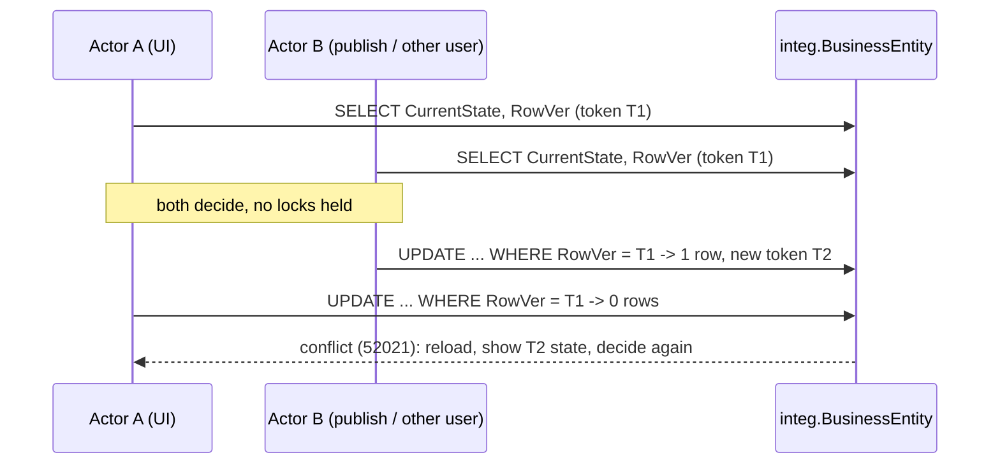
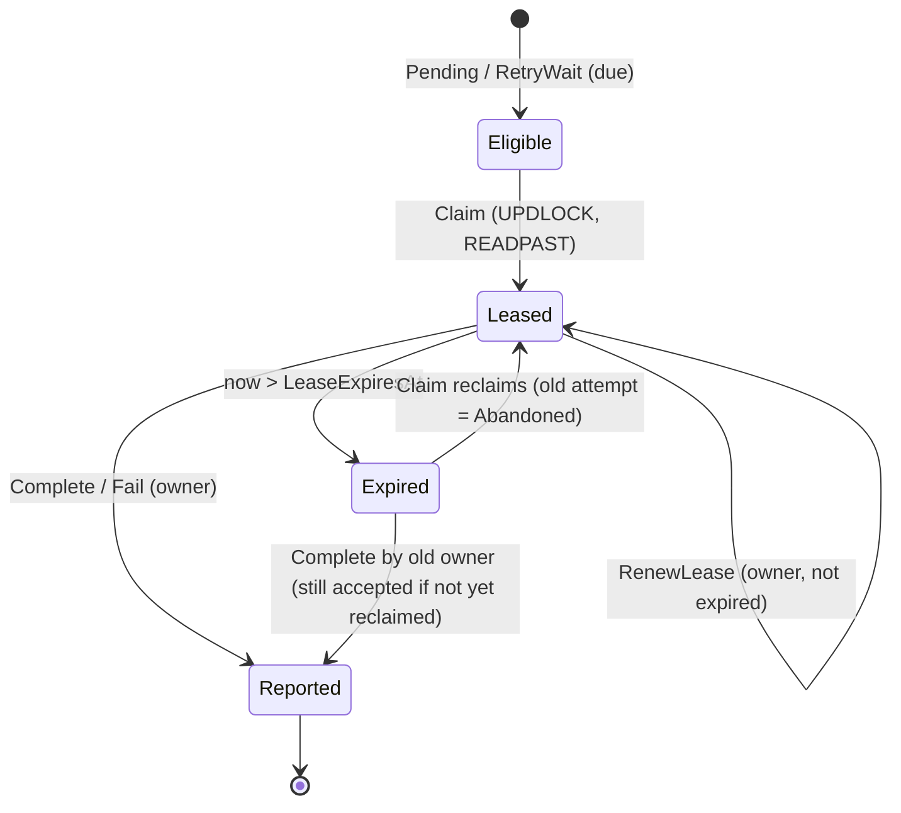
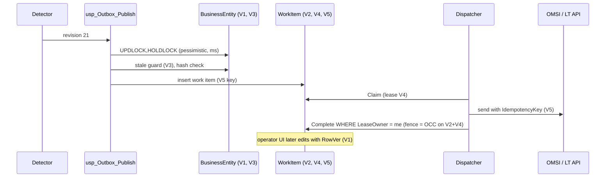
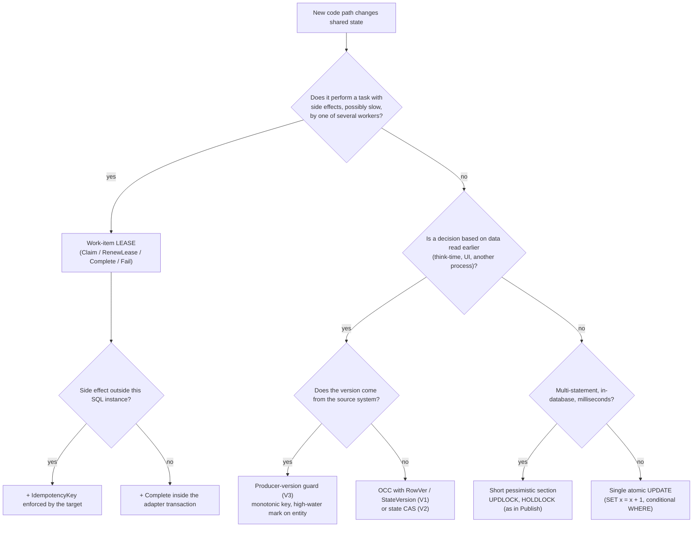

# Concurrency Control — Entity OCC Versioning vs Work-Item Lease Locking

**Audience:** developers and solution architects who build on, extend or review the `integ` ledger  
**Companion to:** [OMSI_Integration_Target_Design.md](./OMSI_Integration_Target_Design.md) (§4.3, §5, §13.7, §14) and [WorkItem_Ledger_Developer_Guide.md](./WorkItem_Ledger_Developer_Guide.md) (§6–§7)  
**Code referenced:** [01_integ_tables.sql](./01_integ_tables.sql), [02_integ_core_procs.sql](./02_integ_core_procs.sql), [templates/usp_Adapter_Template.sql](./templates/usp_Adapter_Template.sql)  
**Tests referenced:** [tests/20_concurrency_seed_400.sql](./tests/20_concurrency_seed_400.sql), [tests/30_mid_process_failure_tests.sql](./tests/30_mid_process_failure_tests.sql), [tests/40_state_machine_tests.sql](./tests/40_state_machine_tests.sql)

> **Status of the code samples.** Samples marked **(reference code)** are copied from the scripts above. Samples marked **(proposed pattern)** are not in the reference scripts yet. They show how to apply the mechanism and are written to the same conventions.

---

## 0. Summary

The ledger uses two different concurrency mechanisms. They solve **different problems** and they aren't interchangeable.

| | **Entity OCC versioning** | **Work-item lease locking** |
|---|---|---|
| Question it answers | *"Is the state I based my decision on still the current state?"* | *"Who is allowed to do this unit of work right now, and for how long?"* |
| What it protects | The **truth** about a business entity (`integ.BusinessEntity`, entity revisions, operator edits) | The **execution** of a delivery (`integ.WorkItem` while `Leased`) |
| Assumption | Conflicts are **rare**; let everyone proceed and detect the conflict at write time | Conflicts are **expected** (several SSIS runs compete for the same queue); prevent duplicate work up front |
| When the conflict is detected | At **commit** (the conditional `UPDATE` affects 0 rows) | At **claim** (row is skipped by `READPAST`) and again at **completion** (fencing) |
| Physical SQL locks held | Only for the single write statement (milliseconds) | Only for the claim statement (milliseconds) |
| Logical "lock" held | None | A **lease** stored as data: `LeaseOwner`, `LeaseExpiresAt` (minutes) |
| Behaviour if the actor crashes | Nothing to clean up: no lock was held | The lease **expires** and the item is reclaimed; the dead attempt is closed as `Abandoned` |
| Loser of a race | Gets a conflict error, reloads, re-decides | Never sees the item (skipped), or is **fenced** (`52001`, `52002`, `-1`) |
| Typical token | `rowversion` / integer `Version` / producer revision | `LeaseOwner` (+ `LeaseExpiresAt`, + `AttemptNo`) |
| Liveness | Lock-free; a writer can starve only under heavy contention | Bounded by lease length; a crash delays work by up to one lease + one schedule interval |

**Rule of thumb:**

- Use **OCC** when a *decision* is made on data that someone else might change before the decision is written back: support UI edits, reconciliation corrections, revision ordering.
- Use a **lease** when a *task* must be performed by one worker at a time, the task takes long enough that you can't hold a SQL lock for it, and the worker may die mid-task: dispatch, HTTP calls, file transfers.

**The ledger combines them.** The claim is a short **pessimistic** lock that hands out a time-bounded **lease**. Every later transition (`Complete`, `Fail`, `RenewLease`) is an **optimistic compare-and-set** on `(Status, LeaseOwner)`. So the lease is "pessimistic for exclusion, optimistic for fencing".

---

## 1. Two problems, not one

### 1.1 The lost-update problem (entity state) → OCC

Two actors read the same entity, each decides something based on what it read, and each writes back. The second write silently erases the first.

```
t0  Support user A reads Shipment 4171753:  CurrentState = 'DeadLetterReview', RowVer = 0x...07D1
t1  Publish (revision 21) sets CurrentState = 'Modified'                      RowVer = 0x...07E4
t2  User A (still looking at the t0 screen) clicks "Mark Cancelled"
    -> without OCC: Cancelled overwrites Modified; revision 21 is ignored by A's decision
    -> with OCC:    UPDATE ... WHERE RowVer = 0x...07D1 affects 0 rows -> conflict, A reloads
```

Nothing in this scenario is a "task". There's no worker to fence and nothing to time out. The defect is purely that **a decision was based on stale data**.

### 1.2 The duplicate-work / zombie-worker problem (delivery) → lease

Several SSIS runs (or several dispatcher threads) poll the same queue. Each delivery may take seconds to minutes (an HTTP call to the LumberTrack API, a multi-table insert into OMSI). A worker can be killed at any moment.

```
t0  Run #41 claims WorkItem 9001 (lease until t0+300 s)
t1  Run #42 polls: 9001 is skipped (locked during claim) or not eligible (lease still valid)
t2  Run #41 is killed by the SSIS host
t3  t0+300 s: lease expires; next claim reclaims 9001, attempt 1 = Abandoned, attempt 2 starts
```

The defect this prevents is **two workers doing the same task** and **a task being lost because its worker died**. OCC alone can't fix this: OCC would let both workers perform the expensive, non-reversible HTTP call and only tell the second one "conflict" afterwards.

### 1.3 Why one mechanism can't replace the other

| If you use only... | ...this breaks |
|---|---|
| OCC for dispatch | Both workers perform the side effect (HTTP call, OMSI insert); OCC only detects the race **after** the effect. With an external target, the duplicate has already happened. |
| A pessimistic SQL lock held for the whole dispatch | A slow HTTP call holds row/page locks for minutes, blocks other claimers (no `READPAST` benefit for already-locked rows that later need FIFO checks), and a hung client keeps the lock until the connection dies. |
| Leases for entity edits | A user who opens a screen would "lease" the entity. If they walk away, every publish for that shipment blocks until expiry, and you need renewal for a human. Leases are a poor fit for think-time. |

---

## 2. Vocabulary: five "version-like" things in the ledger

The word *version* is overloaded in this design. Keep these apart; mixing them is the most common review finding.

| # | Token | Column(s) | Owner / who increments it | Purpose | Mechanism family |
|---|---|---|---|---|---|
| V1 | **Local concurrency token** | `BusinessEntity.RowVer`, `WorkItem.RowVer` (`rowversion`) | SQL Server, on **every** update of the row | Detect "row changed since I read it" | **OCC** |
| V2 | **State predicate** | `WorkItem.Status` (and `BusinessEntity.CurrentState`) used in `WHERE` | The procedure that performs the transition | Allow a transition only from legal source states (compare-and-set on state) | **OCC (state-based CAS)** |
| V3 | **Producer version** | `OutboxEvent.SourceChangeVersion`; planned `EntityRevision.SourceRevisionTiebreak`, `BusinessEntity.LastRevisionAt/LastRevisionTiebreak` (§13.7) | LumberTrack (the **source** system) | Order revisions of the same entity; reject stale/late snapshots | **Monotonic version guard** (OCC-like, but the version comes from outside) |
| V4 | **Lease / fencing token** | `WorkItem.LeaseOwner`, `WorkItem.LeaseExpiresAt`; `WorkItemAttempt.AttemptNo` | `usp_WorkItem_Claim` | Exclusive, time-bounded right to work an item; reject zombies | **Lease** |
| V5 | **Idempotency key** | `OutboxEvent.IdempotencyKey`, `WorkItem.IdempotencyKey` | Publish / Claim | Make repeated **effects** harmless at the target | **Deduplication** (complements both) |

> **Do not use V1 for V3's job.** `rowversion` changes whenever *our* row changes (including `LastContentHash`, `UpdatedAt`). It says nothing about the order in which LumberTrack made its edits. Conversely, a producer revision never protects against two *local* actors overwriting each other. The initial assessment states the same rule: *"local optimistic concurrency and external event ordering are not the same counter."*

---

## 3. Entity OCC versioning — in depth

### 3.1 The pattern

Optimistic concurrency control has four steps:

1. **Read** the entity together with its concurrency token (V1 `RowVer`, or an explicit integer `Version`).
2. **Decide** outside any transaction (user think-time, validation, calculation). No locks are held.
3. **Write conditionally**, in one statement: `UPDATE … SET … WHERE Key = @Key AND RowVer = @ExpectedRowVer`.
4. **Check the affected-row count.**
   - `1` → success. Return the **new** token to the caller (`OUTPUT inserted.RowVer`).
   - `0` → either the row is gone, or someone changed it. Disambiguate, roll back, and surface a **conflict** to the caller, who reloads and decides again.

The conditional `UPDATE` is atomic in SQL Server. The engine takes an update (U) lock on the qualifying row, re-evaluates the predicate against the **current committed** row, converts to an exclusive (X) lock and writes. Two concurrent writers with the same expected token therefore can't both succeed: the second one re-evaluates `RowVer = @ExpectedRowVer` after the first commits, finds the new value, and affects 0 rows.



### 3.2 Where OCC appears in this codebase today

Be precise about what exists and what is proposed:

| Location | Kind | Status | How it works |
|---|---|---|---|
| `integ.BusinessEntity.RowVer`, `integ.WorkItem.RowVer` | V1 token | **Column exists; no procedure uses it yet** | Reserved for support UIs and API callers ("for optimistic checks in UIs", ledger guide §2). |
| `usp_WorkItem_Retry`, `usp_WorkItem_Cancel`, `usp_WorkItem_Replay` | V2 state CAS | **Implemented** | `UPDATE … WHERE WorkItemId = @Id AND Status IN (…)`; `@@ROWCOUNT = 0` → `THROW 52010/52011/52012`. Two operators clicking *Retry* at once: exactly one wins. |
| `usp_WorkItem_Complete` | V2 + V4 CAS | **Implemented** | `WHERE Status = 'Leased' AND LeaseOwner = @LeaseOwner`; `0 rows` → `THROW 52001`. This is OCC applied to the lease (see §4.4). |
| `usp_WorkItem_RenewLease` | V2 + V4 CAS | **Implemented** | Adds `AND LeaseExpiresAt > @Now`; `0 rows` → `THROW 52002`. |
| `usp_Outbox_Publish` stale guard | V3 producer version | **Implemented (interim)** | `@SourceChangeVersion < MAX(SourceChangeVersion)` for the entity → `RETURN 3` (stale). Being replaced by the `EntityRevision` high-water mark (§13.7). |
| `usp_Outbox_Publish` entity serialisation | **Pessimistic**, not OCC | **Implemented** | `SELECT … FROM integ.BusinessEntity WITH (UPDLOCK, HOLDLOCK)` serialises all publishes for one entity. See §3.6 for why this is pessimistic. |

**(reference code)** — state-based CAS in an operator action:

```sql
UPDATE integ.WorkItem
   SET Status = 'Pending', NextAttemptAt = SYSDATETIME(), RetryBudgetBase = AttemptCount,
       StatusReason = CONCAT('Manual retry: ', @Reason)
 WHERE WorkItemId = @WorkItemId AND Status IN ('DeadLetter','RetryWait');
IF @@ROWCOUNT = 0 THROW 52010, 'Only DeadLetter or RetryWait work items can be retried.', 1;
```

**(reference code)** — producer-version guard (V3) inside publish. It runs **after** the entity row is locked with `UPDLOCK, HOLDLOCK`, so the `MAX()` read and the following insert can't interleave with another publish for the same entity:

```sql
IF @SourceChangeVersion IS NOT NULL
   AND @SourceChangeVersion < (SELECT MAX(SourceChangeVersion) FROM integ.OutboxEvent WHERE EntityId = @EntityId)
BEGIN
    IF @OwnTran = 1 COMMIT;
    RETURN 3;   -- stale: never let a late revision overwrite newer state
END;
```

### 3.3 Reference implementation for a real OCC write (proposed pattern)

Use this shape for any support-UI or API operation that changes entity state based on what the user saw. Error numbers `52020`/`52021` are unused in the reference scripts.

```sql
/* (proposed pattern) Operator correction of an entity's lifecycle state, guarded by OCC. */
CREATE OR ALTER PROCEDURE integ.usp_Entity_SetState_Occ
    @EntityId        bigint,
    @ExpectedRowVer  binary(8),                 -- the RowVer the caller read
    @ToState         varchar(30),
    @Reason          nvarchar(400),
    @NewRowVer       binary(8) = NULL OUTPUT    -- give the caller the next token
AS
BEGIN
    SET NOCOUNT ON;
    SET XACT_ABORT ON;
    DECLARE @Out TABLE (FromState varchar(30), NewRowVer binary(8));

    BEGIN TRANSACTION;

    UPDATE integ.BusinessEntity
       SET CurrentState = @ToState, StateChangedAt = SYSDATETIME(), UpdatedAt = SYSDATETIME()
    OUTPUT deleted.CurrentState, inserted.RowVer INTO @Out
     WHERE EntityId = @EntityId
       AND RowVer   = @ExpectedRowVer;          -- the optimistic check

    IF @@ROWCOUNT = 0
    BEGIN
        ROLLBACK;
        IF NOT EXISTS (SELECT 1 FROM integ.BusinessEntity WHERE EntityId = @EntityId)
            THROW 52020, 'Entity not found.', 1;
        THROW 52021, 'Concurrency conflict: the entity changed after you read it. Reload and retry.', 1;
    END;

    INSERT integ.EntityStateHistory (EntityId, FromState, ToState, IsExpected, TriggerKind)
    SELECT @EntityId, FromState, @ToState, 0, 'OPERATOR' FROM @Out;

    SELECT @NewRowVer = NewRowVer FROM @Out;
    COMMIT;
END;
```

Implementation notes:

- **One statement does check and write.** Never `SELECT RowVer …; IF @rv = @Expected UPDATE …`. That's a time-of-check/time-of-use (TOCTOU) race unless you add `UPDLOCK`, at which point it's pessimistic.
- **`OUTPUT inserted.RowVer`** returns the token after the update, so the UI can do a second edit without re-reading.
- **Disambiguate 0 rows.** "Not found" and "conflict" need different UI responses. The existence check after the failed update is advisory (the row could be deleted a microsecond later); that's acceptable because it only selects the error message.
- **History in the same transaction.** The state change and its `EntityStateHistory` row commit together, exactly like `usp_Entity_ApplyState`.
- **Don't retry automatically inside the procedure.** A conflict means the caller's *decision* may be wrong. Only the caller (user or service) can re-decide. Automatic retry is only correct when the operation is a pure function of the current row (for example "increment counter"), and then a single atomic `UPDATE … SET x = x + 1` is better than OCC anyway.

**HTTP mapping** (for an API or support portal in front of the ledger): return the token as an `ETag` (`"0x00000000000007E4"`), require `If-Match` on `PUT`/`PATCH`/`POST …/actions`, map `52021` → **412 Precondition Failed**, `52020` → **404**, and a missing `If-Match` → **428 Precondition Required**.

### 3.4 Choosing the token: `rowversion` vs explicit `Version int`

| Aspect | `rowversion` (what the tables have) | Explicit `Version int NOT NULL DEFAULT 0` |
|---|---|---|
| Maintenance | Automatic, can't be forgotten | Every writer must do `SET Version = Version + 1` (or a trigger) |
| Granularity | Changes on **any** column update, even a no-op `SET x = x` | Changes only when your code says the *business* version changed |
| False conflicts | **Yes.** `usp_Outbox_Publish` updates `LastContentHash`/`UpdatedAt` on every publish, so a UI editing the state conflicts with a publish that didn't touch state | Avoidable: only bump on meaningful changes |
| Meaning to humans | Opaque `binary(8)`, database-wide counter | "Version 8" is meaningful in logs and audit |
| Survives copy/restore to another DB | **No**: values are per database; tokens from prod are meaningless on a restored copy | Yes |
| Type in APIs | `binary(8)` / base64 / hex string | `int` |
| Cost | 8 bytes, no code | 4 bytes, discipline |

Recommendation for this ledger: keep `RowVer` for **operator tooling** on `WorkItem` (where every column change matters). For **business entity** edits, if false conflicts with the publish path become a problem, add `BusinessEntity.StateVersion int` bumped only by `usp_Entity_ApplyState` and OCC procedures, and use that as the UI token.

### 3.5 Isolation-level interactions

| Isolation level | Effect on the OCC `UPDATE … WHERE RowVer = @Expected` |
|---|---|
| READ COMMITTED (locking) | Correct. The update locks and re-checks the current row. |
| READ COMMITTED SNAPSHOT (RCSI) | Correct. Reads are versioned, but **updates** still read the latest committed row under U/X locks. The *read* in step 1 may return a version that is already being changed; OCC catches that at step 3. |
| SNAPSHOT | Correct, but the conflict can surface differently: if another transaction committed a change to the row after your snapshot began, the update fails with **error 3960** (update conflict) instead of affecting 0 rows. Handle 3960 as `52021`. |
| SERIALIZABLE | Works but adds range locks you don't need; avoid for OCC writes. |

### 3.6 Why `usp_Outbox_Publish` uses a pessimistic lock instead of OCC

Publish performs a read-decide-write across **several tables** (entity, outbox event, work items, supersede/promote updates, alerts, history). Its decisions (no-op suppression via `LastContentHash`, stale guard via `MAX(SourceChangeVersion)`, supersede/promotion via the open items of the entity) all depend on the entity's state at the start.

- OCC would require the whole transaction to be re-run on conflict, inside the detector loop. That's possible but adds a retry loop to every caller.
- The work is entirely **inside one database**, takes milliseconds, has no user think-time and no external calls. That's exactly the profile where a short pessimistic lock is cheaper than OCC: contention on one shipment is rare, the lock is held briefly, and no retry code is needed.
- `UPDLOCK, HOLDLOCK` on the `UQ_BusinessEntity` key also covers the **not-yet-existing** case: the key-range lock prevents two first-time publishes for a new shipment from both inserting it (they would otherwise collide on the unique constraint).

So the reference design applies the general rule: **pessimistic for short, in-database, multi-statement critical sections; optimistic for decisions that span think-time or process boundaries.**

---

## 4. Work-item ledger lease locking — in depth

### 4.1 The pattern

A lease is an **ownership record with an expiry**, stored in the row itself, granted atomically and checked on every subsequent transition.

1. **Claim** (atomic, short, pessimistic): find eligible rows and mark them `Leased` with `LeaseOwner` and `LeaseExpiresAt` in one statement.
2. **Work** with **no SQL locks held** on the ledger row. The worker calls the adapter, the API, whatever.
3. **Renew** (optional heartbeat): extend `LeaseExpiresAt` if still owner and not expired.
4. **Report** (fenced CAS): `Complete` or `Fail`, accepted only from the current owner.
5. **Expire and reclaim**: if the worker never reports, a later claim takes the row over and closes the abandoned attempt.



### 4.2 Two lock layers: physical vs logical

| Layer | What | Held for | Released by |
|---|---|---|---|
| **Physical** (SQL Server lock manager) | `U`→`X` row locks taken by the claim `UPDATE` on `integ.WorkItem` | The claim transaction only (milliseconds) | `COMMIT` of `usp_WorkItem_Claim` |
| **Logical** (data) | `Status = 'Leased'`, `LeaseOwner`, `LeaseExpiresAt` | Up to `@LeaseSeconds` (default 300), extendable | `Complete`, `Fail`, or expiry + reclaim |

This split is the whole point. A SQL lock dies with the session and can't be inspected easily by the dashboard; a lease survives a reconnect, is visible in `vw_*` views, has an explicit expiry, and is enforced by **procedures**, not by the lock manager. The price is that a lease is only **advisory to code that doesn't check it**. Any code path that updates `integ.WorkItem` without going through the procedures bypasses it (ledger guide §1: "application code never `UPDATE`s `integ.WorkItem` directly").

### 4.3 Claim: the exclusive grant

**(reference code)** — abbreviated from `usp_WorkItem_Claim`:

```sql
WITH c AS (
    SELECT TOP (@BatchSize) w.WorkItemId, w.Status, w.LeaseOwner, w.LeaseExpiresAt, w.AttemptCount
      FROM integ.WorkItem w WITH (UPDLOCK, READPAST, ROWLOCK)
     WHERE (   (w.Status IN ('Pending','RetryWait') AND w.NextAttemptAt <= @Now)
            OR (w.Status = 'Leased' AND w.LeaseExpiresAt < @Now))          -- reclaim expired leases
       AND NOT EXISTS (SELECT 1 FROM integ.WorkItem p                        -- per-entity FIFO
                        WHERE p.OrderingKey = w.OrderingKey AND p.TargetSystem = w.TargetSystem
                          AND p.WorkItemId < w.WorkItemId
                          AND p.Status IN ('Pending','Leased','RetryWait','DeadLetter'))
     ORDER BY w.Priority, w.WorkItemId
)
UPDATE c
   SET Status = 'Leased', LeaseOwner = @LeaseOwner,
       LeaseExpiresAt = DATEADD(SECOND, @LeaseSeconds, @Now), AttemptCount = AttemptCount + 1
OUTPUT inserted.WorkItemId, inserted.AttemptCount, deleted.Status INTO @Claimed;
```

Why each piece is necessary for exclusivity:

| Element | Without it |
|---|---|
| Single `UPDATE` over an updatable CTE | A `SELECT` then `UPDATE` would let two workers select the same row between the statements. |
| `UPDLOCK` | Two claimers could both read the row with shared locks, both pass the predicate, and serialise only on the write. The second writer would then re-mark an already-leased row. |
| `READPAST` | Claimers would **queue** behind each other's locked rows instead of taking different rows. Throughput would collapse to one claimer at a time. |
| `ROWLOCK` | Lock escalation to page/table could make `READPAST` skip far more than intended, or block. |
| Expired-lease branch | A crashed worker's items would stay `Leased` forever. |
| `deleted.Status` in `OUTPUT` | You couldn't tell a fresh claim from a reclaim, so you couldn't close the previous attempt as `Abandoned`. |
| `@Now = SYSDATETIME()` (server clock) | Worker clock skew would make leases expire early or late. All lease arithmetic uses **one** clock. |

`READPAST` requires READ COMMITTED or REPEATABLE READ for the statement. It can't be used under SERIALIZABLE. Under RCSI the `UPDLOCK` hint makes the read a locking read, so the claim behaves the same with or without RCSI.

Verified behaviour (design doc §11, [tests/20_concurrency_seed_400.sql](./tests/20_concurrency_seed_400.sql)): 8 parallel dispatchers on 400 items, every item processed exactly once, none lost.

### 4.4 Fencing: OCC applied to the lease

After the claim, exclusivity is maintained **optimistically**. The worker holds no lock; every report re-checks ownership in the same statement that changes state.

**(reference code)** — `usp_WorkItem_Complete`:

```sql
UPDATE w
   SET @Outcome = Status = IIF(o.RequiresAck = 1, 'Dispatched', 'Succeeded'),
       ExternalRef = COALESCE(@ExternalRef, w.ExternalRef), DispatchedAt = @Now,
       CompletedAt = IIF(o.RequiresAck = 1, NULL, @Now),
       LeaseOwner = NULL, LeaseExpiresAt = NULL, StatusReason = NULL
  FROM integ.WorkItem w
  JOIN integ.OperationCatalog o ON o.OperationCode = w.OperationCode
 WHERE w.WorkItemId = @WorkItemId AND w.Status = 'Leased' AND w.LeaseOwner = @LeaseOwner;
IF @@ROWCOUNT = 0
    THROW 52001, 'Lease lost: work item is no longer leased by this owner (another worker may have reclaimed it).', 1;
```

**(reference code)** — `usp_WorkItem_RenewLease` (adds a time check):

```sql
UPDATE integ.WorkItem
   SET LeaseExpiresAt = DATEADD(SECOND, @LeaseSeconds, @Now)
 WHERE WorkItemId = @WorkItemId AND Status = 'Leased' AND LeaseOwner = @LeaseOwner
   AND LeaseExpiresAt > @Now;          -- never resurrect an expired lease
IF @@ROWCOUNT = 0 THROW 52002, 'Lease lost or expired: stop processing this work item.', 1;
```

Two deliberate asymmetries:

| Procedure | Checks owner | Checks expiry | Reason |
|---|---|---|---|
| `Complete` | yes | **no** | If the lease expired but nobody reclaimed the item yet, the original owner's work is still the only work done. Accepting it avoids a pointless retry. Correctness rests on **ownership**, not on time. |
| `RenewLease` | yes | **yes** | Once expired, the item is *eligible* for reclaim. Extending it would race with a claimer that already decided to take it. Renewal must never resurrect. |

**Same-instance atomicity.** The adapter calls `Complete` **inside** the same transaction as its write to OMSI ([templates/usp_Adapter_Template.sql](./templates/usp_Adapter_Template.sql), rule 4). If `Complete` throws `52001`, `XACT_ABORT` rolls back the zombie's OMSI insert too, so only the current owner's write survives. For an **external** target (HTTP), there's no shared transaction; the zombie's call has already happened, and only the target's idempotency check (V5) prevents a duplicate (design doc §14 #5).

```mermaid
sequenceDiagram
  participant W1 as Worker 1 (zombie)
  participant L as integ.WorkItem
  participant W2 as Worker 2
  participant T as OMSI (same instance)
  W1->>L: Claim, lease to t+300
  Note over W1: stalls (no RenewLease)
  Note over L: t+300 lease expires
  W2->>L: Claim reclaims; attempt 1 = Abandoned
  W2->>T: BEGIN TRAN; insert operation
  W2->>L: Complete (owner = W2) OK
  W2->>T: COMMIT
  W1->>T: BEGIN TRAN; insert operation
  W1->>L: Complete (owner = W1) -> THROW 52001
  W1->>T: XACT_ABORT rolls back W1's insert
  W1->>L: Fail -> returns -1 (not owner), no change
```

### 4.5 Lease sizing and recovery-time math

Let:

- `D99` = 99th-percentile duration of one item's work (adapter call, HTTP round trip incl. retries in the client)
- `L` = `@LeaseSeconds`
- `R` = renewal interval (if the worker renews)
- `S` = scheduling interval of the worker (SSIS: **600 s**)

| Rule | Formula | Default in this design |
|---|---|---|
| No renewal | `L > D_max` with margin, e.g. `L ≥ 2 × D99` | `L = 300 s`; fine for in-instance OMSI adapters (sub-second) |
| With renewal | `R ≈ L / 2`, so one missed renewal is tolerated | Required for the LumberTrack API calls (§14 #12) |
| Batch size vs lease | All items in a claimed batch share one `LeaseExpiresAt`. Item *k* in a sequential batch starts at `≈ k × D_avg`. Need `BatchSize × D99 < L`, or renew per item. | `usp_Dispatch`: 50 × in-instance adapter ≪ 300 s. **An SSIS HTTP loop with 50 items × 10 s = 500 s breaks this.** Reduce batch size or renew. |
| Worst-case recovery after a crash | `≤ L + S` (lease must expire, then the next run must start) | `300 + 600 = 900 s` ≈ 15 min before the item is retried |
| Lower bound on `L` | Too small → healthy-but-slow workers get reclaimed; `Abandoned` attempts and duplicate external calls rise | Watch the `Abandoned` rate (§10) |

### 4.6 Interaction with per-entity FIFO

The `NOT EXISTS` in the claim makes the lease also an **ordering** lock: while item *n* for `Shipment:4171753` is `Leased` (or `Pending`, `RetryWait`, `DeadLetter`), item *n+1* for the same shipment and target isn't eligible. Consequences:

- A long lease on one item delays all later items of the **same** entity, never other entities.
- A crashed worker delays the entity by up to `L + S`.
- `Dispatched` doesn't block, so ordering is guaranteed at hand-off, not at acknowledgement (ledger guide §8).
- `DeadLetter` blocks followers until an operator acts or a newer snapshot supersedes it (design doc §14 #11 proposes per-stream ordering keys to narrow this).

### 4.7 The fencing token

The current fencing token is the string `LeaseOwner`, formatted `<ProcessName>#<RunId>` by `usp_Dispatch`. It's unique **per run**, not per attempt. That's sufficient as long as one run processes its items **sequentially** (as `usp_Dispatch` does). If a single run processes items in **parallel** (for example an SSIS package with several concurrent data-flow paths sharing one `LeaseOwner`), two threads of the same run are indistinguishable to the fence (see §8.2 S2).

A stronger token is the pair `(LeaseOwner, AttemptNo)`: `AttemptNo` is strictly increasing per item, and every reclaim increments it. Classic fencing-token theory (monotonic token checked by the resource) maps onto this directly.

---

## 5. Side-by-side technical comparison

| Dimension | Entity OCC versioning | Work-item lease locking |
|---|---|---|
| Concurrency model | Optimistic: proceed, validate on write | Pessimistic at grant (claim), optimistic at report (fence) |
| Unit protected | A row's **value** (entity state, revision high-water mark) | A row's **right to be worked** |
| Conflict detection point | Write time | Claim time (prevention) and report time (fencing) |
| Physical lock duration | One statement | One statement (claim) |
| Logical hold duration | Zero | `L` seconds, renewable |
| Requires a clock | No | **Yes** (server clock: `SYSDATETIME()`) |
| Requires actor identity | No (token only) | **Yes** (`LeaseOwner`) |
| Crash of the actor | No effect on others | Item delayed up to `L + S`; attempt recorded `Abandoned` |
| Slow actor | No effect on others; the slow actor may lose at write time | Lease may expire → duplicate execution unless renewed; zombie is fenced at report |
| Prevents duplicate **side effects** | **No** (detects after the fact) | **Mostly**: prevents concurrent claims; duplicates still possible after expiry → needs V5 for external targets |
| Prevents lost updates | **Yes** | Only for the work-item row itself (via fencing CAS) |
| Handles ordering | Only if the token is a producer version (V3) | Yes, per `OrderingKey` + `TargetSystem` |
| Throughput under contention | Degrades: many conflicts and retries on hot rows | Scales out: `READPAST` spreads workers over different rows |
| Throughput without contention | Excellent: no lock overhead between read and write | Good: one extra write per claim and per report |
| Starvation | Possible for a slow writer on a hot row (always loses) | Not between entities; possible within one entity behind a dead letter |
| Caller complexity | Must carry the token, handle conflict, re-decide | Must carry `LeaseOwner`, renew if slow, stop on `52001`/`52002`/`-1` |
| Observability | Conflicts are invisible unless you log them | Built in: `WorkItemAttempt`, `Abandoned`, `ProcessRun.HeartbeatAt`, dashboard views |
| Error signals in this ledger | `52010–52012` (state CAS), proposed `52020/52021`; `RETURN 3` (stale revision) | `52001` (Complete), `52002` (Renew), `-1` (Fail) |
| Storage cost | 8 bytes (`rowversion`) or 4 bytes (`int`) | Up to ~270 bytes per row (`LeaseOwner nvarchar(128)`, `LeaseExpiresAt`) + one attempt row per claim |
| Survives DB failover | Yes (token is data) | Yes (lease is data); clock continuity on the new primary matters |

---

## 6. Strengths

### 6.1 Entity OCC versioning

1. **No locks across think-time.** A support user can keep a screen open for an hour; nobody is blocked.
2. **No cleanup on crash.** Nothing to expire, nothing to reclaim, no zombie owner.
3. **Clock-free.** Correctness doesn't depend on any clock or timeout tuning.
4. **Cheap when conflicts are rare.** One predicate in the `WHERE` clause; no extra round trip, no extra row.
5. **Composes across tiers.** The token travels through HTTP (`ETag`/`If-Match`), queues and UIs; any tier can validate it.
6. **Precise conflict semantics.** "Your view is stale" is exactly the information the caller needs to re-decide.
7. **Deadlock-resistant.** A single-row conditional update takes one lock briefly and in a fixed order.
8. **Producer-version variant (V3) gives ordering for free.** With a monotonic source revision, late or replayed snapshots are rejected deterministically, regardless of detection order or SSIS timing (`RETURN 3`).

### 6.2 Work-item lease locking

1. **Prevents duplicate work up front.** Two workers never *start* the same item concurrently, which matters when the work has non-reversible side effects.
2. **Crash-tolerant by construction.** A dead worker's items come back automatically after `L`; nothing is lost.
3. **Competing consumers scale out.** `UPDLOCK + READPAST` lets N workers drain the queue in parallel without blocking each other.
4. **Bounded ownership.** No item is held forever; the worst-case delay is computable (`L + S`).
5. **Zombie-safe reporting.** Fencing (`52001`/`52002`/`-1`) makes stale workers' outcomes harmless; with same-instance targets it even rolls back their writes.
6. **Ordering per entity.** Combined with the FIFO predicate, the lease enforces per-entity serial delivery while keeping cross-entity parallelism.
7. **First-class observability.** Every claim is an attempt row with owner, run, start, end and outcome. `Abandoned` attempts are direct evidence of crashed or too-slow workers.
8. **Platform-neutral.** Any worker that can call a stored procedure (SSIS, SQL Agent, .NET, Azure Functions) can participate, with no broker.

---

## 7. Good use cases

### 7.1 Use entity OCC versioning for...

| Use case | Token | Example in this integration |
|---|---|---|
| Human edits from a support UI | V1 `RowVer` (or `StateVersion`) | Operator changes `BusinessEntity.CurrentState` after investigating an unexpected transition (`IsExpected = 0`). |
| Operator actions on work items | V2 state CAS (implemented) + optional V1 | Two support staff click *Retry* / *Cancel* on the same dead letter: exactly one wins (`52010`/`52011`). Add `RowVer` if the UI must also detect "the error message changed since you looked". |
| Admin edits to configuration rows | V1 | Two admins edit the same `RetryPolicy` or `ValueMap` row. |
| Out-of-order snapshots from the source | V3 producer revision | LumberTrack revision 19 detected after 20 → `RETURN 3`, no work created ([tests/30_mid_process_failure_tests.sql](./tests/30_mid_process_failure_tests.sql)). |
| Inbound updates that must not regress state | V3 (from the vendor's sequence) | Applying OMSI status messages where a late "In transit" must not overwrite "Delivered". |
| External API callers updating ledger resources | V1 via `ETag`/`If-Match` | A future REST façade over the ledger for partners or a portal. |
| Long-running reconciliation jobs | V1 | A nightly job computes a correction from a snapshot taken hours earlier; OCC rejects it if the entity moved since. |

**Avoid OCC when:** the operation has an external side effect that must not be duplicated; contention on the same row is high (hot rows → retry storms); or the work spans several rows that must be decided together and you can't easily retry (use a short pessimistic critical section as in `usp_Outbox_Publish`).

### 7.2 Use work-item lease locking for...

| Use case | Example in this integration |
|---|---|
| Competing workers draining a queue | Several SSIS runs or `usp_Dispatch` instances dispatching to OMSI. |
| Work with non-reversible external effects | Calling the LumberTrack API for freight accruals / AP (9101/9102), together with an idempotency key. |
| Work that may take longer than a SQL lock should be held | Slow HTTP calls, file generation and SFTP upload, large payload assembly. |
| Work whose worker may crash | SSIS packages killed by schedule overlap, server patching, or timeouts. |
| Per-key serialisation with cross-key parallelism | One OMSI operation in flight per shipment, many shipments in parallel. |
| Singleton jobs (generalisation) | A "leader" row for the inbound harvester (`HarvestWatermark`) so only one harvester runs at a time, with automatic takeover if it dies. |

**Avoid leases when:** the "holder" is a human (think-time is unbounded and renewal is awkward); the critical section is short and in-database (a transaction lock is simpler); or you only need to detect a stale read (OCC is lighter).

---

## 8. Shortfalls and how to mitigate them

### 8.1 Entity OCC versioning

| # | Shortfall | Effect | Mitigation |
|---|---|---|---|
| O1 | **Detects, doesn't prevent.** | The losing actor has already done its work (computation, or worse, an external call) before learning about the conflict. | Never place a side effect between OCC read and OCC write. Do side effects through the work-item ledger (lease + idempotency). |
| O2 | **Retry storms on hot rows.** | Under high contention, most writes fail; throughput can drop below a pessimistic lock's. | Keep OCC for low-contention rows (human edits). Use a short `UPDLOCK` critical section for machine-driven, high-frequency writes (as publish does). |
| O3 | **False conflicts with `rowversion`.** | `RowVer` changes on any column update. `usp_Outbox_Publish` updates `LastContentHash`/`UpdatedAt` on every publish, so a UI state edit conflicts even when the state didn't change. | Use a dedicated `StateVersion int` bumped only by state changes (§3.4), or narrow the predicate (`WHERE CurrentState = @ExpectedState`) when only one column matters. |
| O4 | **Not implemented for entities yet.** | `RowVer` columns exist but no procedure accepts `@ExpectedRowVer`. A support UI built today would have to write directly (forbidden) or use non-OCC procedures. | Add `usp_Entity_SetState_Occ` (§3.3) before exposing entity edits in any UI. |
| O5 | **Caller burden.** | Every caller must carry the token and implement reload-and-re-decide. Callers that "just retry" defeat the purpose. | Return the new token on success; give the error a distinct number; document the UX ("this record changed — reload"). |
| O6 | **`rowversion` isn't portable.** | Values are per database; a restored or copied database produces different tokens. | Don't persist `rowversion` values outside the session that read them; use `int` versions for anything stored. |
| O7 | **Producer versions (V3) depend on the source's monotonicity.** | Today's guard uses `MAX(SourceChangeVersion)`. If the source revision is a **local timestamp** (`revdate + revtime`), DST fall-back makes newer revisions look older → wrongly `Stale` (design doc §14 #3). | Use a monotonic row key (`PROGRESS_RECID`) as the ordering key (`EntityRevision.SourceRevisionTiebreak`, §13.7); timestamps for display only. |
| O8 | **Producer-version guard cost and history dependency.** | `MAX()` over `OutboxEvent` scans the entity's event history (index `IX_OE_Entity` doesn't include the version), and retention purges could lower the observed maximum. | Store the high-water mark on the locked entity row (`BusinessEntity.LastRevisionAt/LastRevisionTiebreak`, §13.7) and compare against it. |
| O9 | **SNAPSHOT isolation changes the signal.** | Under `SNAPSHOT`, a conflict raises error 3960 instead of returning 0 rows. Code that only checks `@@ROWCOUNT` misses it. | Map 3960 to the same conflict error, or don't run OCC writes under `SNAPSHOT`. |

### 8.2 Work-item lease locking

| # | Shortfall | Effect | Mitigation |
|---|---|---|---|
| L1 | **A lease is not exactly-once.** | After expiry, a second worker repeats the work. For external targets (HTTP), the first worker's call may already have succeeded: **at-least-once delivery**. | Target-side idempotency (`IdempotencyKey`, `409` → `Duplicate` → `Succeeded`). Go-live gate for the LT API (§14 #5). For same-instance OMSI, keep `Complete` in the adapter's transaction. |
| L2 | **Tuning dependency.** | `L` too short → healthy slow workers are reclaimed (duplicate calls, `Abandoned` noise). `L` too long → crash recovery is slow. | Size from measured `D99` (§4.5); renew at `L/2` for slow steps; alert on `Abandoned` rate. |
| L3 | **Batch shares one expiry.** | All items in a claim batch get the same `LeaseExpiresAt`; late items in a sequential loop may run on an almost-expired lease. | Keep `BatchSize × D99 < L`, or call `RenewLease` per item before starting it. |
| L4 | **Recovery latency.** | A crash delays the item (and its entity's followers, via FIFO) by up to `L + S` (≈ 15 min with SSIS every 10 min). | Accept for this domain, or run a short-interval dispatcher (SQL Agent every minute) for latency-sensitive operations. |
| L5 | **Advisory to non-compliant code.** | Any direct `UPDATE integ.WorkItem` ignores the lease. | Deny `UPDATE` on `integ.WorkItem` to all roles except the procedures' owner (ownership chaining); review rule "procedures only". |
| L6 | **Clock dependency.** | All expiry is server-clock based. A large forward clock jump (NTP correction, failover to a node with skew) expires all leases at once; a backward jump extends them. | Keep server time synced; after failover, expect a burst of reclaims and `Abandoned` attempts. |
| L7 | **Zombie side effects outside the database.** | Fencing stops a zombie's *ledger* write and its *same-instance* write, but not its HTTP call or file upload. | Renew before each long external step and stop on `52002`; rely on target idempotency (L1). |
| L8 | **Per-run fencing token.** (see §4.7) | Two parallel threads of the same run share `LeaseOwner`; if one thread's item is reclaimed **by the same run**, the fence can't tell attempt 1 from attempt 2. | Use a unique `LeaseOwner` per thread (`<Process>#<RunId>.<Thread>`), or extend the fence to `(LeaseOwner, AttemptNo)`. |
| L9 | **`usp_WorkItem_Fail` fences only at the top (TOCTOU).** | `Fail` checks ownership with a plain `SELECT` **outside** its transaction, then later runs `UPDATE integ.WorkItem … WHERE WorkItemId = @WorkItemId` **without** the owner/status predicate. If the lease expires and another worker reclaims the item between those two statements, the zombie's `Fail` overwrites the new owner's `Leased` state and closes the new owner's open attempt. The new owner then gets `52001` on `Complete`. The window is small (it requires the lease to expire during `Fail`'s classification step), but it violates invariant 3 of the ledger guide. | Make the `UPDATE` itself the fence: add `AND Status = 'Leased' AND LeaseOwner = @LeaseOwner`, check `@@ROWCOUNT`, `ROLLBACK` and `RETURN -1` on 0 rows; filter the attempt update by the owner's `AttemptNo`. Add a two-session test to [tests/40_state_machine_tests.sql](./tests/40_state_machine_tests.sql). |
| L10 | **Head-of-line blocking per entity.** | A long or dead-lettered item blocks later items of the same entity and target. | By design; narrow with per-stream `OrderingKey` (§14 #11); supersede via newer snapshots. |
| L11 | **Write amplification.** | Each claim writes the work item, an attempt row, and a `ProcessRun` update; each report writes them again. | Negligible at this volume; keep the filtered indexes (`IX_WI_Claim`, `IX_WI_Ordering`) small with retention. |

**Proposed fix for L9 (proposed pattern):**

```sql
-- inside usp_WorkItem_Fail, replacing the unfenced UPDATE
BEGIN TRANSACTION;

UPDATE integ.WorkItem
   SET Status = @NewStatus, /* ... unchanged SET list ... */
       LeaseOwner = NULL, LeaseExpiresAt = NULL
 WHERE WorkItemId = @WorkItemId
   AND Status = 'Leased' AND LeaseOwner = @LeaseOwner;    -- fence in the write itself

IF @@ROWCOUNT = 0
BEGIN
    ROLLBACK;
    RETURN -1;                                             -- lease lost between check and write
END;

UPDATE integ.WorkItemAttempt
   SET /* ... unchanged ... */
 WHERE WorkItemId = @WorkItemId AND EndedAt IS NULL AND LeaseOwner = @LeaseOwner;
```

The initial `SELECT` can stay to read the operation and attempt counters, but correctness must come from the conditional `UPDATE`, exactly as in `Complete` and `RenewLease`.

---

## 9. How the mechanisms compose along one shipment change

Each layer covers a different failure. Removing any one reopens a specific defect.

| Step | Risk | Mechanism | Where |
|---|---|---|---|
| 1. Detector reads LumberTrack revision 21 | Dirty read of an uncommitted ERP edit | READ COMMITTED, never `NOLOCK` | §14 #4 |
| 2. Publish revision 21 | Late revision 20 arrives after 21 | **V3** producer-version guard → `RETURN 3` | `usp_Outbox_Publish` |
| 2. Publish revision 21 | Two detectors publish the same shipment at once | **Pessimistic** `UPDLOCK, HOLDLOCK` on the entity | `usp_Outbox_Publish` |
| 2. Publish revision 21 | The same change detected twice | **V5** `OutboxEvent.IdempotencyKey` (unique) → `RETURN 1` | `UQ_OutboxEvent_Idem` |
| 3. Dispatch | Two SSIS runs send the same work item | **Lease** claim (`UPDLOCK, READPAST`) | `usp_WorkItem_Claim` |
| 3. Dispatch | Modify sent before create | **Lease + FIFO** predicate | `usp_WorkItem_Claim` |
| 4. Worker stalls, item reclaimed | Stale worker overwrites the outcome | **Fencing** CAS (`52001`, `52002`, `-1`) | `Complete`, `RenewLease`, `Fail` |
| 4. Worker stalls, item reclaimed | Stale worker's OMSI insert survives | Same-transaction `Complete` + `XACT_ABORT` | Adapter template |
| 4. Worker stalls, item reclaimed | Stale worker's HTTP call succeeded | **V5** idempotency at the target | LT API (`Idempotency-Key`) |
| 5. Operator intervenes | Two operators act on the same dead letter | **V2** state CAS → `52010/52011/52012` | Operator procedures |
| 5. Operator intervenes | Operator decides on a stale screen | **V1** OCC (`RowVer`) | Proposed (§3.3) |



---

## 10. Observability

**Lease health** (reference schema; run against the ledger):

```sql
-- Abandoned-attempt rate per operation, last 24 h (lease too short, or workers crashing)
SELECT w.OperationCode,
       SUM(IIF(a.Outcome = 'Abandoned', 1, 0))                 AS Abandoned,
       COUNT(*)                                               AS Attempts,
       CAST(100.0 * SUM(IIF(a.Outcome = 'Abandoned', 1, 0)) / COUNT(*) AS decimal(5,2)) AS AbandonedPct
  FROM integ.WorkItemAttempt a
  JOIN integ.WorkItem w ON w.WorkItemId = a.WorkItemId
 WHERE a.StartedAt >= DATEADD(HOUR, -24, SYSDATETIME())
 GROUP BY w.OperationCode
 ORDER BY AbandonedPct DESC;

-- Leases about to expire or already expired and not yet reclaimed
SELECT WorkItemId, OperationCode, OrderingKey, LeaseOwner, LeaseExpiresAt,
       DATEDIFF(SECOND, SYSDATETIME(), LeaseExpiresAt) AS SecondsLeft
  FROM integ.WorkItem
 WHERE Status = 'Leased' AND LeaseExpiresAt < DATEADD(SECOND, 60, SYSDATETIME())
 ORDER BY LeaseExpiresAt;

-- Attempt duration distribution vs the lease (input for L sizing)
SELECT w.OperationCode,
       MAX(DATEDIFF(MILLISECOND, a.StartedAt, a.EndedAt)) AS MaxMs,
       AVG(DATEDIFF(MILLISECOND, a.StartedAt, a.EndedAt)) AS AvgMs
  FROM integ.WorkItemAttempt a
  JOIN integ.WorkItem w ON w.WorkItemId = a.WorkItemId
 WHERE a.EndedAt IS NOT NULL AND a.Outcome <> 'Abandoned'
   AND a.StartedAt >= DATEADD(DAY, -7, SYSDATETIME())
 GROUP BY w.OperationCode;
```

**OCC health.** OCC conflicts leave no trace by default. When you add OCC procedures, log conflicts (for example `usp_Alert_Raise` with category `Concurrency` and severity `Info`, keyed per entity) so you can see whether a screen or job conflicts unusually often. Track stale-revision results (`RETURN 3`) from the detector the same way; a burst usually means detector lag or a DST/ordering-key problem (§14 #3).

Suggested thresholds: `AbandonedPct > 1 %` for an operation → review `L` and batch size; any stale-revision burst → check the revision ordering key; any OCC conflict rate `> 5 %` on a screen → the screen holds data too long or the token is too coarse (§8.1 O3).

---

## 11. Testing recipes

Concurrency bugs only show up with two sessions. Use two SSMS windows (or two `sqlcmd` processes).

**Test A: OCC conflict (proposed procedure from §3.3)**

```sql
-- Session 1
DECLARE @rv binary(8) = (SELECT RowVer FROM integ.BusinessEntity WHERE EntityId = 1);
SELECT @rv AS TokenRead;   -- keep this value
-- (switch to session 2 and run its step, then come back)
EXEC integ.usp_Entity_SetState_Occ @EntityId = 1, @ExpectedRowVer = @rv,
     @ToState = 'Cancelled', @Reason = N'test A';   -- expect THROW 52021

-- Session 2 (between the two steps of session 1)
EXEC integ.usp_Outbox_Publish @EntityType = 'Shipment', @SourceKey = N'<key of entity 1>',
     @EventType = 'ShipmentModified', @PayloadJson = N'{"rev":99}';
```

**Test B: lease fencing (reference procedures)** — run on a test ledger where exactly one item is eligible, so session 2's claim picks the same item.

```sql
-- Session 1: claim with a 5-second lease, then wait past expiry
DECLARE @run bigint; EXEC integ.usp_Run_Start N'TestA', @run OUTPUT;
EXEC integ.usp_WorkItem_Claim @RunId = @run, @LeaseOwner = N'W1', @BatchSize = 1, @LeaseSeconds = 5;
WAITFOR DELAY '00:00:07';
-- (session 2 reclaims here)
EXEC integ.usp_WorkItem_RenewLease @WorkItemId = <id>, @LeaseOwner = N'W1';   -- expect THROW 52002
EXEC integ.usp_WorkItem_Complete   @WorkItemId = <id>, @LeaseOwner = N'W1';   -- expect THROW 52001

-- Session 2: after 5 s
DECLARE @run2 bigint; EXEC integ.usp_Run_Start N'TestB', @run2 OUTPUT;
EXEC integ.usp_WorkItem_Claim @RunId = @run2, @LeaseOwner = N'W2', @BatchSize = 1, @LeaseSeconds = 300;
-- verify: attempt 1 Outcome = 'Abandoned', attempt 2 open for W2
```

**Test C: `Fail` TOCTOU (L9).** Reproducing it deterministically needs a pause inside `Fail` between its `SELECT` and its `UPDATE` (for example a temporary `WAITFOR DELAY` in a test copy of the procedure). Expected after the fix: the zombie's `Fail` returns `-1`, and W2's lease and open attempt are unchanged.

**Regression suites:** [tests/20_concurrency_seed_400.sql](./tests/20_concurrency_seed_400.sql) (parallel claim exactly-once), [tests/30_mid_process_failure_tests.sql](./tests/30_mid_process_failure_tests.sql) (stale revision, mid-process crashes), [tests/40_state_machine_tests.sql](./tests/40_state_machine_tests.sql) (every transition and guard, including `52001`/`52002`).

---

## 12. Decision guide



---

## 13. Checklist for reviewers

**OCC**

- [ ] The check and the write are **one** statement (`UPDATE … WHERE … AND RowVer = @Expected`), never `SELECT` then `UPDATE`.
- [ ] `@@ROWCOUNT = 0` is handled, with "not found" and "conflict" distinguished.
- [ ] The new token is returned to the caller (`OUTPUT inserted.RowVer`).
- [ ] No side effect happens between the OCC read and the OCC write.
- [ ] The token is the right one: local edits use V1/V2; source ordering uses V3. Never mixed.
- [ ] Error 3960 is handled if the session can run under `SNAPSHOT`.
- [ ] The history row (`EntityStateHistory`) commits in the same transaction as the change.

**Lease**

- [ ] All transitions out of `Leased` go through `Complete`, `Fail` or `RenewLease` with the caller's `LeaseOwner`.
- [ ] Every fenced write has the owner/status predicate **in the `UPDATE` itself** (see L9).
- [ ] `LeaseOwner` is unique per concurrent thread, not only per run.
- [ ] `@LeaseSeconds` ≥ 2 × measured `D99` of one item; `BatchSize × D99 < L` or per-item renewal.
- [ ] Long external steps renew at `L/2` and stop immediately on `52002`.
- [ ] Same-instance adapters call `Complete` inside their transaction; external targets enforce `IdempotencyKey`.
- [ ] On `52001`/`52002`/`-1` the worker stops, logs, and does **not** retry the item itself.
- [ ] The dashboard or an alert watches the `Abandoned` rate.
