# OMSI Integration — Target Design: Integration Ledger (Database-Centric)

**Audience:** integration solution architects, developers, business analysts  
**Scope:** LumberTrack (ERP) ⇄ LTInterforAux (middle layer) ⇄ OMSI (TMS interface DB) and the LumberTrack custom API called by SSIS  
**Reference implementation:** [01_integ_tables.sql](./01_integ_tables.sql), [02_integ_core_procs.sql](./02_integ_core_procs.sql), [03_omsi_adapter.sql](./03_omsi_adapter.sql), [04_integ_dashboard.sql](./04_integ_dashboard.sql), [05_seed_configuration.sql](./05_seed_configuration.sql) (compiled and scenario-tested on SQL Server 2019)

---

## 1. Position: message queue or database?

**Recommendation: build the integration ledger in the database now. Add a broker later, only when one of the triggers in §10 applies.**

The reasons are specific to this landscape, not a general preference:

| Factor | What it implies |
|---|---|
| OMSI's contract **is a database** (`operation` / `log_entry`) polled every 5 min | The last hop is always a SQL write. A broker in front of it adds a hop but removes no database work. |
| LTInterforAux and OMSI are on the **same SQL instance** | The adapter can write the vendor rows **and** mark the ledger "dispatched" in **one local transaction**: exactly-once hand-off with no 2PC/DTC. A broker cannot give you that without the outbox pattern anyway. |
| Workers are **SSIS on a 10-min schedule** | A table-based queue with leases is what SSIS consumes naturally. A broker needs a long-running consumer. |
| The real pain is **visibility, retry, reprocessing** | These come from the **ledger data model**, not the transport. Even with Azure Service Bus you still need the ledger for audit, business lifecycle, replay and dashboards. A broker's dead-letter queue is not a business record. |

> **Even if you adopt a message broker later, keep this ledger.** The broker moves messages; the ledger is the system of record for *what happened to every shipment and every attempt*. In §10 the outbox becomes the seam where a relay publishes to the broker, and none of these tables change.

---

## 2. How each weakness is fixed (patterns → artifacts)

| Weakness in today's implementation | Pattern applied | Where it lives |
|---|---|---|
| Change detection rescans ERP with `NOLOCK` on every run; no record of *what* was sent | **Outbox** (change-data-fed) + **content hash** | `integ.OutboxEvent`, `usp_Outbox_Publish` |
| Global head-of-line blocking; one bad row stops all processing | **Work-item queue** with **per-entity FIFO** + **dead-letter** | `integ.WorkItem`, `usp_WorkItem_Claim` |
| Errors lost or swallowed; ineffective deadlock retry | **Attempt log** + **error classification** + **retry policy with backoff** | `integ.WorkItemAttempt`, `ErrorCatalog`, `RetryPolicy`, `usp_WorkItem_Fail` |
| Concurrent SSIS runs could double-send | **Competing consumers with leases** (`UPDLOCK, READPAST`) + **fencing** by lease owner | `usp_WorkItem_Claim`, `usp_WorkItem_Complete` |
| Duplicate ERP accruals/AP on replay (SSIS + API is not one transaction) | **Idempotency key** per work item, sent to the API; `HTTP 409` = success | `WorkItem.IdempotencyKey`, `ErrorCatalog` "Duplicate" rule |
| Direct DML into ERP financial tables | **Only the API** writes to ERP; the ledger records request/response | `OperationCatalog` rows 9101/9102 (target `LT_API`) |
| Three-part names everywhere; vendor flags overwritten (`is_read = 2`) | **Adapter / anti-corruption layer** + **synonyms**; vendor flags only set with vendor meaning | schema `omsi_adp` |
| `is_ready = 1` before the payload exists | **Publish-last** ordering inside one transaction | `omsi_adp.usp_SendShipment` |
| `LB` vs `LBS`, hardcoded start dates and codes | **Canonical model + value maps** (effective-dated) | `integ.ValueMap`, `fn_MapValue` |
| Unread inbound messages purged; no correlation to what was sent | **Inbox** (idempotent consumer) + correlation on OMSI `operation_id` | `integ.InboxMessage`, `usp_HarvestInbound`, `usp_ProcessInbound` |
| Email-only monitoring, one email per poll, monitors that change data | **Read-model views** + **deduplicated alerts** + **trend snapshots** | `vw_*`, `integ.Alert`, `usp_Monitor_Evaluate` |
| Business can't see a shipment's integration story | **Entity lifecycle** (state machine + history) + **timeline view** | `BusinessEntity`, `EntityStateHistory`, `vw_EntityTimeline` |

---

## 3. Target architecture

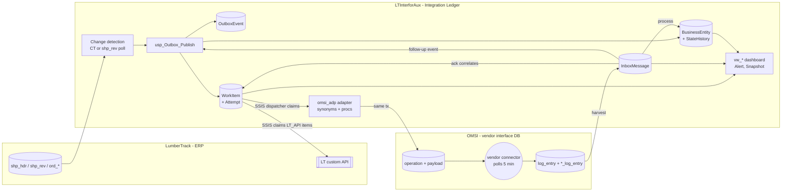

**Three ledgers, three questions.** Keeping them separate is the core modeling decision:

| Ledger | Question it answers | Mutability | Tables |
|---|---|---|---|
| **Business lifecycle** | *Where is shipment 4171753 in its life?* | current state is mutable; history append-only | `BusinessEntity`, `EntityStateHistory` |
| **Facts (outbox/inbox)** | *What did ERP tell us, and what did OMSI tell us?* | immutable | `OutboxEvent`, `InboxMessage` |
| **Delivery (work)** | *Did we deliver it, how many tries, why did it fail, who reprocessed it?* | status mutable; attempts append-only | `WorkItem`, `WorkItemAttempt`, `OperatorAction`, `ProcessRun` |

Mixing these (as `ShipmentTransferLog` does today: it is detection watermark, delivery status and acknowledgement record at once) is why reprocessing is hard today.

### Data model (ERD)

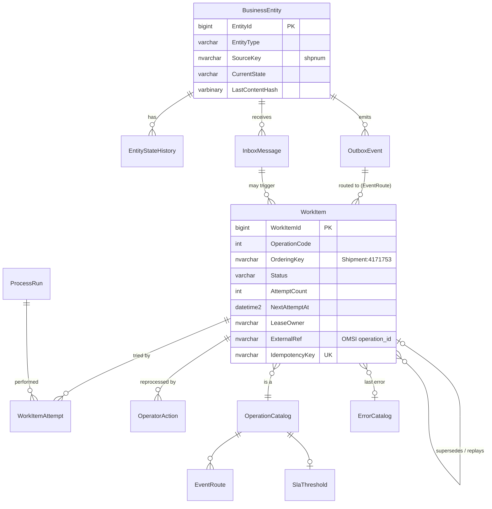

---

## 4. Area 1 — Outbox

### 4.1 An honest constraint

A *true* transactional outbox means the business transaction writes the outbox row in the same commit. **We don't own LumberTrack's transactions** (it's a Progress application), so at the ERP edge this is a **change-data-fed outbox**: changes are captured reliably and turned into immutable outbox events. Everywhere we *do* own the transaction, it is a true outbox:
- inbound processing → follow-up events
- adapter → ledger completion

### 4.2 Change detection options (ERP edge)

| Option | Reliability | Invasiveness to ERP | Recommendation |
|---|---|---|---|
| **SQL Server Change Tracking** on `shp_hdr`, `shp_ord`, `ord_hdr`, `shp_rev` | High: version-based and transactionally consistent; no missed rows | Low: a DB setting, no schema change (needs ERP vendor/DBA approval) | **Preferred** |
| Keep polling `shp_rev` (today) but publish through `usp_Outbox_Publish` | Medium: the content hash makes re-polls harmless | None | **Phase-1 fallback**. Drop `NOLOCK`; use `READ COMMITTED SNAPSHOT` on a readable source if possible. |
| Triggers on ERP tables | High | High: changes vendor schema, risk to ERP transactions | Avoid |
| CDC (log-based) | High, with before/after images | Medium (Agent jobs, change tables) | Use if you need before/after values for audit |

### 4.3 Publish semantics (`usp_Outbox_Publish`)

All of the following happens in **one transaction**, serialized per entity with `UPDLOCK, HOLDLOCK` on `BusinessEntity`:

1. **Upsert the business entity** (`EntityType`, `SourceSystem`, `SourceKey` is unique).
2. **No-op suppression.** If the SHA-256 of the canonical payload equals `LastContentHash`, return `2`. ERP revisions that don't change what the TMS receives (e.g. an internal note) produce no traffic.
3. **Idempotency key** = `EVT|type|key|event|<sourceChangeVersion>` or `…|<prevHash>><newHash>`. Re-detecting the same change returns `1` (duplicate) and creates nothing. A genuine A→B→A change still publishes, because the key contains the transition.
4. **Immutable event**: `OutboxEvent` holds the canonical JSON payload plus a `CorrelationId` that flows to every attempt and log line.
5. **Routing**: `EventRoute` maps the business event to one or more operations (fan-out ready: one event can feed OMSI **and** another consumer).
6. **Snapshot supersede and promotion (per operation, BA-configured in `OperationCatalog`)**:

   | Setting | Meaning | Shipment modify (200) | Insurance (7500) | Payment/accrual (5800/9101/9102) |
   |---|---|---|---|---|
   | `PayloadSemantics` | `Snapshot` = full current state; `Event` = distinct business fact | Snapshot | Snapshot | Event |
   | `SupersedeScope` | Which older *undelivered* items of the same operation a newer one replaces: `None`, `Unsent`, `UnsentAndDeadLetter` | UnsentAndDeadLetter | UnsentAndDeadLetter | None (never dropped) |
   | `PromoteToOperationCode` | If the create was never delivered, send this snapshot **as** the create | 100 | — | — |

   A table constraint forbids supersede or promotion on `Event` operations, so a payment can never be silently dropped. Replaced items keep their full history (`Superseded`, `SupersededById`), and a replaced dead letter's alert closes automatically.

   **Why promotion matters:** the most common bad-data case is a bad *create*. The user fixes it in LumberTrack, producing a *modify*. Without promotion, that modify waits behind the dead-lettered create, and retrying the create resends the old bad snapshot. With promotion, the newest revision goes out as the create. If the newest revision is still bad, it dead-letters as the new create and raises a new alert; the next fix replaces it again.

   **Revision guard:** when `SourceChangeVersion` (the LumberTrack revision) is supplied, a revision older than one already published returns `3` (stale) and creates no work, so late detection can never overwrite newer state.
7. **Terminal semantics**: a cancel supersedes everything still open for that shipment, including dead letters. If nothing was ever delivered to OMSI, the cancel is closed as `Cancelled — nothing to cancel` instead of sending OMSI a cancel for a load it never saw.
8. **Lifecycle**: applies `@NewState` (§8).

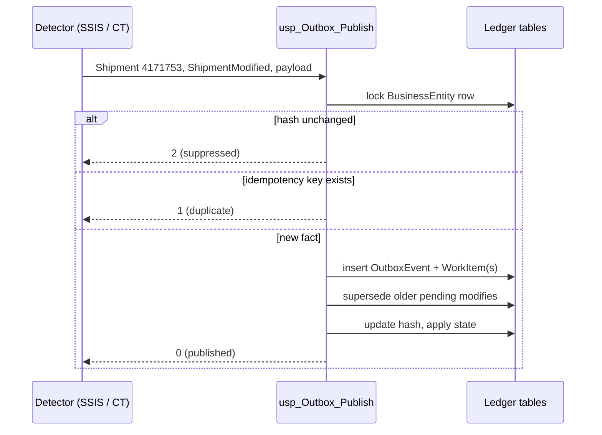

---

## 5. Area 2 — Integration service as a *data model* (work-item ledger)

Your preference fits this design: **the ledger is the service contract**. Any process (SSIS today, a .NET worker or Azure Function tomorrow) can pick up work using a handful of procedures. The processing logic is stateless; all state is in the tables.

> **Developers:** the full internal logic is in [WorkItem_Ledger_Developer_Guide.md](./WorkItem_Ledger_Developer_Guide.md). It covers the transition table with guards, invariants, lock-hint rationale, lease and fencing timeline, backoff math, worker contracts, a reuse checklist and an adapter template. This section is the summary.
> For when to use entity optimistic concurrency (OCC versioning) versus work-item leases, and the trade-offs of each, see [Concurrency_OCC_vs_Lease_Developer_Guide.md](./Concurrency_OCC_vs_Lease_Developer_Guide.md).
### 5.1 Work-item state machine

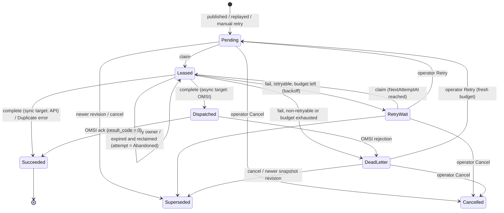

### 5.2 Claim algorithm (`usp_WorkItem_Claim`)

- `SELECT TOP (n) … WITH (UPDLOCK, READPAST, ROWLOCK)` inside an updatable CTE. Concurrent workers **skip** each other's rows; no blocking, no double claim.
- **Lease** (`LeaseOwner`, `LeaseExpiresAt`). If an SSIS run crashes, its items are reclaimed after the lease expires and the dead attempt is closed as `Abandoned`.
- **Per-entity FIFO**: an item is claimable only if no *earlier* item for the same `OrderingKey` + target is open (`Pending`, `Leased`, `RetryWait`, `DeadLetter`). This replaces today's global stall: a broken shipment blocks only its **own** later messages, and the dashboard shows `BlockedFollowers`.
- **Priority**: cancellations (`300`) have priority 1, so they jump the queue.
- The claim returns the payload, the idempotency key and the adapter procedure name. The worker needs nothing else.

**Fencing.** `usp_WorkItem_Complete` succeeds only if the caller still holds the lease (otherwise it throws `52001 Lease lost`), so a slow, reclaimed worker cannot overwrite a newer outcome.

**Lease renewal.** Workers whose step can outlast the lease (slow HTTP calls) call `usp_WorkItem_RenewLease` at about half the lease interval. It refuses (`52002`) once the lease has expired, so a lost lease is never resurrected.

### 5.3 Failure handling (`usp_WorkItem_Fail`)

1. **Classify** with `ErrorCatalog` (by error number or message pattern) into `Transient`, `Data`, `Mapping`, `Contract`, `Auth`, `Duplicate` or `Unknown`. Each rule carries a **business meaning, resolution hint and owner team**, written for BAs and support, not developers.
2. **Decide** with `RetryPolicy` (per operation, falling back to the default):
   - retryable and attempts remain → `RetryWait`, with **exponential backoff plus jitter**
   - otherwise → `DeadLetter`, plus a deduplicated Critical alert
   - `Duplicate` (`HTTP 409` from the API, or an adapter-raised `Duplicate:` error) → **`Succeeded`**: the target already has it, which is idempotency working as intended. SQL duplicate-key errors inside the OMSI write (2627/2601) are classified `Data`, because a repeated stop sequence is bad data, not a replay.
3. **Record** everything on the attempt row: error number, procedure, line, message, request and response snapshots.

> Call `Fail` **after** rolling back the business transaction, so the error record is never rolled back with the work (today's verbose logs disappear on rollback).

### 5.4 Reprocessing (operator actions, all audited in `OperatorAction`)

| Action | Allowed from | Effect | Typical use |
|---|---|---|---|
| `usp_WorkItem_Retry` | `DeadLetter`, `RetryWait` | Back to `Pending` now, same idempotency key, **fresh retry budget** (`RetryBudgetBase = AttemptCount`; lifetime `AttemptCount` is kept) | Mapping added, data fixed, API back up |
| `usp_WorkItem_Cancel` | `Pending`, `RetryWait`, `DeadLetter` | `Cancelled`; unblocks followers | Obsolete message |
| `usp_WorkItem_Replay` | `Succeeded`, `Dispatched`, `Cancelled`, `Superseded` | **New** work item linked by `ParentWorkItemId`, new key `…\|R1` | TMS lost a load; resend deliberately |

Retry and Replay are deliberately different: *Retry* is "try the same thing again" (target dedupes by key); *Replay* is "send it again on purpose" (new key).

### 5.5 Inbound processing (Inbox)

- `omsi_adp.usp_HarvestInbound` copies new `log_entry` rows into `integ.InboxMessage`. The unique key (`SourceSystem`, `SourceMessageId`) makes it **exactly-once**. It re-scans a small look-back window, because identity values can commit out of order when the vendor uses long transactions; plain watermarks miss those rows.
- `omsi_adp.usp_ProcessInbound` uses **one transaction per message**:
  1. correlate the acknowledgement to the outbound work item through OMSI's `operation_id` (`WorkItem.ExternalRef`), giving `Succeeded`, or `DeadLetter` if OMSI rejected it
  2. apply the lifecycle state (`InboundRoute.ResultingState`)
  3. publish a **follow-up event** if configured (e.g. `6800` ready-to-pay → `ReadyToPayReported` → `LT_API` op `9102`), with an idempotency key derived from the inbound message
  4. set vendor `log_entry.is_read = 1` **only now**, in the same transaction
  
  A failing message is marked `Failed` with the reason and retried on later runs; after N failures it alerts. **It never stalls other messages.**

### 5.6 How SSIS uses the ledger (contract for developers)

**OMSI target.** One SQL task: `EXEC omsi_adp.usp_DispatchOutbound`. It's a thin wrapper over the generic `integ.usp_Dispatch @TargetSystem = 'OMSI'`, which loops claim → adapter → complete/fail and records a `ProcessRun`. Any other same-instance SQL target reuses `integ.usp_Dispatch` with its own adapter ([templates/usp_Adapter_Template.sql](./templates/usp_Adapter_Template.sql)).

**ERP API target.** The SSIS package does the HTTP call (renewing the lease if the call can be slow):
```
RunId = usp_Run_Start('SSIS.LtApi')
loop:
  items = usp_WorkItem_Claim(RunId, owner, @TargetSystem='LT_API')
  for each item:
     POST /api/... headers: Idempotency-Key = item.IdempotencyKey, X-Correlation-Id = item.CorrelationId
     2xx  -> usp_WorkItem_Complete(item, owner, ExternalRef = api txn id, Request/Response snapshots)
     else -> usp_WorkItem_Fail(item, owner, ErrorMessage = 'HTTP <code> <body>')
usp_Run_End(RunId)
```

This closes the **dual-write gap** from the review. If SSIS crashes after the API succeeded but before `Complete`, the lease expires and the item is retried with the **same** key. The API must reject the repeat (`409`), which the ledger records as `Succeeded`.

**Requirement on the LT API team:** persist the `Idempotency-Key` and reject repeats. This is the single most important change for financial safety.

---

## 6. Area 3 — Vendor contract / adapter (anti-corruption layer)

### 6.1 Rules

1. **Only schema `omsi_adp` touches OMSI.** Its synonyms (`omsi_adp.operation`, `.shipment`, `.stop`, `.log_entry`, `.shipment_log_entry`) are the *only* place the OMSI database name appears. Moving OMSI to another instance or database means re-pointing the synonyms; no code changes.
2. **Canonical model in, vendor model out.** Upstream code produces canonical JSON (shipment, stops, …). Only the adapter knows OMSI column names, `client_key_1`, `heading` codes and similar details.
3. **Contract validation before writing**: required keys, at least 2 stops, value mappings. Failures are typed (`Contract:` / `No mapping:` prefixes) so the error catalog routes them to the right owner.
4. **Publish last**: `operation.is_ready = 0` → payload rows → `is_ready = 1` → ledger `Dispatched` with `ExternalRef = operation_id`, **all in one transaction**. The vendor connector can never see a partial shipment, and the ledger can never disagree with OMSI.
5. **Vendor flags keep vendor meaning.** The ledger never writes values like `is_read = 2`. "Orphan" detection is a *view* (`vw_AwaitingAck`), not an update.
6. **Contract versioning**: `ContractVersion` and `OperationCatalog.ContractVersion`/`AdapterProcedure` record which adapter implements which operation for which OMSI release. An OMSI upgrade (e.g. 22.04 → next) becomes a new adapter procedure plus catalog rows, testable side by side.
7. **Least privilege**: only the adapter's database role has write access to OMSI. SSIS logins get `EXECUTE` on `integ`/`omsi_adp` procedures and no table rights in OMSI or LumberTrack.

### 6.2 Value maps (fixes `LB` vs `LBS`)

`integ.ValueMap(Domain, SourceSystem, SourceValue, TargetSystem, TargetValue, EffectiveFrom/To)` is maintained by BAs. Missing mappings fail loudly as `Mapping` errors routed to "Integration BA", instead of silently dropping shipments (today's `TransportationMode` inner-join issue). Use the same table for ShipVia → TransportationMode and EquipmentType rules.

### 6.3 Concurrency finding from testing (also applies to today's OMSI writers)

With 6 parallel dispatchers, the first adapter version deadlocked on `OMSI.dbo.operation` (`PK_OPERATION` key locks). The cause: `INSERT … SELECT FROM OPENJSON` carries a fixed 50-row estimate, so SQL Server validated the foreign keys (`shipment → operation`, `stop → shipment`) with **scans**. Those scans collide with other sessions' uncommitted rows. The OMSI tables have no secondary indexes, so they are especially prone to this.

**Fix applied:** insert the header as a single-row `VALUES`, and use `OPTION (LOOP JOIN)` on multi-row child inserts to force seek-based FK checks. **Result: 400 of 400 shipments dispatched by 8 concurrent workers, 0 failures, 0 duplicates.**

Even the unfixed version lost nothing: the 60 deadlock victims were classified `Transient` and parked in `RetryWait`. That was the ledger doing its job.

---

## 7. Area 4 — Backlog dashboard

All views are read models over the ledger, so Power BI, SSRS, Grafana or plain SSMS can consume them. `usp_Monitor_Evaluate` runs every 5 minutes. It:
- snapshots the backlog for trend charts
- raises **deduplicated** alerts: one open alert per key, with an occurrence count
- **auto-resolves** alerts when the condition clears
- returns only alerts not yet notified, so each problem produces **one email instead of one per poll**

| View | Answers | Primary audience |
|---|---|---|
| `vw_Backlog` | How much is waiting per operation/status, oldest age, SLA breaches | Ops, architects |
| `vw_AwaitingAck` | What was sent to OMSI but not acknowledged, and **where it is stuck**: *not released*, *not picked up by connector*, *picked up but no response* | Support, TMS admin |
| `vw_DeadLetter` | What needs a human: business meaning, resolution hint, owner team, how many later messages it blocks | Support, BAs |
| `vw_ProcessHealth` | Is each SSIS job alive (heartbeat), failures in the last 24 h | Ops |
| `vw_EntityStuck` | Shipments too long in a business state (e.g. *Ready* > 30 min, *Delivered* but not *ReadyToPay* > 7 days) | BAs, logistics |
| `vw_LifecycleAnomalies` | Out-of-sequence events (e.g. ready-to-pay before award) | BAs, data quality |
| `vw_Throughput24h` | Volume, average and p95 end-to-end latency per operation | Architects |
| `vw_EntityTimeline` | Complete story of one shipment: events, attempts, errors, inbound messages, state changes | Everyone (drill-down) |

**Suggested dashboard layout:**
1. Health strip: process heartbeats, open Critical alerts.
2. Backlog by operation, as stacked status bars plus trend from `BacklogSnapshot`.
3. Awaiting-ack table with its diagnosis column.
4. Dead-letter work queue with owner and hint, and Retry/Cancel buttons wired to the operator procedures.
5. Business tiles: shipments by lifecycle state, stuck counts, anomalies.
6. Search box → `vw_EntityTimeline` by shipment number.

**Mapping from today's monitors:**

| Today | Replaced by |
|---|---|
| `ispOrphanOperationsMonitor` (sets `is_read = 2`) | `vw_AwaitingAck` with `SlaThreshold.MaxAckMinutes` (default 30 min ≥ 3× the 5-min OMSI poll) |
| `ispUnacknowldgedMessagesMonitor` (hardcoded emails) | `Alert` (category `AckOverdue`) + routing table / Database Mail profile |
| `LogEntryError`, `StageLoggingMessage` | `WorkItemAttempt` + `InboxMessage.ProcessingError` |
| Ad-hoc `ispShipmentInvestigate` | `vw_EntityTimeline` |

---

## 8. Business entity lifecycle (for BAs)

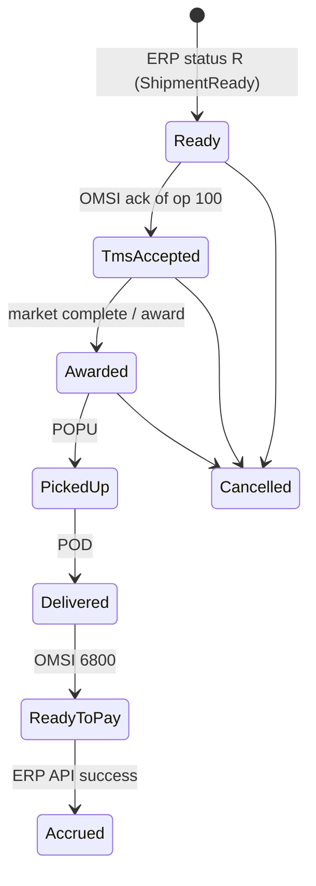

- **Configured, not coded**: `LifecycleTransition` lists expected transitions; `LifecycleSla` sets the maximum time per state. BAs maintain both.
- **Reality wins**: an unexpected transition is **applied** (the event did happen) but recorded with `IsExpected = 0` and shown in `vw_LifecycleAnomalies`. Rejecting real-world events (POD arriving before pickup confirmation is common) would hide data, not fix it.
- **Separation from delivery**: a shipment can be `Awarded` while a modify is in `RetryWait`. The business state and the integration state are different questions, answered by different tables.
- Inbound codes other than acknowledgements and `6800` are marked **TBD** in the seed and must be confirmed against your OMSI version (award/market complete, POPU, POD, freight bill, appointments).

---

## 9. Migration path (strangler, no big bang)

| Phase | Change | Risk | Old objects retired |
|---|---|---|---|
| **0** (weeks) | Tactical fixes from the review: insurance filter, orphan threshold, `ispStageDataManager` lock/filter/logging | Low | — |
| **1** | Deploy the ledger tables, catalog and dashboard. **Shadow mode**: existing procedures also call `usp_Outbox_Publish` and write attempts. | Low (additive) | — |
| **2** | Inbound: harvest and process OMSI `log_entry` through the Inbox; ERP API calls through `LT_API` work items with idempotency keys | Medium | `ispShipmentRecordAcknowledgement`, `ispShipmentRecordReadyToPay`, `ShipmentTransferLogInbound`, `LogEntryError` |
| **3** | Outbound through the adapter (`usp_DispatchOutbound`), one operation at a time: 7500 → 300 → 100/200 | Medium | `ispStageDataManager`, `Stage*` tables, `StageShipmentTransferLog`, `ispOmsi*CreateFromStage` |
| **4** | Change detection through Change Tracking (if approved) feeding `usp_Outbox_Publish` | Medium | `ispShipmentsReadReadySend*`, `ShipmentTransferLog` as watermark |
| **5** | Remove direct-DML ERP procedures and orphan/email monitors | Low | `ispApCreate`, `ispShipmentAccrueFreightCharge`, `ispOrphanOperationsMonitor`, `ispUnacknowldgedMessagesMonitor` |

Each phase is reversible, because the old path stays until the new path's dashboard shows parity.

---

## 10. When to switch to (or add) a message broker

Add **Azure Service Bus** (or similar) when **any** of these become true:
- more consumers of shipment events (visibility portal, analytics, a second TMS, carrier APIs)
- the TMS moves to an **API/event contract** instead of the OMSI database
- the middle layer moves **off the ERP's SQL instance** (cross-instance means no local atomicity)
- latency requirements drop below about 1 minute, or volume makes polling wasteful

**How this design evolves** (no data-model rework):
1. Add a **relay** that reads `WorkItem` rows for a new target `SB` and publishes to a Service Bus topic, with `SessionId = OrderingKey` (per-entity FIFO) and `MessageId = IdempotencyKey` (broker de-duplication). That's the transactional-outbox relay pattern.
2. Consumers keep an **Inbox** table (the same `InboxMessage` design) for idempotent consumption.
3. The ledger, lifecycle and dashboards stay as they are. The broker becomes one more `TargetSystem`.

**Not recommended:** SQL Server Service Broker. It's transactional, but its operations are opaque, the skill set is rare, and it offers nothing here that the ledger tables don't.

---

## 11. Validation performed

The reference scripts were deployed to SQL Server 2019 (LocalDB) against a mock `OMSI` database built from the **real** `operation`, `shipment`, `stop`, `log_entry` and `shipment_log_entry` definitions, including their foreign keys. Scenarios tested, all passing:

| # | Scenario | Verified |
|---|---|---|
| 1 | New + 2 modifies + identical modify | Older modify superseded; identical payload suppressed |
| 2 | Dispatch | Only the *new* is sent first (per-entity FIFO); `is_ready = 1`; `LBS → LB`; 2 stops written |
| 3 | Deadlock on modify | `RetryWait` with backoff, then dispatched; 2 attempts recorded |
| 4 | OMSI ack + 6800 inbound | Exactly-once harvest (re-run harvests 0); ack correlated → `Succeeded`; lifecycle → `ReadyToPay` flagged as unexpected; `is_read = 1` |
| 5 | ERP API returns 409 | Treated as `Succeeded` (idempotent) |
| 6 | Unmapped UOM | `DeadLetter` (class Mapping, owner "Integration BA"); other shipments unaffected; follower shows as blocked; cancel supersedes both and closes as "nothing to cancel" |
| 7 | Replay, ack overdue, dead SSIS job | Replay creates a linked item; `AckOverdue` alert with diagnosis "Not picked up by OMSI connector"; `ProcessDown` alert; dead-letter alert auto-resolved after cancel |
| 8 | 400 shipments, 8 parallel dispatchers | 400/400 dispatched, 0 duplicates, 0 failures (after the FK-scan deadlock fix in §6.3) |
| 9 | Failure **in the middle** of one shipment's OMSI write (`operation` + `shipment` written, `stop` insert fails) | Whole OMSI write rolled back (no orphan rows); item `DeadLetter` (class `Data`); the other shipments in the same run are dispatched |
| 10 | Error the adapter can't catch in its own scope (missing procedure, 2812) | Caught by the dispatcher's per-item guard and recorded on that item only; the run completes |
| 11 | Worker dies after claiming (SSIS killed) | Other shipments dispatched immediately; abandoned item reclaimed after lease expiry (attempt recorded as `Abandoned`) |
| 12 | Bad create, then a still-bad revision, then a fixed revision | Each newer revision replaces the dead letter and is sent **as the create**; the still-bad one dead-letters with a new alert; the fixed one is dispatched; no dead letters remain |
| 13 | Delivered create, then a bad modify, then a newer modify | The newer modify replaces the dead-lettered modify and is dispatched as a modify (no promotion) |
| 14 | Two freight payments, the first dead-lettered | The second **does not** replace the first (Event semantics) and waits, shown as `BlockedFollowers` |
| 15 | LumberTrack revision 19 arriving after revision 20 | Rejected as stale (`3`); no work created |

> **Failure-isolation rule:** a failure never blocks other shipments. For the same shipment, a newer **snapshot** revision replaces undelivered and dead-lettered ones; an **event** (payment, accrual) waits until the dead letter is retried or cancelled. Note that SQL duplicate-key errors (2627/2601) *inside* the OMSI write are classified as `Data`, not `Duplicate`: a repeated stop sequence is bad data, not an idempotent replay. Only explicit target signals (`HTTP 409`, adapter-raised `Duplicate:`) count as "already applied".

---

## 12. Decisions needed

1. **Change Tracking on LumberTrack**: is it approved by the ERP vendor/DBA? If not, Phase 4 keeps `shp_rev` polling through the publish procedure.
2. **LT API idempotency**: can the API persist and enforce an `Idempotency-Key`? This is required for financial safety.
3. **OMSI inbound codes**: confirm codes and `result_code` semantics (0 = success assumed) for award, POPU, POD, freight bill and appointment messages.
4. **Retention**: ledger history retention (default 180 days); dead letters are never purged automatically.
5. **Dashboard tool**: Power BI (recommended for BAs) or SSRS.

---

## 13. End-to-end views (consolidated design)

> `integ.EntityRevision` (marked \*) is the agreed revision ledger from the review. It is designed below; its DDL is not yet in the reference scripts.

### 13.1 System design (components and boundaries)

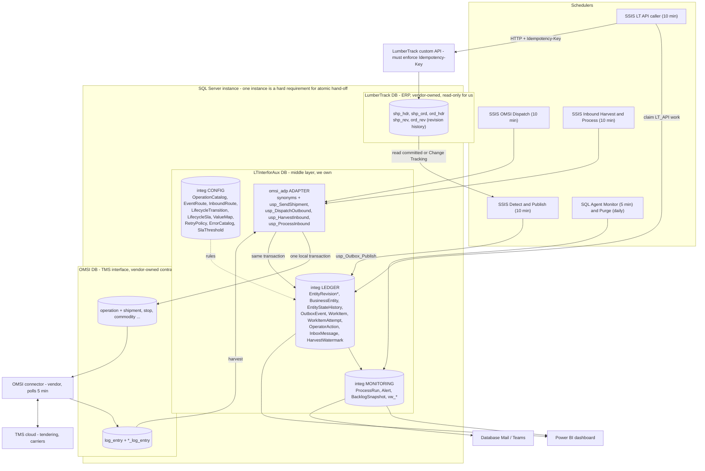

**Ownership rules:**
- Only `omsi_adp` touches OMSI.
- Only the LT API writes to LumberTrack.
- SSIS logins can only run `integ` and `omsi_adp` procedures; they have no table rights in OMSI or LumberTrack.

### 13.2 Process flow — end-to-end shipment lifecycle

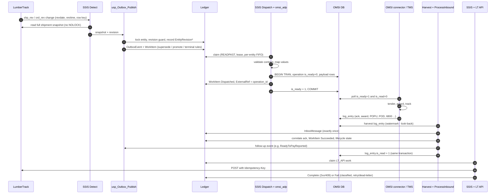

### 13.3 Process logic — publish decision (revision guard)

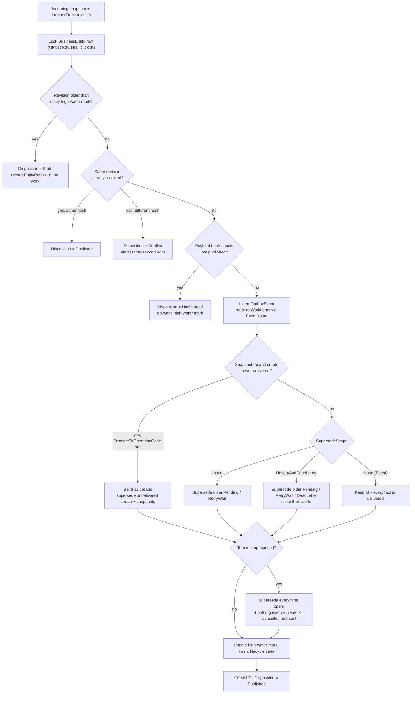

### 13.4 Process logic — dispatch and failure handling

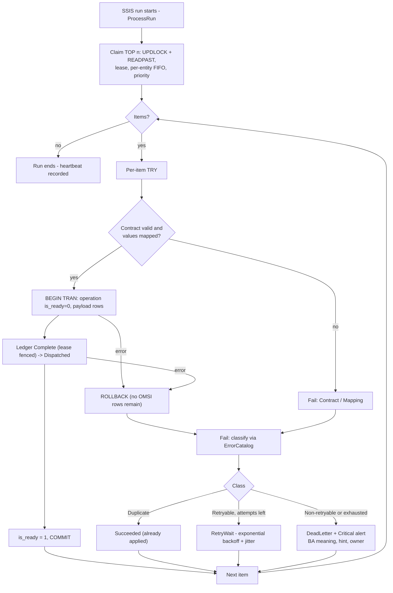

### 13.5 Process logic — inbound

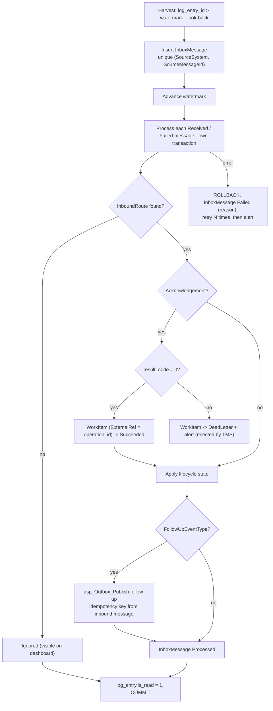

### 13.6 Data flow diagram

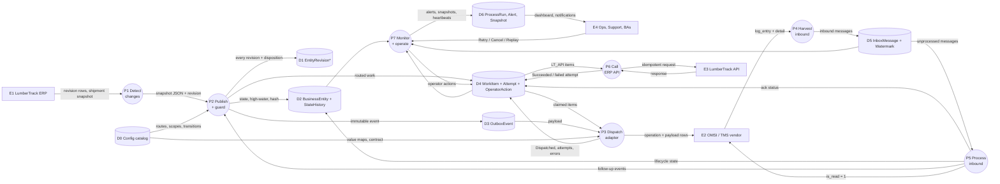

### 13.7 `integ.EntityRevision` (agreed, to be added)

| Column | Purpose |
|---|---|
| `EntityRevisionId` bigint PK | Ledger key |
| `EntityId` FK | The shipment / insurance record |
| `SourceRevisionAt` datetime2(0) | `revdate + revtime` (LumberTrack local time) |
| `SourceRevisionTiebreak` bigint | Unique, increasing row key from `shp_rev`/`ord_rev` (e.g. `PROGRESS_RECID`) if available; otherwise ledger sequence |
| `SourceRevisionTable`, `SourceRevisionRef` | `shp_rev` / `ord_rev` and the row key (lineage) |
| `RevisionDesc` | `revDesc` / `editField` (what changed) |
| `PayloadHash`, `EventId` | Snapshot received and the event it became (if any) |
| `Disposition` | `Published`, `Unchanged`, `Duplicate`, `Stale`, `Conflict` |
| `ReceivedAt` | Detection time |

`BusinessEntity` also gains a high-water mark: `LastRevisionAt` and `LastRevisionTiebreak`. The guard compares against that row, which is already locked during publish.

---

## 14. Critical technical elements (check-up)

🔴 = must be resolved before production cut-over; 🟠 = resolve during rollout.

| # | Sev | Element | Why it is critical | Required action |
|---|---|---|---|---|
| 1 | 🔴 | **Legacy cut-over: ledger has no history of shipments sent by the old path** | A cancel for a shipment created by the legacy procs finds "nothing delivered" in the ledger and is **closed as Cancelled without being sent**. The carrier keeps the load. | Before each operation cut-over, back-fill `BusinessEntity` and a synthetic `Succeeded` create per shipment from `ShipmentTransferLog`. Also see #2. |
| 2 | 🔴 | **Terminal/promotion logic reads work-item history, which retention purges** | After 180 days the delivered create is purged, so the same "nothing delivered" false negative appears for long-lived shipments. | Persist the fact on the entity: `EntityTargetDelivery(EntityId, TargetSystem, FirstDeliveredAt)`, and base terminal/promotion decisions on it, not on work-item history. |
| 3 | 🔴 | **Daylight-saving fall-back (next one: 2026-11-01)** | `revdate + revtime` is local time. During the repeated 01:00–02:00 hour, real newer revisions look older and a timestamp-only guard would **reject them as Stale**. | Order revisions by a monotonic row key (`PROGRESS_RECID` or equivalent) as the primary key, with the timestamp for display only. If no such key exists, disable the Stale rule during the repeated hour and use Conflict alerts instead. |
| 4 | 🔴 | **Snapshot assembled with `NOLOCK`** (today's pattern) | A dirty read of an uncommitted ERP edit that later rolls back gets published, hashed and sent to the TMS. The no-op check then hides the correction until the next real change. | Read snapshots with READ COMMITTED (or snapshot isolation on a readable copy), never `NOLOCK`. |
| 5 | 🔴 | **LT API idempotency not yet confirmed** | Without it, a crash between the API's success and `Complete` duplicates accruals or AP on retry, exactly as today. | The API must persist and enforce `Idempotency-Key` (409 on repeat). This is a go-live gate for 9101/9102. |
| 6 | 🔴 | **OMSI acknowledgement contract unverified** | The design assumes OMSI echoes the outbound operation code and `operation_id` in `log_entry`, with `result_code = 0` meaning success. If wrong, every item stays Dispatched and `AckOverdue` alerts flood. | Confirm with the vendor and with production `log_entry` samples; adjust `InboundRoute` and the correlation. |
| 7 | 🔴 | **Same-instance requirement** | Exactly-once hand-off to OMSI depends on one local transaction. If OMSI or LTInterforAux moves to another instance (upgrade, availability group, cloud), synonyms keep working but **atomicity is silently lost**. | Treat co-location as an architectural constraint; if it changes, switch to the broker/outbox-relay pattern (§10) instead of a distributed transaction. |
| 8 | 🟠 | **Inbound look-back window is finite** | A vendor transaction holding an identity value for longer than 200 newer IDs would be skipped permanently: lost POD or ready-to-pay. | Add a reconciliation view for `log_entry` rows with `is_read = 0` older than N minutes and absent from `InboxMessage`, plus an alert. |
| 9 | 🟠 | **Vendor connector isolation level and triggers unknown** | Our `is_ready=0` → payload → ledger → `is_ready=1` order (now the last statement before commit) is safe for READ COMMITTED and nearly so for NOLOCK readers. Vendor-side triggers or RCSI could change behaviour. | Confirm with the vendor; test against a vendor-provided OMSI instance. |
| 10 | 🟠 | **Foreign-key scans on vendor tables under concurrency** | Reproduced: deadlocks on `PK_OPERATION` when FK validation scans. Fixed in the adapter; any new adapter (5800, 7500) must follow the same rule. | Single-row `VALUES` for headers and `OPTION (LOOP JOIN)` for child inserts; parallel-dispatch test for every new adapter. |
| 11 | 🟠 | **Cross-stream blocking per shipment** | A dead-lettered freight payment (Event) also holds back shipment modifies for that shipment. | Separate ordering streams: `OrderingKey = Shipment:<n>:<stream>` (Snapshot vs Financial). |
| 12 | 🟠 | **Lease shorter than a slow API call** | A 300-second lease can expire during a slow HTTP call; the item is reclaimed and called twice. That's safe only with #5. | **Mechanism added:** `integ.usp_WorkItem_RenewLease` (fenced; tested). Remaining action: external workers must call it at about half the lease interval. |
| 13 | 🟠 | **Dual running during migration** | Legacy procedures and the new adapter both sending the same operation would create duplicate OMSI operations. | Cut over one operation type at a time; disable the legacy path for that type in the same release (§9). |
| 14 | 🟠 | **Order revisions fan out** | One `ord_rev` change can affect several shipments (via `shp_ord`), and one shipment can have several orders. | The detector must publish one snapshot per affected shipment, using the newest revision across `shp_rev` and `ord_rev`. |
| 15 | 🟠 | **Payload snapshots retain contact data** | `PayloadJson` and `RequestSnapshot` hold names, phones and emails for the retention period. | Mask in snapshots where not needed; restrict `SELECT` on ledger tables; align retention with privacy policy. |

**Still open in today's production system** (from the first review, independent of this design): the insurance 7500 feed may be stuck (`AcknowledgeDate` filter); the orphan monitor marks healthy operations `is_read = 2` at 5 minutes; one bad row stalls `ispStageDataManager`; and direct DML still writes into ERP financial tables.
