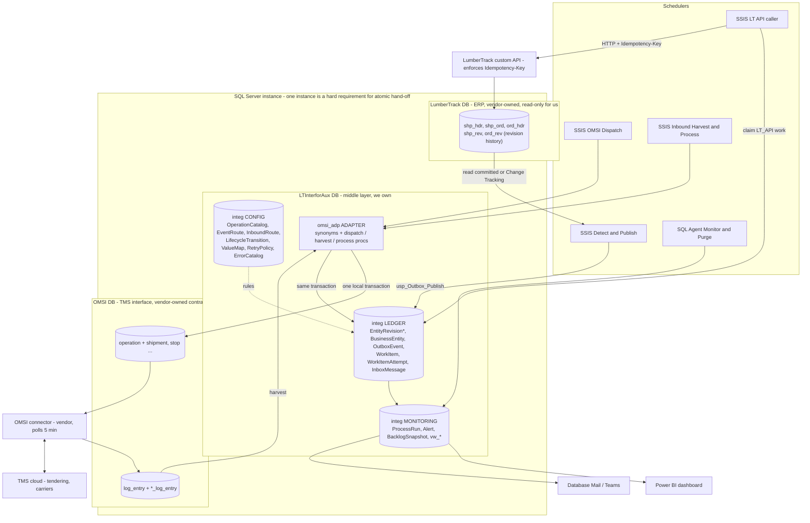
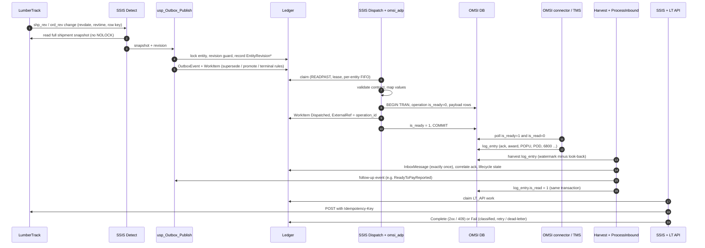
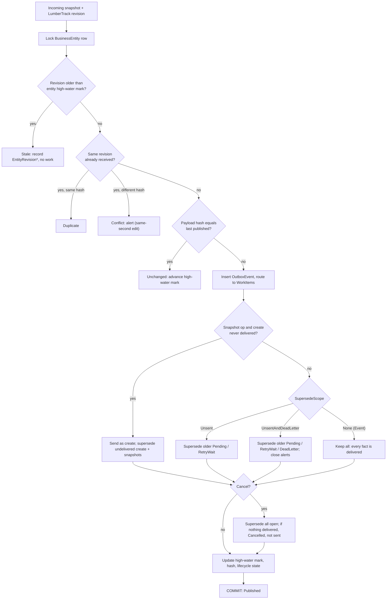
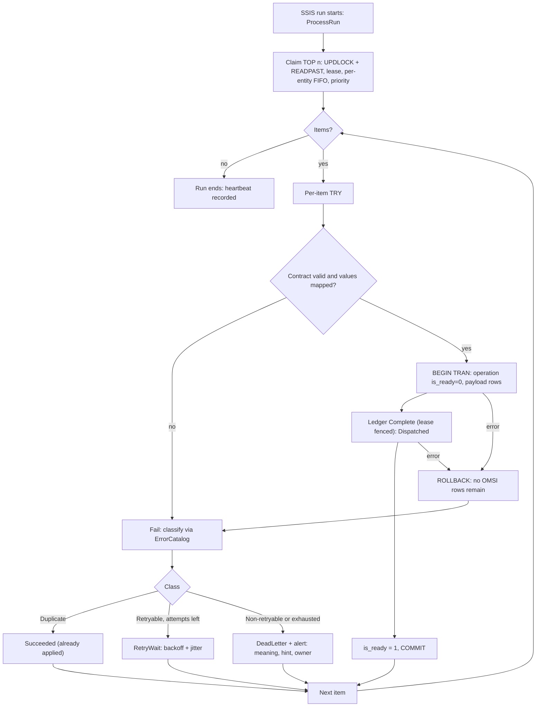
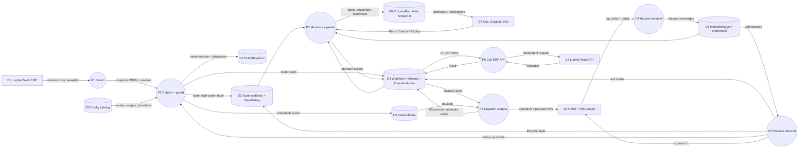

User: This is the middle layer of enterprise application integration implementation - shipment integration between ERP source systems and OMSI shipment procurement/tendering system. You are a master of integration solution architect and specialist. Please critique these two database programming object schema defintion source files: 1) OMSI database transaction processing logs tables; 2) custom stored procedures implementation how the ERP source systems interact with the OMSI - middle layer. Explain the design strategies and methodologies applied in this implementation. Perform a deep, solution design analysis on the effectiveness and practicality (in the real business world) by using this type of application integration pattern and any technical, design gaps you discovered. NOTE: custom stored procedures implementation quality is in questions but hope it provides the insight about how the OMSI middle layer was interacted / transacted during the inbound and outbound updates. Always ask questions if needed. Reply with the techical quality and solid recommendation or summary.

Copilot: I'll start by reviewing the schema file and listing the stored procedures.

Ran terminal command: (Get-Item omsi_db_schema.sql).Length; (Get-Item omsi_stored_proc_defintions.sql).Length; Select-String -Path omsi_db_schema.sql -Pattern '^\s*CREATE\s+(TABLE|INDEX|UNIQUE|CLUSTERED|NONCLUSTERED|VIEW|SEQUENCE|TRIGGER)' | ForEach-Object { "$($_.LineNumber): $($_.Line.Trim())" }

Read , lines 1 to 160
Completed with input: {
  "path": "c:\\Users\\dong.shen\\source\\omsi_tms_solution\\omsi_db_schema.sql",
  "view_range": [
    1,
    160
  ]
}

Read , lines 800 to 870
Completed with input: {
  "path": "c:\\Users\\dong.shen\\source\\omsi_tms_solution\\omsi_db_schema.sql",
  "view_range": [
    800,
    870
  ]
}

Read , lines 1440 to 2029
Completed with input: {
  "path": "c:\\Users\\dong.shen\\source\\omsi_tms_solution\\omsi_db_schema.sql",
  "view_range": [
    1440,
    2029
  ]
}

Files are UTF-16; I'll convert to UTF-8 working copies in the session folder for analysis.

Ran terminal command: $d='c:\Users\dong.shen\.copilot\session-state\8708f37f-803b-427d-af76-20a82ea53d21\files'; Get-Content omsi_db_schema.sql -Encoding Unicode | Set-Content "$d\schema.sql" -Encoding UTF8; Get-Content omsi_stored_proc_defintions.sql -Encoding Unicode | Set-Content "$d\procs.sql" -Encoding UTF8; Select-String -Path "$d\procs.sql" -Pattern '^\s*(CREATE|ALTER)\s+(PROC|PROCEDURE|FUNCTION|TRIGGER|VIEW)' | % { "$($_.LineNumber): $($_.Line.Trim())" }

Ran terminal command: $f='C:\Users\DONG~1.SHE\AppData\Local\Temp\1793387794483-copilot-tool-output-23452-0e06a3e7-83ea-49ee-93e4-6ccfc7f78c2d.txt'; (Get-Content $f) | % { ($_ -replace '^(\d+): \w+ (proc|procedure|PROCEDURE|PROC|function|FUNCTION|view|VIEW|trigger|TRIGGER) ','$1 ') -replace '\s*\(.*$','' } | Out-String -Width 300

Read tool output
Completed with input: {
  "path": "C:\\Users\\DONG~1.SHE\\AppData\\Local\\Temp\\1793387798943-copilot-tool-output-23452-f6021aa9-d610-48bb-971d-113fbf7206da.txt",
  "forceReadLargeFiles": true
}

The stored procedure catalog shows a clear staging → OMSI → transfer-log → acknowledgement pipeline. Next I'll read the preamble and the core orchestration procedures.

Read , lines 1 to 917
Completed with input: {
  "path": "c:\\Users\\dong.shen\\.copilot\\session-state\\8708f37f-803b-427d-af76-20a82ea53d21\\files\\procs.sql",
  "view_range": [
    1,
    917
  ]
}

Read , lines 218 to 560
Completed with input: {
  "path": "c:\\Users\\dong.shen\\.copilot\\session-state\\8708f37f-803b-427d-af76-20a82ea53d21\\files\\procs.sql",
  "view_range": [
    218,
    560
  ]
}

Read , lines 560 to 917
Completed with input: {
  "path": "c:\\Users\\dong.shen\\.copilot\\session-state\\8708f37f-803b-427d-af76-20a82ea53d21\\files\\procs.sql",
  "view_range": [
    560,
    917
  ]
}

Ran terminal command: $p='c:\Users\dong.shen\.copilot\session-state\8708f37f-803b-427d-af76-20a82ea53d21\files\procs.sql'; $pats=@('BEGIN\s+TRAN','COMMIT','ROLLBACK','BEGIN\s+TRY','BEGIN\s+CATCH','THROW','RAISERROR','NOLOCK','READPAST','UPDLOCK','DECLARE\s+\w+\s+CURSOR','OPENQUERY','sp_executesql','EXEC\s*\(','sp_send_dbmail','MERGE\s','TRUNCATE\s+TABLE','\bWHILE\b','SET\s+XACT_ABORT','SET\s+NOCOUNT','@@ERROR','@@ROWCOUNT','SCOPE_IDENTITY','IDENT_CURRENT','\[OMSI\]\.\[dbo\]','OMSI\.dbo\.','\bLT\w*\.\w+\.','sp_getapplock','ISOLATION\s+LEVEL','WAITFOR','DELETE\s+FROM','\bGOTO\b','select\s+\*'); foreach($x in $pats){ $c=(Select-String -Path $p -Pattern $x -AllMatches).Count; "{0,-28} {1}" -f $x,$c }

Ran terminal command: $p='c:\Users\dong.shen\.copilot\session-state\8708f37f-803b-427d-af76-20a82ea53d21\files\procs.sql'; Select-String -Path $p -Pattern '\b(LT\w*|OMSI|LTI\w*)\.(\w+)\.(\w+)' -AllMatches | % { $_.Matches } | % { $_.Value } | Group-Object | Sort-Object Count -desc | Select -First 60 | % { "{0,4} {1}" -f $_.Count,$_.Name }; "---linked/4part"; Select-String -Path $p -Pattern '\[\w+\]\.\[\w+\]\.\[\w+\]\.\[\w+\]|\b\w+\.\w+\.\w+\.\w+\b' | Select -First 15 | % { "$($_.LineNumber): $($_.Line.Trim())" }

Core pattern is clear: the `LTInterforAux` staging DB writes directly into `OMSI.dbo` tables using cross-database calls. Next I'll read the orchestrator and the operation-creation procedures.

Read , lines 11815 to 12200
Completed with input: {
  "path": "c:\\Users\\dong.shen\\.copilot\\session-state\\8708f37f-803b-427d-af76-20a82ea53d21\\files\\procs.sql",
  "view_range": [
    11815,
    12200
  ]
}

Read , lines 4700 to 4860
Completed with input: {
  "path": "c:\\Users\\dong.shen\\.copilot\\session-state\\8708f37f-803b-427d-af76-20a82ea53d21\\files\\procs.sql",
  "view_range": [
    4700,
    4860
  ]
}

Read , lines 11993 to 12340
Completed with input: {
  "path": "c:\\Users\\dong.shen\\.copilot\\session-state\\8708f37f-803b-427d-af76-20a82ea53d21\\files\\procs.sql",
  "view_range": [
    11993,
    12340
  ]
}

Read , lines 1017 to 1036
Completed with input: {
  "path": "c:\\Users\\dong.shen\\.copilot\\session-state\\8708f37f-803b-427d-af76-20a82ea53d21\\files\\schema.sql",
  "view_range": [
    1017,
    1036
  ]
}

Ran terminal command: $p='c:\Users\dong.shen\.copilot\session-state\8708f37f-803b-427d-af76-20a82ea53d21\files\procs.sql'; Select-String -Path $p -Pattern 'sp_getapplock|UPDLOCK|sp_send_dbmail|begin\s+tran|XACT_ABORT|LumberTrack\.|linked|OPENROWSET|\bwith\s*\(nolock\)' | ? { $_.Line -notmatch 'nolock' -or $_.LineNumber -lt 0 } | % { "$($_.LineNumber): $($_.Line.Trim())" }; "--- LumberTrack refs count:"; (Select-String -Path $p -Pattern 'LumberTrack\.dbo\.\w+' -AllMatches | % {$_.Matches.Value} | Group-Object | sort Count -desc | % { "$($_.Count) $($_.Name)" })

Ran terminal command: $f='C:\Users\DONG~1.SHE\AppData\Local\Temp\1793387850876-copilot-tool-output-23452-3b819101-5861-422a-b207-12ee836cc6b6.txt'; Get-Content $f | ? { $_ -match 'getapplock|UPDLOCK|send_dbmail|tran|XACT|^\d+ LumberTrack|insert LumberTrack|update LumberTrack|delete LumberTrack' }

Read , lines 11229 to 11434
Completed with input: {
  "path": "c:\\Users\\dong.shen\\.copilot\\session-state\\8708f37f-803b-427d-af76-20a82ea53d21\\files\\procs.sql",
  "view_range": [
    11229,
    11434
  ]
}

Read , lines 8724 to 8870
Completed with input: {
  "path": "c:\\Users\\dong.shen\\.copilot\\session-state\\8708f37f-803b-427d-af76-20a82ea53d21\\files\\procs.sql",
  "view_range": [
    8724,
    8870
  ]
}

Read , lines 2888 to 3110
Completed with input: {
  "path": "c:\\Users\\dong.shen\\.copilot\\session-state\\8708f37f-803b-427d-af76-20a82ea53d21\\files\\procs.sql",
  "view_range": [
    2888,
    3110
  ]
}

Read , lines 7679 to 7770
Completed with input: {
  "path": "c:\\Users\\dong.shen\\.copilot\\session-state\\8708f37f-803b-427d-af76-20a82ea53d21\\files\\procs.sql",
  "view_range": [
    7679,
    7770
  ]
}

Read , lines 918 to 1040
Completed with input: {
  "path": "c:\\Users\\dong.shen\\.copilot\\session-state\\8708f37f-803b-427d-af76-20a82ea53d21\\files\\procs.sql",
  "view_range": [
    918,
    1040
  ]
}

Read , lines 12338 to 12540
Completed with input: {
  "path": "c:\\Users\\dong.shen\\.copilot\\session-state\\8708f37f-803b-427d-af76-20a82ea53d21\\files\\procs.sql",
  "view_range": [
    12338,
    12540
  ]
}

Read , lines 9436 to 9535
Completed with input: {
  "path": "c:\\Users\\dong.shen\\.copilot\\session-state\\8708f37f-803b-427d-af76-20a82ea53d21\\files\\procs.sql",
  "view_range": [
    9436,
    9535
  ]
}

Read , lines 7251 to 7300
Completed with input: {
  "path": "c:\\Users\\dong.shen\\.copilot\\session-state\\8708f37f-803b-427d-af76-20a82ea53d21\\files\\procs.sql",
  "view_range": [
    7251,
    7300
  ]
}

Read , lines 13340 to 13386
Completed with input: {
  "path": "c:\\Users\\dong.shen\\.copilot\\session-state\\8708f37f-803b-427d-af76-20a82ea53d21\\files\\procs.sql",
  "view_range": [
    13340,
    13386
  ]
}

Ran terminal command: $s='c:\Users\dong.shen\.copilot\session-state\8708f37f-803b-427d-af76-20a82ea53d21\files\schema.sql'; $p='c:\Users\dong.shen\.copilot\session-state\8708f37f-803b-427d-af76-20a82ea53d21\files\procs.sql'; foreach($x in 'FOREIGN KEY','CREATE\s+\w*\s*INDEX','DEFAULT','IDENTITY','CHECK\s*\(','PRIMARY KEY','ALTER TABLE','\[datetime2\]','\[datetime\]','decimal\]\(1, 0\)','nvarchar\]\(4000\)'){ "{0,-25} schema={1} procs={2}" -f $x,(Select-String -Path $s -Pattern $x).Count,(Select-String -Path $p -Pattern $x).Count }; "--- tables lacking PK in schema:"; $t=Get-Content $s -Raw; [regex]::Matches($t,'CREATE TABLE \[dbo\]\.\[(\w+)\]\(([\s\S]*?)\n\) ON \[PRIMARY\]') | ? { $_.Groups[2].Value -notmatch 'PRIMARY KEY' } | % { $_.Groups[1].Value }; "--- ALTER lines"; Select-String -Path $s -Pattern 'ALTER TABLE' | select -first 20 | % { "$($_.LineNumber): $($_.Line.Trim())" }

Ran terminal command: $s='c:\Users\dong.shen\.copilot\session-state\8708f37f-803b-427d-af76-20a82ea53d21\files\schema.sql'; $l=Get-Content $s; for($i=0;$i -lt $l.Count;$i++){ if($l[$i] -match 'ADD\s+CONSTRAINT \[(\w+)\] FOREIGN KEY\((.*?)\)' ){ $t=($l[$i] -replace '^ALTER TABLE (\S+).*','$1'); "$t $($matches[2]) -> $($l[$i+1].Trim())" } }

Read , lines 10340 to 10600
Completed with input: {
  "path": "c:\\Users\\dong.shen\\.copilot\\session-state\\8708f37f-803b-427d-af76-20a82ea53d21\\files\\procs.sql",
  "view_range": [
    10340,
    10600
  ]
}

Ran terminal command: Remove-Item 'c:\Users\dong.shen\.copilot\session-state\8708f37f-803b-427d-af76-20a82ea53d21\files\schema.sql','c:\Users\dong.shen\.copilot\session-state\8708f37f-803b-427d-af76-20a82ea53d21\files\procs.sql'

# OMSI middle-layer review: shipment integration between LumberTrack (ERP) and the OMSI tendering system

I read both scripts. The schema file has 48 tables. The procedures file has about 190 procedures plus about 30 middle-layer tables in `LTInterforAux`. I focused on the paths that matter for integration: the orchestrator, change detection, acknowledgements, financial write-back, cleanup and monitoring. I didn't read every lookup/CRUD procedure line by line.

## 1. How it's built

```
LumberTrack (ERP, Progress tables on SQL Server)
   │  ispShipmentsReadReadySend{New|Modified|Cancelled|Messages}  (polling, NOLOCK)
   ▼
LTInterforAux.OMSI  (middle layer: Stage* tables, ShipmentTransferLog, settings and mapping tables)
   │  ispOmsiStage*Create → ispStageDataManager → ispOmsi*CreateFromStage
   ▼
OMSI.dbo  (the TMS vendor's interface database)
   outbound: operation (header, is_ready/is_read) + shipment/stop/commodity/... (payload)
   inbound : log_entry (header, is_read) + *_log_entry (typed payload: POD, freight bill, appointment...)
   ▲
   │  ispShipmentRecordAcknowledgement / RecordReadyToPay / AccrueFreightCharge / ApCreate
   └── writes back directly into ERP tables (udf_fields, mil_doc, fap_rcn)
```

All three databases are on the same SQL Server instance. Procedures call across them with three-part names (`LumberTrack.dbo.*`, `LTInterforAux.omsi.*`, `omsi.dbo.*`).

## 2. Design patterns used

| Pattern | Where it shows up |
|---|---|
| **Shared database / interface tables** | OMSI is a vendor-defined mailbox database. Both sides read and write its tables. |
| **Polling consumer with status flags** | `operation.is_ready/is_read` going out, `log_entry.is_read` coming in, `LAST_BATCH_PROCESSED` |
| **Header + typed payload tables** | `operation` → `shipment/stop/commodity/...`; `log_entry` → 18 `*_log_entry` tables, each linked 1:1 by key |
| **Staging, then promotion** | `Stage*` tables, then `*CreateFromStage`, then the staged rows are deleted |
| **Transfer log as a ledger** | `ShipmentTransferLog` records each send: read, write and acknowledgement timestamps. It drives "never sent / already sent / paid" decisions. |
| **Change detection from the ERP audit trail** | Reads `shp_rev`/`ord_rev` revision rows. `ModifiedShipments(@apiUser)` ignores changes made by the API user, so the ERP doesn't echo TMS updates back. |
| **Configuration-driven routing** | `ReadyShipment`, `BusinessAddressBranch.EffectiveOn`, `EquipmentType`, `TransportationMode` and similar tables. Branches are switched on by effective date. |
| **Monitoring and housekeeping** | Orphan monitor, unacknowledged-message monitor (Database Mail), batched purge procedures |

**Practicality.** For a single-instance, database-centric shop this is a reasonable and common approach. It follows the vendor's interface contract, has low latency, and is easy for DBAs to inspect. Branch onboarding by effective date and API-echo suppression show real business maturity. The weaknesses are tight coupling, little real reliability machinery, and direct writes into ERP financial tables. Most of these are fixable without replacing the architecture.

## 3. Defects found (highest risk first)

| # | Severity | Finding |
|---|---|---|
| 1 | 🔴 | **The queue stalls across operation types.** `ispStageDataManager` takes `min(id)` over *all* pending rows and only then filters `operation = @operationType`. If the oldest pending row is a different type, `@logId` is NULL and the procedure returns 0. That type is then starved until the other type is processed. |
| 2 | 🔴 | **One bad message stops everything.** The CATCH block rolls back, raises and returns 55555. The failing row is still the `min(id)`, so every later run fails on it again. There's no retry counter, quarantine status or dead-letter path. |
| 3 | 🔴 | **Errors are lost when verbose logging is off.** `@loggingMessage` is only set when `@verboseOutput = 1`. Otherwise it's NULL, and `NULL + ... + error_message()` is NULL. Production errors are logged and raised with an empty message. |
| 4 | 🔴 | **The deadlock retry never retries.** `ispShipmentRecordAcknowledgement` runs with `XACT_ABORT ON`. After a deadlock the transaction is uncommittable, so the CATCH rolls back and THROWs, which ends the loop. In the opposite case (`xact_state() = 0`), non-deadlock errors are swallowed silently. |
| 5 | 🔴 | **Writes into ERP financial tables can duplicate.** `ispShipmentAccrueFreightCharge` inserts into `mil_doc` without checking whether the accrual already exists, so a replay doubles it. `ispApCreate` inserts into `fap_rcn` with a caller-supplied `rcnnum`, which can collide with the ERP's own number sequence. Both bypass the Progress business logic (`PROGRESS_RECID_ALT_` is inserted as NULL). |
| 6 | 🟠 | **`is_ready = 1` is set before the payload exists.** `ispOmsiOperationCreate` flags the header ready before shipment/stop/commodity rows are inserted. The surrounding transaction protects this only if the vendor's reader uses READ COMMITTED. If it uses NOLOCK or snapshot isolation, it can pick up a partial shipment. The safer order is to set `is_ready = 1` last. |
| 7 | 🟠 | **New vs. modified sends disagree on weight unit.** `New` defaults to `'LB'`; `Modified` defaults to `'LBS'`. Modified uses a hardcoded `@startDate = '2021-11-20'`, while New relies on `EffectiveOn`. |
| 8 | 🟠 | **Shipments with no transport-mode mapping drop out silently.** In ReadySendNew, `left join TransportationMode tm ... where tm.IsActive = 1` turns the LEFT JOIN into an INNER JOIN. Unmapped ship-vias are silently excluded, and the later `coalesce(TransportationMode, 10)` can never apply. |
| 9 | 🟠 | **Only one freight payment per shipment is ever sent.** `ispShipmentsReadFreightPayments` skips any shipment that already has a 5800 entry. Supplemental or corrected invoices are never sent. |
| 10 | 🟡 | **The orphan monitor changes the vendor's status flag.** `ispOrphanOperationsMonitor` sets `is_read = 2`, a value the vendor doesn't define, after 5 minutes. This can race with the vendor's connector and nothing re-queues the operation. |
| 11 | 🟡 | **Inbound purge can delete unprocessed messages.** `ispMessageInboundCleanUp` doesn't check `is_read`, so unread inbound messages are deleted after 180 days. The `dateAdd(..., process_time)` filter can't use an index, and rows with NULL `process_time` are never purged. |
| 12 | 🟡 | **Error handling has dead code.** `ispShipmentRecordReadyToPay` runs `THROW` before `ROLLBACK`. Only `XACT_ABORT` keeps this safe. |

## 4. Schema and design gaps

- **Missing indexes.** Neither script contains any nonclustered indexes. Columns that need them:
  - `operation(is_ready, is_read)`, which both the vendor's poller and the monitor scan
  - `log_entry(operation_id, operation)`, `log_entry(is_read)` and `log_entry(process_time)`
  - `ShipmentTransferLog(ShipmentNumber)` and `(OperationId)`, referenced about 45 times
  - Please confirm whether indexes exist but were excluded from the script.
- **Staging tables are heaps with no keys.** `StageShipment`, `StageStop`, `StageCommodity` and similar tables have no primary keys. Duplicate staging rows go straight through into OMSI.
- **Missing keys and constraints.** `COMMODITY_LOG_ENTRY`, `freight_bill_log_entry` and `ship_client_value_log_entry` have no primary key. There's no foreign key from `log_entry.operation_id` to `operation`, so an inbound acknowledgement can point at an operation that doesn't exist. There are no DEFAULT or CHECK constraints (flags are `decimal(1,0)` with no domain check).
- **No idempotency or correlation key.** Shipment number plus revision isn't enforced as unique. Replays and duplicate sends are prevented only by procedure logic (`NOT EXISTS` against the transfer log).
- **No ordering guarantee per shipment.** Different operation types for the same shipment (new / modify / cancel / message) aren't sequenced against each other, combined with defect #1.
- **Tight coupling.** Three-part names hard-wire all three databases to one instance. An ERP upgrade, OMSI version change (e.g., the 22.04 table additions), or moving any one database breaks the integration. There's no schema contract or version layer.
- **Dirty reads drive business decisions.** There are 79 `NOLOCK` hints on ERP reads, which can return phantom or duplicate rows during ERP writes.
- **Row-by-row processing.** Scalar UDFs run per shipment, the manager loops one row at a time, and one procedure needs a compatibility-level-110 hint. This won't scale with volume.
- **Code hygiene.** `_test`, `_Original`, `New` and `_May16_2024` variants are deployed. Email addresses are hardcoded in procedures. Two near-duplicate pickup-confirmation procedures exist.
- **Observability.** Logging is verbose-or-nothing. There's no correlation ID across ERP → stage → OMSI → acknowledgement, and no metrics on latency or backlog per operation type.
- **Better reference implementation.** `ispStageInsuranceUpdatesManager` is the strongest code here: it uses an application lock, `XACT_ABORT`, a clean TRY/CATCH and keeps only the latest row per key. However, it processes everything in one all-or-nothing transaction. Its filter `AcknowledgeDate > @MaxWriteDate` on rows that haven't been sent yet looks wrong; question 3 below asks about it.

## 5. Recommendations

**Tactical fixes (weeks):**
1. Fix #1 by moving `operation = @operationType` inside the subquery. Initialise `@loggingMessage` always. Use `CONCAT()` or `ISNULL` in error messages.
2. Add poison-message handling: `RetryCount`, `Status` (Pending / InFlight / Done / Failed / Quarantined) and `LastError` columns on `StageShipmentTransferLog`. Skip quarantined rows and alert on them.
3. Rewrite the deadlock retry to the standard pattern: in CATCH, roll back if `XACT_STATE() <> 0`; if the error is 1205 and retries remain, wait briefly and loop; otherwise THROW.
4. Insert the operation header with `is_ready = 0` and set it to 1 as the last statement. Better still, confirm the vendor connector's isolation level.
5. Make ERP write-backs idempotent with a `NOT EXISTS` check on (`doctype`, `dockey`, `millnetcode`) or a unique index. Get `rcnnum` from the ERP's own numbering, or call the ERP's API/ABL procedures instead of inserting rows directly.
6. Add the indexes from section 4 and primary keys on the staging tables. Make the purge check `is_read = 1` and use a sargable `process_time < DATEADD(day, -@days, GETDATE())`.
7. Unify the UOM defaults and the start-date logic. Fix the `TransportationMode` filter and log excluded shipments as warnings. Remove the dead procedure variants.

**Strategic changes (quarters):**
- Introduce an **outbox pattern** on the ERP side. Shipment events are written once with a unique (shipment, revision) key and published reliably, replacing the four "ReadySend" polling queries.
- Put a thin integration service between the layers: Azure Service Bus or a queue in SQL Server Service Broker, with a worker. That gives retries, dead-lettering, per-shipment ordering (sessions) and correlation IDs.
- Treat OMSI as a **vendor contract**: only the integration service reads and writes OMSI, with versioned mapping. Stop direct cross-database DML into ERP financial tables.
- Add a backlog dashboard: pending operations by type, oldest age, rows with no acknowledgement after N minutes, and the quarantine count.

**Overall:** the integration patterns are sound, but the reliability engineering is not production-grade. Fixes 1–5 address the most likely real incidents: stuck queues, lost errors, duplicate freight accruals and partially sent loads.

## 6. Open questions that affect these conclusions

1. Which isolation level does the vendor's OMSI connector (presumably CarrierPoint, given the "CP" comments) use when it polls `operation`? This determines how serious #6 is.
2. What calls `ispStageDataManager`, and is it parallel per operation type (SQL Agent, SSIS or an app)? This determines the impact of #1.
3. What is `AcknowledgeDate > @MaxWriteDate` meant to do in the insurance manager?
4. Are there indexes, triggers or synonyms that weren't included in these scripts?
5. Is directly inserting into `mil_doc` and `fap_rcn` approved by the LumberTrack vendor? Do Progress triggers or `PROGRESS_RECID` rules need to fire?

User: 1. It polls every 5 minutes; 2. by SSIS jobs every 10 minutes; 3. unknown - what do you mean "the insurance manager"? 4. not available 5. custom API calls generated by SSIS jobs.

Copilot: I'll re-read the insurance-update flow so I can explain that question precisely.

Ran terminal command: $d='c:\Users\dong.shen\.copilot\session-state\8708f37f-803b-427d-af76-20a82ea53d21\files\p.sql'; Get-Content c:\Users\dong.shen\source\omsi_tms_solution\omsi_stored_proc_defintions.sql -Encoding Unicode | Set-Content $d -Encoding UTF8; $l=Get-Content $d; ($l[2546..2648] + '=====' + $l[4447..4560] + '=====' + $l[6174..6202]) -join "`n"; Remove-Item $d

The "insurance manager" is `ispStageInsuranceUpdatesManager`. It's the newest flow in the file (2026): it sends carrier insurance certificate changes from LumberTrack to OMSI as operation 7500. Your answers change several of my earlier conclusions, and I re-read the insurance flow in full to explain question 3.

## 1. The insurance update flow (question 3)

| Step | Procedure | What it does |
|---|---|---|
| 1. Detect changes | `ispInsuranceUpdatesReadReadySendMessages` | Takes the earlier of the latest `TransferReadDate` and the latest `TransferWriteDate` as a "last processed" timestamp. Reads ERP rows in `__DF_CarrierIns` with `Ins_moddate` after that timestamp. |
| 2. Log and stage | `ispInsuranceUpdatesTransferLogCreate`, `ispOmsiStageInsuranceUpdatesCreate` | Writes each change to the transfer log and the stage table, called by SSIS. |
| 3. Promote | The manager | Takes an application lock and keeps the latest row per vendor and insurance type. Creates an operation, inserts into `CARRIER_INSURANCE`, and stamps the transfer log. |

The line I asked about is in step 3:

```sql
WHERE OperationId IS NULL AND (AcknowledgeDate > @MaxWriteDate OR @MaxWriteDate IS NULL)
```

Step 2's insert never sets `AcknowledgeDate` (or `TransferReadDate`), so new rows have `AcknowledgeDate = NULL`. After the first successful run `@MaxWriteDate` is no longer NULL, so `NULL > @MaxWriteDate` is never true and **no new insurance rows qualify.**

- Either SSIS fills `AcknowledgeDate` with a "captured at" time (a misuse of an acknowledgement column),
- or the 7500 feed silently stopped after its first batch.

You can tell which in seconds:

```sql
SELECT COUNT(*) AS stuck, MIN(Id) AS oldest_id
FROM LTInterforAux.omsi.InsuranceUpdatesTransferLog
WHERE Operation = 7500 AND OperationId IS NULL AND AcknowledgeDate IS NULL;
```

If `stuck` is greater than zero and growing, carrier insurance changes aren't reaching OMSI. That's a compliance risk, because carriers with expired insurance could still be tendered loads.

Other problems in this flow:
- **Empty operations are sent.** The manager creates an operation with `is_ready = 1` *before* checking for data. If both inserts skip a duplicate (they use `NOT EXISTS`), OMSI receives an empty 7500 operation.
- **A check that never fails.** `IF NOT EXISTS (... WHERE operation_id = @NewOperationId)` is always true, because that ID was just created.
- **Mixed clocks.** The change detection compares the ERP's `Ins_moddate` with the middle layer's `getDate()`. Rows changed between the read and the write can be skipped or re-read.
- **Superseded rows stay unsent forever.** Older rows for the same vendor and type keep `OperationId = NULL`, so they look like a backlog to any monitoring.

## 2. What your other answers change

**OMSI polls every 5 minutes (question 1).** This makes **#10 worse.** `ispOrphanOperationsMonitor` defaults to a 5-minute threshold, the same as the poll interval. An operation created just after a poll is normally unread for about 5 minutes plus processing time. The monitor can then mark a healthy operation `is_read = 2`, and OMSI may never pick it up.
- **Fix:** raise the threshold to at least 3× the poll interval (15–20 min), and alert instead of changing the vendor's flag.

**SSIS runs every 10 minutes (question 2).** Two things follow:
- **Overlapping runs can send duplicates.** `ispStageDataManager` has no application lock, and it picks its next row with a plain `SELECT` (no `UPDLOCK, READPAST`). If one run takes longer than 10 minutes, or two packages call it at once, both can take the same `@logId`. OMSI then receives a duplicate shipment. The insurance manager already shows the right pattern (`sp_getapplock`), so reuse it here.
- **Latency.** Normal end-to-end time is up to about 15 minutes (≤10 SSIS + ≤5 OMSI poll), and acknowledgement detection adds up to another 10 minutes. That's acceptable for tendering, but a **cancellation** (operation 300) can reach the carrier 15–25 minutes late. With the cross-type stalling in #1, a single bad shipment can hold up cancellations indefinitely. Process cancellations first, or in a separate run that can't be blocked by other types.

**Indexes and triggers aren't available (question 4).** You can check them yourself with this query, run in both `OMSI` and `LTInterforAux`:

```sql
SELECT OBJECT_SCHEMA_NAME(i.object_id) s, OBJECT_NAME(i.object_id) t, i.name, i.type_desc
FROM sys.indexes i
WHERE OBJECTPROPERTY(i.object_id,'IsUserTable')=1 AND i.type > 0
ORDER BY s, t;

SELECT OBJECT_NAME(parent_id) tbl, name, is_disabled
FROM sys.triggers WHERE parent_class = 1;
```

Also look at `sys.dm_db_missing_index_details` for `log_entry`, `operation` and `ShipmentTransferLog`.

**ERP updates go through custom SSIS-driven API calls (question 5).** Some parts of the script don't match that:
- `ispShipmentRecordReadyToPay` still updates `udf_fields.udfLogical04` directly.
- `ispShipmentAccrueFreightCharge` inserts into `mil_doc`.
- `ispApCreate` inserts into `fap_rcn`.

A 2020 comment says only the `udfLogical03` update moved to the API. If SSIS no longer calls these three procedures, remove them so nothing can call them by mistake. If they're still called, risk #5 stands.

The API approach also brings its own risk: **SSIS and the API call aren't in one transaction.** If the API call succeeds (AP or accrual created in LumberTrack) but the next step fails (marking `log_entry.is_read = 1` or writing the transfer log), the next run repeats the call and creates a duplicate financial record. To prevent this:
- Send a stable idempotency key, such as `log_entry_id` or `operation_id`, with each API call, and have the API reject repeats.
- Or record "API call started/completed" in the middle layer before and after the call, and check it before retrying.
- Log each API request and response, with HTTP status, in the middle layer for reconciliation.

## 3. Revised priorities

1. **Check the insurance feed now** with the `stuck` query above. If rows are stuck, change the filter to depend only on `OperationId IS NULL` and drop the `AcknowledgeDate` condition.
2. **Raise the orphan monitor threshold** to at least 15 minutes and stop it setting `is_read = 2`.
3. **Fix `ispStageDataManager`:** add an application lock, filter by operation type inside the subquery, always set `@loggingMessage`, and add poison-message handling (status and retry count).
4. **Make the SSIS-driven API calls idempotent** (point 5 above), and retire the direct-DML ERP procedures if they're unused.
5. Everything else from my first review stands: the deadlock retry, setting `is_ready = 1` last, the `LB`/`LBS` mismatch, the transport-mode filter, the one-payment-per-shipment rule and purging unread messages.

User: Expand further on what you describe: "Practicality. For a single-instance, database-centric shop this is a reasonable and common approach. It follows the vendor's interface contract, has low latency, and is easy for DBAs to inspect. Branch onboarding by effective date and API-echo suppression show real business maturity. The weaknesses are tight coupling, little real reliability machinery, and direct writes into ERP financial tables. Most of these are fixable without replacing the architecture."  how would you fix the weaknesses by your technical design standards/patterns? 

Expand further on your recommended "Strategic changes - quarters" in your ideal solutin design: how would you solidify in these four areas here: 
1. outbox pattern; 
2. a thin integration service (my preference is to focus on the data modeling to fill in the gap, such as logging each operation or message in errors; any service process can pick them up to retry); 
3. A vendor contract or adapter;
 4 a backlog dashboard;

 Again my focus is to get better understand of how you would model it or design it at the database backend to catch up business entity lifecycle changes and integration processing (re-processing) logs. if you believe using message queue is better, do speak out loudly. However, I do want to see the database level - design and implementation as an alternative way (if possible).

 Your audience: integration solution architects, developers, business analysts.

Copilot: I'll write this up as a design document plus a reference DDL script, since your audience will reuse both. First I'll check whether a local SQL Server is available to compile the DDL.

Ran terminal command: Get-Command sqlcmd,sqllocaldb -ErrorAction SilentlyContinue | select Name,Source; if (Get-Command sqllocaldb -ErrorAction SilentlyContinue) { sqllocaldb info }

Ran terminal command: $l=Get-Content c:\Users\dong.shen\source\omsi_tms_solution\omsi_db_schema.sql -Encoding Unicode; $cur=''; foreach($x in $l){ if($x -match 'CREATE TABLE \[dbo\]\.\[(\w+)\]'){$cur=$matches[1]}; if($cur -in 'shipment','stop','log_entry','shipment_log_entry','operation' -and $x -match 'NOT NULL'){ "$cur : $($x.Trim())" } }; "--- shipment_log_entry cols"; $in=$false; foreach($x in $l){ if($x -match 'CREATE TABLE \[dbo\]\.\[shipment_log_entry\]'){$in=$true;continue}; if($in -and $x -match 'CONSTRAINT|^\)'){break}; if($in){$x.Trim()} }

Now writing the reference DDL: ledger tables, outbox and queue procedures, the OMSI adapter, and dashboard views.

"Create File" failed
Completed with input: {}
Tool execution failed: Tool call arguments truncated by the model output token limit

The single-file write was too large, so I'll split the DDL into four numbered scripts.

"Create File" failed
Completed with input: {
  "path": "c:\\Users\\dong.shen\\source\\omsi_tms_solution\\design\\01_integ_tables.sql",
  "file_text": "/* =====================================================================\n   OMSI Integration Ledger - reference design (part 1 of 4): tables\n   Target database : LTInterforAux (middle layer)        SQL Server 2016+\n   Schema          : integ\n   Purpose         : system of record for business-entity lifecycle and\n                     every integration unit of work (outbound + inbound),\n                     with retry / dead-letter / reprocessing support.\n   ===================================================================== */\nSET ANSI_NULLS ON;\nSET QUOTED_IDENTIFIER ON;\nGO\nIF SCHEMA_ID(N'integ') IS NULL EXEC (N'CREATE SCHEMA integ AUTHORIZATION dbo;');\nGO\nIF SCHEMA_ID(N'omsi_adp') IS NULL EXEC (N'CREATE SCHEMA omsi_adp AUTHORIZATION dbo;');\nGO\n\n/* ---------------------------------------------------------------------\n   A. CONTRACT / CONFIGURATION  (owned by integration team, edited by BAs)\n   --------------------------------------------------------------------- */\nCREATE TABLE integ.ContractVersion (\n    TargetSystem    varchar(20)   NOT NULL,          -- OMSI, LT_API\n    ContractVersion varchar(20)   NOT NULL,          -- e.g. OMSI 22.04\n    EffectiveFrom   datetime2(0)  NOT NULL,\n    EffectiveTo     datetime2(0)  NULL,\n    Notes           nvarchar(500) NULL,\n    CONSTRAINT PK_ContractVersion PRIMARY KEY (TargetSystem, ContractVersion)\n);\n\n-- One row per integration operation (outbound OMSI ops, inbound OMSI log ops, ERP API calls)\nCREATE TABLE integ.OperationCatalog (\n    OperationCode     int           NOT NULL,\n    Direction         char(3)       NOT NULL CONSTRAINT CK_OpCat_Dir CHECK (Direction IN ('OUT','IN')),\n    TargetSystem      varchar(20)   NOT NULL,\n    Name              varchar(60)   NOT NULL,\n    EntityType        varchar(30)   NOT NULL,\n    ContractVersion   varchar(20)   NULL,\n    AdapterProcedure  sysname       NULL,            -- proc that performs the hop\n    DefaultPriority   tinyint       NOT NULL CONSTRAINT DF_OpCat_Pri DEFAULT (5),  -- 1 = highest\n    IsCoalescable     bit           NOT NULL CONSTRAINT DF_OpCat_Coal DEFAULT (0), -- newer replaces older pending\n    IsTerminal        bit           NOT NULL CONSTRAINT DF_OpCat_Term DEFAULT (0), -- e.g. cancel\n    RequiresAck       bit           NOT NULL CONSTRAINT DF_OpCat_Ack DEFAULT (0),  -- async target (OMSI)\n    IsActive          bit           NOT NULL CONSTRAINT DF_OpCat_Act DEFAULT (1),\n    CONSTRAINT PK_OperationCatalog PRIMARY KEY (OperationCode)\n);\n\n-- Which outbound operation(s) a business event produces (fan-out capable)\nCREATE TABLE integ.EventRoute (\n    EventType      varchar(40) NOT NULL,\n    OperationCode  int         NOT NULL CONSTRAINT FK_EventRoute_Op REFERENCES integ.OperationCatalog (OperationCode),\n    IsActive       bit         NOT NULL CONSTRAINT DF_EventRoute_Act DEFAULT (1),\n    CONSTRAINT PK_EventRoute PRIMARY KEY (EventType, OperationCode)\n);\n\n-- What an inbound message means for the business entity, and what it triggers next\nCREATE TABLE integ.InboundRoute (\n    SourceSystem       varchar(20) NOT NULL,\n    MessageType        int         NOT NULL,           -- OMSI log_entry.operation code\n    EntityType         varchar(30) NOT NULL,\n    ResultingState     varchar(30) NULL,               -- lifecycle state to apply\n    IsAcknowledgement  bit         NOT NULL CONSTRAINT DF_InRoute_Ack DEFAULT (0),\n    FollowUpEventType  varchar(40) NULL,               -- e.g. FreightAccrualRequested\n    IsActive           bit         NOT NULL CONSTRAINT DF_InRoute_Act DEFAULT (1),\n    CONSTRAINT PK_InboundRoute PRIMARY KEY (SourceSystem, MessageType)\n);\n\n-- Expected lifecycle (state machine). Unexpected transitions are applied but flagged.\nCREATE TABLE integ.LifecycleTransition (\n    EntityType  varchar(30) NOT NULL,\n    FromState   varchar(30) NOT NULL,                  -- '*' = any\n    ToState     varchar(30) NOT NULL,\n    CONSTRAINT PK_LifecycleTransition PRIMARY KEY (EntityType, FromState, ToState)\n);\n\nCREATE TABLE integ.LifecycleSla (\n    EntityType       varchar(30) NOT NULL,\n    State            varchar(30) NOT NULL,\n    MaxMinutesInState int        NOT NULL,\n    Severity         varchar(10) NOT NULL CONSTRAINT DF_LcSla_Sev DEFAULT ('Warning'),\n    CONSTRAINT PK_LifecycleSla PRIMARY KEY (EntityType, State)\n);\n\n-- Code translation (fixes LB vs LBS style drift). Effective-dated.\nCREATE TABLE integ.ValueMap (\n    Domain        varchar(40)   NOT NULL,              -- WeightUOM, ShipVia->TransportMode ...\n    SourceSystem  varchar(20)   NOT NULL,\n    SourceValue   nvarchar(100) NOT NULL,\n    TargetSystem  varchar(20)   NOT NULL,\n    TargetValue   nvarchar(100) NOT NULL,\n    EffectiveFrom date          NOT NULL CONSTRAINT DF_ValueMap_From DEFAULT ('19000101'),\n    EffectiveTo   date          NULL,\n    CONSTRAINT PK_ValueMap PRIMARY KEY (Domain, SourceSystem, SourceValue, TargetSystem, EffectiveFrom)\n);\n\nCREATE TABLE integ.RetryPolicy (\n    RetryPolicyId     int IDENTITY(1,1) NOT NULL CONSTRAINT PK_RetryPolicy PRIMARY KEY,\n    OperationCode     int          NULL,              -- NULL = default for all operations\n    ErrorClass        varchar(20)  NOT NULL,\n    MaxAttempts       int          NOT NULL,\n    BaseDelaySeconds  int          NOT NULL,\n    BackoffFactor     decimal(4,2) NOT NULL CONSTRAINT DF_Retry_Factor DEFAULT (2.0),\n    MaxDelaySeconds   int          NOT NULL CONSTRAINT DF_Retry_MaxDelay DEFAULT (3600),\n    CONSTRAINT UQ_RetryPolicy UNIQUE (OperationCode, ErrorClass)\n);\n\n-- Translates technical errors into business meaning + owner (for BAs / support)\nCREATE TABLE integ.ErrorCatalog (\n    ErrorCatalogId   int IDENTITY(1,1) NOT NULL CONSTRAINT PK_ErrorCatalog PRIMARY KEY,\n    MatchOrder       int           NOT NULL,\n    MatchErrorNumber int           NULL,\n    MatchPattern     nvarchar(200) NULL,              -- LIKE pattern on message\n    ErrorClass       varchar(20)   NOT NULL\n        CONSTRAINT CK_ErrCat_Class CHECK (ErrorClass IN ('Transient','Data','Mapping','Contract','Auth','Duplicate','Unknown')),\n    IsRetryable      bit           NOT NULL,\n    BusinessMeaning  nvarchar(400) NOT NULL,\n    ResolutionHint   nvarchar(400) NULL,\n    OwnerTeam        nvarchar(60)  NULL\n);\n\nCREATE TABLE integ.SlaThreshold (\n    OperationCode      int NOT NULL CONSTRAINT PK_SlaThreshold PRIMARY KEY\n                           CONSTRAINT FK_Sla_Op REFERENCES integ.OperationCatalog (OperationCode),\n    MaxPendingMinutes  int NOT NULL,                  -- created -> dispatched\n    MaxAckMinutes      int NULL                       -- dispatched -> acknowledged (async targets)\n);\nGO\n\n/* ---------------------------------------------------------------------\n   B. BUSINESS ENTITY LIFECYCLE\n   --------------------------------------------------------------------- */\nCREATE TABLE integ.BusinessEntity (\n    EntityId        bigint IDENTITY(1,1) NOT NULL CONSTRAINT PK_BusinessEntity PRIMARY KEY,\n    EntityType      varchar(30)   NOT NULL,           -- Shipment, CarrierInsurance, FreightInvoice\n    SourceSystem    varchar(20)   NOT NULL,           -- LT\n    SourceKey       nvarchar(100) NOT NULL,           -- shpnum, vendor|type ...\n    CurrentState    varchar(30)   NOT NULL,\n    StateChangedAt  datetime2(3)  NOT NULL,\n    LastContentHash varbinary(32) NULL,               -- last outbound payload hash (no-op suppression)\n    CreatedAt       datetime2(3)  NOT NULL CONSTRAINT DF_BE_Created DEFAULT (SYSDATETIME()),\n    UpdatedAt       datetime2(3)  NOT NULL CONSTRAINT DF_BE_Updated DEFAULT (SYSDATETIME()),\n    RowVer          rowversion    NOT NULL,\n    CONSTRAINT UQ_BusinessEntity UNIQUE (EntityType, SourceSystem, SourceKey)\n);\nCREATE INDEX IX_BusinessEntity_State ON integ.BusinessEntity (EntityType, CurrentState, StateChangedAt);\n\nCREATE TABLE integ.EntityStateHistory (\n    StateHistoryId     bigint IDENTITY(1,1) NOT NULL CONSTRAINT PK_EntityStateHistory PRIMARY KEY,\n    EntityId           bigint        NOT NULL CONSTRAINT FK_ESH_Entity REFERENCES integ.BusinessEntity (EntityId),\n    FromState          varchar(30)   NULL,\n    ToState            varchar(30)   NOT NULL,\n    IsExpected         bit           NOT NULL,         -- 0 = transition not in LifecycleTransition\n    TriggerKind        varchar(10)   NOT NULL CONSTRAINT CK_ESH_Kind CHECK (TriggerKind IN ('EVENT','INBOX','OPERATOR')),\n    TriggerId          bigint        NULL,             -- EventId / InboxMessageId / OperatorActionId\n    ChangedAt          datetime2(3)  NOT NULL CONSTRAINT DF_ESH_At DEFAULT (SYSDATETIME()),\n    ChangedBy          nvarchar(128) NOT NULL CONSTRAINT DF_ESH_By DEFAULT (ORIGINAL_LOGIN())\n);\nCREATE INDEX IX_ESH_Entity ON integ.EntityStateHistory (EntityId, ChangedAt);\nCREATE INDEX IX_ESH_Unexpected ON integ.EntityStateHistory (ChangedAt) WHERE IsExpected = 0;\nGO\n\n/* ---------------------------------------------------------------------\n   C. OUTBOX  (immutable business events, the \"what happened\")\n   --------------------------------------------------------------------- */\nCREATE TABLE integ.OutboxEvent (\n    EventId             bigint IDENTITY(1,1) NOT NULL CONSTRAINT PK_OutboxEvent PRIMARY KEY,\n    EventUid            uniqueidentifier NOT NULL CONSTRAINT DF_OE_Uid DEFAULT (NEWSEQUENTIALID()),\n    EntityId            bigint        NOT NULL CONSTRAINT FK_OE_Entity REFERENCES integ.BusinessEntity (EntityId),\n    EventType           varchar(40)   NOT NULL,       -- ShipmentReady, ShipmentModified, ShipmentCancelled ...\n    SourceChangeVersion bigint        NULL,           -- CT/CDC version or shp_rev key (lineage)\n    PayloadJson         nvarchar(max) NOT NULL CONSTRAINT CK_OE_Json CHECK (ISJSON(PayloadJson) = 1),\n    PayloadHash         varbinary(32) NOT NULL,\n    IdempotencyKey      nvarchar(200) NOT NULL,\n    CorrelationId       uniqueidentifier NOT NULL,\n    CreatedAt           datetime2(3)  NOT NULL CONSTRAINT DF_OE_Created DEFAULT (SYSDATETIME()),\n    CreatedBy           nvarchar(128) NOT NULL CONSTRAINT DF_OE_By DEFAULT (ORIGINAL_LOGIN()),\n    CONSTRAINT UQ_OutboxEvent_Idem UNIQUE (IdempotencyKey)\n);\nCREATE INDEX IX_OE_Entity ON integ.OutboxEvent (EntityId, EventId);\nGO\n\n/* ---------------------------------------------------------------------\n   D. INBOX  (every inbound message exactly once, the \"what we were told\")\n   --------------------------------------------------------------------- */\nCREATE TABLE integ.InboxMessage (\n    InboxMessageId     bigint IDENTITY(1,1) NOT NULL CONSTRAINT PK_InboxMessage PRIMARY KEY,\n    SourceSystem       varchar(20)   NOT NULL,\n    SourceMessageId    nvarchar(100) NOT NULL,         -- OMSI log_entry_id, API callback id\n    MessageType        int           NOT NULL,\n    EntityId           bigint        NULL CONSTRAINT FK_IM_Entity REFERENCES integ.BusinessEntity (EntityId),\n    CorrelationRef     nvarchar(100) NULL,             -- OMSI operation_id it answers\n    PayloadJson        nvarchar(max) NULL,\n    ResultCode         int           NULL,\n    ResultMessage      nvarchar(4000) NULL,\n    Status             varchar(12)   NOT NULL CONSTRAINT DF_IM_Status DEFAULT ('Received')\n        CONSTRAINT CK_IM_Status CHECK (Status IN ('Received','Processed','Ignored','Failed')),\n    ReceivedAt         datetime2(3)  NOT NULL CONSTRAINT DF_IM_Recv DEFAULT (SYSDATETIME()),\n    ProcessedAt        datetime2(3)  NULL,\n    CONSTRAINT UQ_InboxMessage UNIQUE (SourceSystem, SourceMessageId)\n);\nCREATE INDEX IX_IM_Open ON integ.InboxMessage (Status, ReceivedAt) WHERE Status IN ('Received','Failed');\n\nCREATE TABLE integ.HarvestWatermark (\n    SourceName  varchar(60)    NOT NULL CONSTRAINT PK_HarvestWatermark PRIMARY KEY,\n    LastValue   decimal(20,0)  NOT NULL,\n    UpdatedAt   datetime2(3)   NOT NULL CONSTRAINT DF_HW_At DEFAULT (SYSDATETIME())\n);\nGO\n\n/* ---------------------------------------------------------------------\n   E. WORK QUEUE + ATTEMPT LOG  (the \"how we delivered it\", retryable)\n   --------------------------------------------------------------------- */\nCREATE TABLE integ.ProcessRun (\n    RunId          bigint IDENTITY(1,1) NOT NULL CONSTRAINT PK_ProcessRun PRIMARY KEY,\n    ProcessName    nvarchar(128) NOT NULL,             -- SSIS package / job / service\n    HostName       nvarchar(128) NOT NULL CONSTRAINT DF_PR_Host DEFAULT (HOST_NAME()),\n    StartedAt      datetime2(3)  NOT NULL CONSTRAINT DF_PR_Start DEFAULT (SYSDATETIME()),\n    HeartbeatAt    datetime2(3)  NOT NULL CONSTRAINT DF_PR_Hb DEFAULT (SYSDATETIME()),\n    EndedAt        datetime2(3)  NULL,\n    Status         varchar(10)   NOT NULL CONSTRAINT DF_PR_Status DEFAULT ('Running')\n        CONSTRAINT CK_PR_Status CHECK (Status IN ('Running','Succeeded','Failed','Abandoned')),\n    ItemsClaimed   int NOT NULL CONSTRAINT DF_PR_Cl DEFAULT (0),\n    ItemsSucceeded int NOT NULL CONSTRAINT DF_PR_Ok DEFAULT (0),\n    ItemsFailed    int NOT NULL CONSTRAINT DF_PR_Fail DEFAULT (0),\n    Message        nvarchar(4000) NULL\n);\nCREATE INDEX IX_PR_Name ON integ.ProcessRun (ProcessName, StartedAt DESC);\n\nCREATE TABLE integ.WorkItem (\n    WorkItemId        bigint IDENTITY(1,1) NOT NULL CONSTRAINT PK_WorkItem PRIMARY KEY,\n    EventId           bigint        NULL CONSTRAINT FK_WI_Event REFERENCES integ.OutboxEvent (EventId),\n    InboxMessageId    bigint        NULL CONSTRAINT FK_WI_Inbox REFERENCES integ.InboxMessage (InboxMessageId),\n    ParentWorkItemId  bigint        NULL CONSTRAINT FK_WI_Parent REFERENCES integ.WorkItem (WorkItemId),\n    SupersededById    bigint        NULL CONSTRAINT FK_WI_Super REFERENCES integ.WorkItem (WorkItemId),\n    OperationCode     int           NOT NULL CONSTRAINT FK_WI_Op REFERENCES integ.OperationCatalog (OperationCode),\n    TargetSystem      varchar(20)   NOT NULL,\n    OrderingKey       nvarchar(100) NOT NULL,          -- FIFO per business entity (e.g. SHP:4171753)\n    Priority          tinyint       NOT NULL,\n    Status            varchar(12)   NOT NULL CONSTRAINT DF_WI_Status DEFAULT ('Pending')\n        CONSTRAINT CK_WI_Status CHECK (Status IN\n            ('Pending','Leased','RetryWait','Dispatched','Succeeded','DeadLetter','Superseded','Cancelled')),\n    StatusReason      nvarchar(400) NULL,\n    AttemptCount      int           NOT NULL CONSTRAINT DF_WI_Att DEFAULT (0),\n    NextAttemptAt     datetime2(3)  NOT NULL CONSTRAINT DF_WI_Next DEFAULT (SYSDATETIME()),\n    LeaseOwner        nvarchar(128) NULL,\n    LeaseExpiresAt    datetime2(3)  NULL,\n    ExternalRef       nvarchar(100) NULL,              -- OMSI operation_id / ERP API transaction id\n    IdempotencyKey    nvarchar(200) NOT NULL,          -- sent to target; target must reject repeats\n    LastErrorClass    varchar(20)   NULL,\n    LastErrorMessage  nvarchar(4000) NULL,\n    CreatedAt         datetime2(3)  NOT NULL CONSTRAINT DF_WI_Created DEFAULT (SYSDATETIME()),\n    DispatchedAt      datetime2(3)  NULL,\n    CompletedAt       datetime2(3)  NULL,\n    RowVer            rowversion    NOT NULL,\n    CONSTRAINT UQ_WorkItem_Idem UNIQUE (IdempotencyKey),\n    CONSTRAINT CK_WI_Source CHECK (EventId IS NOT NULL OR InboxMessageId IS NOT NULL)\n);\n-- Claim path: only open rows are indexed, so the index stays tiny regardless of history volume\nCREATE INDEX IX_WI_Claim ON integ.WorkItem (Priority, NextAttemptAt, WorkItemId)\n    INCLUDE (Status, OperationCode, OrderingKey, TargetSystem, LeaseExpiresAt)\n    WHERE Status IN ('Pending','RetryWait','Leased');\nCREATE INDEX IX_WI_Ordering ON integ.WorkItem (OrderingKey, TargetSystem, WorkItemId)\n    INCLUDE (Status)\n    WHERE Status IN ('Pending','Leased','RetryWait','DeadLetter');\nCREATE INDEX IX_WI_ExternalRef ON integ.WorkItem (TargetSystem, ExternalRef) WHERE ExternalRef IS NOT NULL;\nCREATE INDEX IX_WI_AwaitAck ON integ.WorkItem (DispatchedAt) INCLUDE (OperationCode, ExternalRef) WHERE Status = 'Dispatched';\nCREATE INDEX IX_WI_Event ON integ.WorkItem (EventId);\n\nCREATE TABLE integ.WorkItemAttempt (\n    AttemptId        bigint IDENTITY(1,1) NOT NULL CONSTRAINT PK_WorkItemAttempt PRIMARY KEY,\n    WorkItemId       bigint        NOT NULL CONSTRAINT FK_WIA_WI REFERENCES integ.WorkItem (WorkItemId),\n    AttemptNo        int           NOT NULL,\n    RunId            bigint        NULL CONSTRAINT FK_WIA_Run REFERENCES integ.ProcessRun (RunId),\n    LeaseOwner       nvarchar(128) NOT NULL,\n    StartedAt        datetime2(3)  NOT NULL CONSTRAINT DF_WIA_Start DEFAULT (SYSDATETIME()),\n    EndedAt          datetime2(3)  NULL,\n    Outcome          varchar(12)   NULL CONSTRAINT CK_WIA_Out CHECK (Outcome IN ('Succeeded','Dispatched','Failed','Abandoned')),\n    ErrorClass       varchar(20)   NULL,\n    ErrorNumber      int           NULL,\n    ErrorProcedure   nvarchar(128) NULL,\n    ErrorLine        int           NULL,\n    ErrorMessage     nvarchar(4000) NULL,\n    RequestSnapshot  nvarchar(max) NULL,               -- e.g. API request body (masked)\n    ResponseSnapshot nvarchar(max) NULL,\n    CONSTRAINT UQ_WIA UNIQUE (WorkItemId, AttemptNo)\n);\nCREATE INDEX IX_WIA_Failed ON integ.WorkItemAttempt (StartedAt) INCLUDE (WorkItemId, ErrorClass) WHERE Outcome = 'Failed';\n\nCREATE TABLE integ.OperatorAction (\n    OperatorActionId bigint IDENTITY(1,1) NOT NULL CONSTRAINT PK_OperatorAction PRIMARY KEY,\n    WorkItemId       bigint        NOT NULL CONSTRAINT FK_OA_WI REFERENCES integ.WorkItem (WorkItemId),\n    Action           varchar(20)   NOT NULL CONSTRAINT CK_OA_Action CHECK (Action IN ('Retry','Cancel','Replay','ForceComplete')),\n    Reason           nvarchar(400) NOT NULL,\n    RequestedBy      nvarchar(128) NOT NULL CONSTRAINT DF_OA_By DEFAULT (ORIGINAL_LOGIN()),\n    RequestedAt      datetime2(3)  NOT NULL CONSTRAINT DF_OA_At DEFAULT (SYSDATETIME()),\n    ResultWorkItemId bigint        NULL\n);\nGO\n\n/* ---------------------------------------------------------------------\n   F. MONITORING\n   --------------------------------------------------------------------- */\nCREATE TABLE integ.Alert (\n    AlertId      bigint IDENTITY(1,1) NOT NULL CONSTRAINT PK_Alert PRIMARY KEY,\n    AlertKey     nvarchar(200) NOT NULL,              -- dedup key, e.g. DEADLETTER:WI:123\n    Category     varchar(30)   NOT NULL,\n    Severity     varchar(10)   NOT NULL CONSTRAINT CK_Alert_Sev CHECK (Severity IN ('Info','Warning','Critical')),\n    Message      nvarchar(2000) NOT NULL,\n    FirstSeenAt  datetime2(3)  NOT NULL CONSTRAINT DF_Alert_First DEFAULT (SYSDATETIME()),\n    LastSeenAt   datetime2(3)  NOT NULL CONSTRAINT DF_Alert_Last DEFAULT (SYSDATETIME()),\n    Occurrences  int           NOT NULL CONSTRAINT DF_Alert_Occ DEFAULT (1),\n    NotifiedAt   datetime2(3)  NULL,\n    ResolvedAt   datetime2(3)  NULL\n);\nCREATE UNIQUE INDEX UX_Alert_Open ON integ.Alert (AlertKey) WHERE ResolvedAt IS NULL;\n\nCREATE TABLE integ.BacklogSnapshot (\n    SnapshotAt        datetime2(0) NOT NULL,\n    TargetSystem      varchar(20)  NOT NULL,\n    OperationCode     int          NOT NULL,\n    Status            varchar(12)  NOT NULL,\n    ItemCount         int          NOT NULL,\n    OldestAgeMinutes  int          NULL,\n    CONSTRAINT PK_BacklogSnapshot PRIMARY KEY (SnapshotAt, TargetSystem, OperationCode, Status)\n);\nGO\n"
}
Tool execution failed: Parent directory does not exist

Ran terminal command: New-Item -ItemType Directory c:\Users\dong.shen\source\omsi_tms_solution\design | Out-Null; "ok"

Create []()

Part 1 is written. I'll add three columns it's missing (error-catalog link on work items, processing error and attempt count on inbox messages), then write the core procedures.

Edit []()

Edit []()
Completed with input: {"path":"c:\\Users\\dong.shen\\source\\omsi_tms_solution\\design\\01_integ_tables.sql"}

Create []()

I left a placeholder line in `usp_WorkItem_Complete` and used fragile timestamp joins for run counters. Fixing both now.

Edit []()

Edit []()
Completed with input: {"path":"c:\\Users\\dong.shen\\source\\omsi_tms_solution\\design\\02_integ_core_procs.sql"}

Edit []()
Completed with input: {"path":"c:\\Users\\dong.shen\\source\\omsi_tms_solution\\design\\02_integ_core_procs.sql"}

Edit []()
Completed with input: {"path":"c:\\Users\\dong.shen\\source\\omsi_tms_solution\\design\\02_integ_core_procs.sql"}

Next is part 3, the OMSI adapter and inbound harvesting. First I'll confirm the OMSI `stop` column names.

Ran terminal command: $l=Get-Content c:\Users\dong.shen\source\omsi_tms_solution\omsi_db_schema.sql -Encoding Unicode; $in=$false; $o=@(); foreach($x in $l){ if($x -match 'CREATE TABLE \[dbo\]\.\[stop\]'){$in=$true;continue}; if($in -and $x -match 'CONSTRAINT'){break}; if($in){$o+=($x.Trim() -replace '\s*\[(\w+)\].*','$1')} }; $o -join ', '

Create []()

Part 4 covers the dashboard views, alert evaluation, and retention.

Create []()

Next, the configuration seed script, which is the part business analysts own.

Create []()

Next is a test harness in the session folder. It builds a mock OMSI database from your real table DDL, deploys scripts 01–05 to LocalDB, and runs the scenarios.

Ran terminal command: $S='(localdb)\MSSQLLocalDB'; sqllocaldb start MSSQLLocalDB | Out-Null; sqlcmd -S $S -h -1 -W -Q "set nocount on; select name from sys.databases where name in ('OMSI','LTInterforAux_IntegTest'); select @@version"

Ran terminal command: $sess='c:\Users\dong.shen\.copilot\session-state\8708f37f-803b-427d-af76-20a82ea53d21\files'; $S='(localdb)\MSSQLLocalDB'
$t=(Get-Content c:\Users\dong.shen\source\omsi_tms_solution\omsi_db_schema.sql -Encoding Unicode) -join "`n"
$want='operation','shipment','stop','log_entry','shipment_log_entry'
$sb="CREATE DATABASE OMSI;`nGO`nUSE OMSI;`nGO`n"
foreach($n in $want){ $m=[regex]::Match($t,"CREATE TABLE \[dbo\]\.\[$n\]\([\s\S]*?\nGO"); if(-not $m.Success){throw "no $n"}; $sb+=$m.Value+"`n" }
foreach($m in [regex]::Matches($t,"ALTER TABLE \[dbo\]\.\[(\w+)\]  WITH CHECK ADD  CONSTRAINT \[\w+\] FOREIGN KEY[^\n]*\nREFERENCES \[dbo\]\.\[(\w+)\][^\n]*\nGO")){ if($want -contains $m.Groups[1].Value -and $want -contains $m.Groups[2].Value){ $sb+=$m.Value+"`n" } }
$sb | Set-Content "$sess\mock_omsi.sql" -Encoding UTF8
sqlcmd -S $S -b -I -i "$sess\mock_omsi.sql"; "omsi exit $LASTEXITCODE"
sqlcmd -S $S -b -Q "CREATE DATABASE LTInterforAux_IntegTest"; 
foreach($f in Get-ChildItem c:\Users\dong.shen\source\omsi_tms_solution\design\0*.sql | sort Name){ sqlcmd -S $S -d LTInterforAux_IntegTest -b -I -i $f.FullName; "$($f.Name) exit $LASTEXITCODE" }

Every script deployed cleanly. Next I'll write the end-to-end scenario test with assertions.

Create []()

Ran terminal command: sqlcmd -S '(localdb)\MSSQLLocalDB' -d LTInterforAux_IntegTest -b -I -W -i 'c:\Users\dong.shen\.copilot\session-state\8708f37f-803b-427d-af76-20a82ea53d21\files\scenario_test.sql'; "exit $LASTEXITCODE"

All seven scenarios pass. Next I'll prove the key concurrency claim, that competing SSIS runs never double-send: 200 shipments, 6 dispatchers in parallel.

Ran terminal command: $S='(localdb)\MSSQLLocalDB'; $db='LTInterforAux_IntegTest'
$seed=@'
SET NOCOUNT ON; DECLARE @i int = 0, @p nvarchar(max), @k nvarchar(20);
WHILE @i < 200 BEGIN
  SET @k = CONVERT(nvarchar(20), 7000000 + @i);
  SET @p = CONCAT(N'{"shipmentNumber":', @k, N',"weightUom":"LB","stops":[{"seq":1,"isPickup":1},{"seq":2,"isPickup":0}]}');
  EXEC integ.usp_Outbox_Publish @EntityType='Shipment', @SourceKey=@k, @EventType='ShipmentReady', @NewState='Ready', @PayloadJson=@p;
  SET @i += 1; END;
'@
sqlcmd -S $S -d $db -b -Q $seed
$jobs = 1..6 | % { Start-Job -ArgumentList $S,$db,$_ -ScriptBlock { param($S,$db,$n) sqlcmd -S $S -d $db -b -Q "EXEC omsi_adp.usp_DispatchOutbound @ProcessName=N'PAR$n', @BatchSize=5, @MaxBatches=100"; $LASTEXITCODE } }
$jobs | Wait-Job | Receive-Job | % { "dispatcher exit: $_" }; $jobs | Remove-Job
sqlcmd -S $S -d $db -W -Q "SET NOCOUNT ON; SELECT COUNT(*) AS items, SUM(IIF(Status='Dispatched',1,0)) AS dispatched FROM integ.WorkItem WHERE OrderingKey LIKE N'Shipment:70%'; SELECT COUNT(*) AS omsi_ops, COUNT(DISTINCT s.client_key_1) AS distinct_shipments FROM OMSI.dbo.shipment s WHERE s.client_key_1 LIKE N'70%'; SELECT COUNT(*) AS items_with_multiple_attempts FROM (SELECT WorkItemId FROM integ.WorkItemAttempt GROUP BY WorkItemId HAVING COUNT(*)>1) x WHERE WorkItemId IN (SELECT WorkItemId FROM integ.WorkItem WHERE OrderingKey LIKE N'Shipment:70%'); SELECT ProcessName, ItemsClaimed, ItemsSucceeded FROM integ.ProcessRun WHERE ProcessName LIKE N'PAR%' ORDER BY ProcessName"

The seed failed because of PowerShell quoting; I'll rerun it from a file.

Ran terminal command: $S='(localdb)\MSSQLLocalDB'; $db='LTInterforAux_IntegTest'; $f='c:\Users\dong.shen\.copilot\session-state\8708f37f-803b-427d-af76-20a82ea53d21\files\seed200.sql'
@'
SET NOCOUNT ON; DECLARE @i int = 0, @p nvarchar(max), @k nvarchar(20);
WHILE @i < 200 BEGIN
  SET @k = CONVERT(nvarchar(20), 7000000 + @i);
  SET @p = CONCAT(N'{"shipmentNumber":', @k, N',"weightUom":"LB","stops":[{"seq":1,"isPickup":1},{"seq":2,"isPickup":0}]}');
  EXEC integ.usp_Outbox_Publish @EntityType='Shipment', @SourceKey=@k, @EventType='ShipmentReady', @NewState='Ready', @PayloadJson=@p;
  SET @i += 1; END;
'@ | Set-Content $f
sqlcmd -S $S -d $db -b -I -i $f; "seed exit $LASTEXITCODE"
$jobs = 1..6 | % { Start-Job -ArgumentList $S,$db,$_ -ScriptBlock { param($S,$db,$n) sqlcmd -S $S -d $db -b -I -Q "EXEC omsi_adp.usp_DispatchOutbound @ProcessName=N'PARB$n', @BatchSize=5, @MaxBatches=100"; $LASTEXITCODE } }
$jobs | Wait-Job | Receive-Job | % { "dispatcher exit: $_" }; $jobs | Remove-Job
sqlcmd -S $S -d $db -W -Q "SET NOCOUNT ON; SELECT COUNT(*) AS items, SUM(IIF(Status='Dispatched',1,0)) AS dispatched FROM integ.WorkItem WHERE OrderingKey LIKE N'Shipment:70%'; SELECT COUNT(*) AS omsi_ops, COUNT(DISTINCT s.client_key_1) AS distinct_shipments FROM OMSI.dbo.shipment s WHERE s.client_key_1 LIKE N'70%'; SELECT COUNT(*) AS items_with_multiple_attempts FROM (SELECT WorkItemId FROM integ.WorkItemAttempt GROUP BY WorkItemId HAVING COUNT(*)>1) x WHERE WorkItemId IN (SELECT WorkItemId FROM integ.WorkItem WHERE OrderingKey LIKE N'Shipment:70%'); SELECT ProcessName, ItemsClaimed, ItemsSucceeded FROM integ.ProcessRun WHERE ProcessName LIKE N'PARB%' ORDER BY ProcessName"

No double-sends, which is the key result. But 60 items were claimed and never finished, so I'll investigate.

Ran terminal command: sqlcmd -S '(localdb)\MSSQLLocalDB' -d LTInterforAux_IntegTest -W -Q "SET NOCOUNT ON; SELECT Status, COUNT(*) n, MAX(LastErrorMessage) err FROM integ.WorkItem WHERE OrderingKey LIKE N'Shipment:70%' GROUP BY Status; SELECT TOP 3 a.Outcome, a.ErrorMessage, a.LeaseOwner FROM integ.WorkItemAttempt a JOIN integ.WorkItem w ON w.WorkItemId=a.WorkItemId WHERE w.OrderingKey LIKE N'Shipment:70%' AND (a.Outcome IS NULL OR a.Outcome<>'Dispatched'); SELECT ProcessName, Status, ItemsFailed, Message FROM integ.ProcessRun WHERE ProcessName LIKE N'PARB%'"

Ran terminal command: $q=@'
SET NOCOUNT ON;
;WITH x AS (SELECT CAST(event_data AS xml) d FROM sys.fn_xe_file_target_read_file('system_health*.xel', NULL, NULL, NULL) WHERE object_name = 'xml_deadlock_report')
SELECT TOP 1
  (SELECT STRING_AGG(CONCAT(p.value('@id','varchar(50)'),' | ', LEFT(REPLACE(REPLACE(p.value('(inputbuf)[1]','nvarchar(400)'),CHAR(10),' '),CHAR(13),' '),200), ' | frame: ', p.value('(executionStack/frame/@procname)[1]','nvarchar(200)'), ' line ', p.value('(executionStack/frame/@line)[1]','varchar(10)')), ' || ')
     FROM d.nodes('/event/data/value/deadlock/process-list/process') t(p)) procs,
  (SELECT STRING_AGG(CONCAT(r.value('local-name(.)','varchar(30)'),' ', r.value('@objectname','nvarchar(200)'),' ', r.value('@indexname','nvarchar(200)'),' ', r.value('@mode','varchar(10)')), ' || ')
     FROM d.nodes('/event/data/value/deadlock/resource-list/*') t(r)) res
FROM x ORDER BY d.value('(/event/@timestamp)[1]','datetime2') DESC;
'@
$f='c:\Users\dong.shen\.copilot\session-state\8708f37f-803b-427d-af76-20a82ea53d21\files\dl.sql'; $q | Set-Content $f
sqlcmd -S '(localdb)\MSSQLLocalDB' -d master -W -y 0 -i $f
Tool execution failed with exit code 1

Ran terminal command: sqlcmd -S '(localdb)\MSSQLLocalDB' -d master -y 0 -i 'c:\Users\dong.shen\.copilot\session-state\8708f37f-803b-427d-af76-20a82ea53d21\files\dl.sql'

Ran terminal command: sqlcmd -S '(localdb)\MSSQLLocalDB' -d master -I -y 0 -i 'c:\Users\dong.shen\.copilot\session-state\8708f37f-803b-427d-af76-20a82ea53d21\files\dl.sql'

Ran terminal command: $l=Get-Content c:\Users\dong.shen\source\omsi_tms_solution\design\03_omsi_adapter.sql; $s=($l | Select-String -Pattern 'CREATE OR ALTER PROCEDURE omsi_adp.usp_SendShipment').LineNumber; $l[($s+46)..($s+49)]

Edit []()

Now a clean rebuild: redeploy, rerun the scenario suite, and rerun the concurrency test at 400 shipments with 8 dispatchers.

Ran terminal command: $S='(localdb)\MSSQLLocalDB'; $db='LTInterforAux_IntegTest'; $sess='c:\Users\dong.shen\.copilot\session-state\8708f37f-803b-427d-af76-20a82ea53d21\files'
sqlcmd -S $S -b -Q "ALTER DATABASE LTInterforAux_IntegTest SET SINGLE_USER WITH ROLLBACK IMMEDIATE; DROP DATABASE LTInterforAux_IntegTest; ALTER DATABASE OMSI SET SINGLE_USER WITH ROLLBACK IMMEDIATE; DROP DATABASE OMSI;" | Out-Null
sqlcmd -S $S -b -I -i "$sess\mock_omsi.sql" | Out-Null; sqlcmd -S $S -b -Q "CREATE DATABASE $db"
$ok=$true; foreach($f in Get-ChildItem c:\Users\dong.shen\source\omsi_tms_solution\design\0*.sql | sort Name){ sqlcmd -S $S -d $db -b -I -i $f.FullName; if($LASTEXITCODE){$ok=$false; "$($f.Name) FAILED"} }; "deploy ok=$ok"
sqlcmd -S $S -d $db -b -I -W -i "$sess\scenario_test.sql" | Select-String 'PASSED|Msg '
(Get-Content "$sess\seed200.sql") -replace '200','400' | Set-Content "$sess\seed400.sql"; sqlcmd -S $S -d $db -b -I -i "$sess\seed400.sql"
$jobs = 1..8 | % { Start-Job -ArgumentList $S,$db,$_ -ScriptBlock { param($S,$db,$n) sqlcmd -S $S -d $db -b -I -Q "EXEC omsi_adp.usp_DispatchOutbound @ProcessName=N'PARC$n', @BatchSize=5, @MaxBatches=200"; $LASTEXITCODE } }
$jobs | Wait-Job | Receive-Job | Group-Object | % { "dispatcher exit $($_.Name) x$($_.Count)" }; $jobs | Remove-Job
sqlcmd -S $S -d $db -W -Q "SET NOCOUNT ON; SELECT Status, COUNT(*) n FROM integ.WorkItem WHERE OrderingKey LIKE N'Shipment:70%' GROUP BY Status; SELECT COUNT(*) AS omsi_shipments, COUNT(DISTINCT client_key_1) AS distinct_shipments FROM OMSI.dbo.shipment WHERE client_key_1 LIKE N'70%'; SELECT COUNT(*) AS failed_attempts FROM integ.WorkItemAttempt WHERE Outcome='Failed' AND LeaseOwner LIKE N'PARC%'; SELECT COUNT(*) active_dispatchers FROM integ.ProcessRun WHERE ProcessName LIKE N'PARC%' AND ItemsClaimed>0"

All scenarios pass, and the concurrency test now dispatches 400 of 400 with zero failures and zero duplicates. Next is the design document that ties it together for architects, developers and BAs.

Create []()

The documentation is done. I'll keep the scenario tests as an executable specification next to the design, then drop the LocalDB test databases and scratch files.

Ran terminal command: $sess='c:\Users\dong.shen\.copilot\session-state\8708f37f-803b-427d-af76-20a82ea53d21\files'; $t='c:\Users\dong.shen\source\omsi_tms_solution\design\tests'
New-Item -ItemType Directory $t -Force | Out-Null
Copy-Item "$sess\mock_omsi.sql" "$t\00_mock_omsi_from_vendor_schema.sql"; Copy-Item "$sess\scenario_test.sql" "$t\10_scenario_tests.sql"; Copy-Item "$sess\seed400.sql" "$t\20_concurrency_seed_400.sql"
sqlcmd -S '(localdb)\MSSQLLocalDB' -b -Q "ALTER DATABASE LTInterforAux_IntegTest SET SINGLE_USER WITH ROLLBACK IMMEDIATE; DROP DATABASE LTInterforAux_IntegTest; ALTER DATABASE OMSI SET SINGLE_USER WITH ROLLBACK IMMEDIATE; DROP DATABASE OMSI;" | Out-Null
Remove-Item "$sess\*.sql"; Get-ChildItem c:\Users\dong.shen\source\omsi_tms_solution\design -Recurse | % { $_.FullName.Replace('c:\Users\dong.shen\source\omsi_tms_solution\','') }

Added 5 artifacts or references
Completed with input: {
  "items": [
    {
      "type": "file",
      "label": "OMSI Integration Target Design",
      "uri": "file:///c:/Users/dong.shen/source/omsi_tms_solution/design/OMSI_Integration_Target_Design.md",
      "isArtifact": true
    },
    {
      "type": "file",
      "label": "Integration ledger tables (DDL)",
      "uri": "file:///c:/Users/dong.shen/source/omsi_tms_solution/design/01_integ_tables.sql",
      "isArtifact": true
    },
    {
      "type": "file",
      "label": "Core ledger procedures",
      "uri": "file:///c:/Users/dong.shen/source/omsi_tms_solution/design/02_integ_core_procs.sql",
      "isArtifact": true
    },
    {
      "type": "file",
      "label": "OMSI adapter procedures",
      "uri": "file:///c:/Users/dong.shen/source/omsi_tms_solution/design/03_omsi_adapter.sql",
      "isArtifact": true
    },
    {
      "type": "file",
      "label": "Backlog dashboard views",
      "uri": "file:///c:/Users/dong.shen/source/omsi_tms_solution/design/04_integ_dashboard.sql",
      "isArtifact": true
    }
  ]
}

I've written a design document and a working database implementation (five scripts plus tests) for all four areas. On SQL Server 2019 LocalDB, the seven end-to-end scenarios pass, and 400 shipments sent by 8 parallel dispatchers produced no duplicates and no failures. The test OMSI database was built from your real `operation`, `shipment`, `stop`, `log_entry` and `shipment_log_entry` definitions, including their foreign keys.

## Message queue or database?

**Build it in the database now; add a message queue later only for specific reasons.**

- **OMSI's contract is a database**, polled every 5 minutes. A queue in front of it adds a hop but removes no database work.
- **Middle layer and OMSI share one SQL instance.** The adapter can write the OMSI rows *and* mark the work item "dispatched" in one local transaction, which guarantees exactly one hand-off. A queue can't give you that without this same pattern.
- **SSIS is a batch scheduler.** A table of work items with time-limited claims is what SSIS consumes naturally.
- **Keep these tables even if you add a queue later.** A queue moves messages; it doesn't record a shipment's history, the attempts, or who reprocessed what.

Add Azure Service Bus when there are more consumers, the TMS moves to an API, the middle layer leaves this SQL instance, or you need sub-minute latency. Section 10 of the document shows how to add it without changing these tables.

## Core modeling decision: three separate records

| Record | Question it answers | Tables |
|---|---|---|
| Business lifecycle | Where is shipment X in its life? | `BusinessEntity`, `EntityStateHistory` |
| Facts received | What did the ERP tell us, and what did OMSI tell us? | `OutboxEvent`, `InboxMessage` (never updated) |
| Delivery | Was it delivered, how many tries, why did it fail, who reprocessed it? | `WorkItem`, `WorkItemAttempt`, `OperatorAction`, `ProcessRun` |

Today `ShipmentTransferLog` mixes all three, which is why reprocessing is hard.

## The four areas

**1. Outbox.** You can't write inside LumberTrack's transactions, so at the ERP side the outbox is fed by captured changes. SQL Server Change Tracking is preferred; continuing to poll `shp_rev` is the fallback. `usp_Outbox_Publish` does the following in one transaction:
- **Skips no-op changes**: if the payload hash hasn't changed, nothing is sent.
- **Ignores duplicates**: each event has a unique key, so re-detecting the same change does nothing.
- **Merges modifies**: a newer modify replaces older unsent ones.
- **Handles cancels sensibly**: a cancel replaces everything still open. If the shipment never reached OMSI, nothing is sent ("nothing to cancel").

**2. Integration service as a data model.** This matches your preference: any process can pick up work through four procedures (`Claim`, `Complete`, `Fail`, and the operator actions `Retry`/`Cancel`/`Replay`).
- **No double claims**: concurrent SSIS runs skip each other's rows. If a run crashes, its items are reclaimed after a timeout.
- **One bad shipment blocks only its own later messages**, not the whole queue.
- **Errors are classified with business meaning**: each class has a description, a fix hint and an owner team. Retries use a configurable policy with increasing delays.
- **Duplicate errors count as success**: if the target already has the record (e.g. API returns `HTTP 409`), the item is marked done.
- **SSIS-to-API calls are safe to repeat**: each call carries an `Idempotency-Key`. A crash after a successful API call retries with the same key, and the API rejects the repeat.

**3. Vendor adapter.** Only the `omsi_adp` schema touches OMSI, through synonyms, so relocating OMSI means re-pointing synonyms only.
- The adapter checks the shipment is complete and maps codes before writing. `ValueMap` fixes the `LB`/`LBS` mismatch.
- It writes `is_ready = 0`, then the payload, then sets `is_ready = 1` last, in the same transaction as the work-item update.
- Vendor flags are never given non-vendor values such as `is_read = 2`.

**4. Backlog dashboard.** Eight views feed it:
- backlog with SLA breaches
- items awaiting OMSI acknowledgement, with a diagnosis: *not released*, *not picked up by the connector*, or *picked up, no response*
- dead letters with owner and what they block
- SSIS job heartbeats
- shipments stuck in a business state
- out-of-sequence lifecycle events
- throughput and p95 latency
- a full timeline for one shipment

`usp_Monitor_Evaluate` sends one alert per problem and closes it automatically when the problem clears, instead of one email per poll.

## Finding from the concurrency test

The first adapter version deadlocked with 6 parallel dispatchers. Inserting rows from JSON makes SQL Server assume about 50 rows, so it checks foreign keys by scanning the whole parent table instead of looking up one key. On your OMSI tables, which have no secondary indexes, those scans hit other sessions' uncommitted rows.

I fixed it by inserting the header as a single row and forcing key lookups on the stop insert. Even before the fix, nothing was lost: the 60 deadlock victims went to `RetryWait` and stayed recoverable. This risk applies to any concurrent writer into OMSI, including today's SSIS jobs.

## Decisions needed before Phase 1

1. Is Change Tracking on LumberTrack approved by the ERP vendor/DBA?
2. Can the LT API store and enforce an `Idempotency-Key`? This is the most important item for financial safety.
3. What are the OMSI inbound codes and the meaning of `result_code` for award, pickup, delivery and freight-bill messages? These are marked TBD in the seed file.

Section 9 of the document lays out a phased migration that runs alongside the existing procedures and lets you retire them one at a time.

Files are in [design/]():
- OMSI_Integration_Target_Design.md
- 01_integ_tables.sql
- 02_integ_core_procs.sql
- 03_omsi_adapter.sql
- 04_integ_dashboard.sql
- 05_seed_configuration.sql
- tests/ (mock OMSI from your schema, scenario tests, concurrency seed)

The mock OMSI script runs `CREATE DATABASE OMSI`, so only run it on a test instance.

User: on What you said: "On SQL Server 2019 LocalDB, the seven end-to-end scenarios pass, and 400 shipments sent by 8 parallel dispatchers produced no duplicates and no failures. The test OMSI database was built from your real operation, shipment, stop, log_entry and shipment_log_entry definitions, including their foreign keys." - Questions: 1) if a single shipment update failed during the integration process - actually at the middle of process, would it be blocking the subsequent other shipment updates being processed?

Copilot: No, a failure partway through one shipment doesn't block other shipments. It does hold back that same shipment's later messages, which is deliberate. Checking this question, I found one gap in my own dispatcher, which I'll fix and test before answering in full.

Read [](), lines 150 to 200
Completed with input: {
  "path": "c:\\Users\\dong.shen\\source\\omsi_tms_solution\\design\\03_omsi_adapter.sql",
  "view_range": [
    150,
    200
  ]
}

Edit []()

Edit []()

Create []()

Now a fresh rebuild, running the original scenario suite and the new mid-process failure tests, each on a clean database.

Ran terminal command: $S='(localdb)\MSSQLLocalDB'; $db='LTInterforAux_IntegTest'; $d='c:\Users\dong.shen\source\omsi_tms_solution\design'
function Reset { sqlcmd -S $S -Q "IF DB_ID('$db') IS NOT NULL BEGIN ALTER DATABASE $db SET SINGLE_USER WITH ROLLBACK IMMEDIATE; DROP DATABASE $db; END; IF DB_ID('OMSI') IS NOT NULL BEGIN ALTER DATABASE OMSI SET SINGLE_USER WITH ROLLBACK IMMEDIATE; DROP DATABASE OMSI; END" | Out-Null
  sqlcmd -S $S -b -I -i "$d\tests\00_mock_omsi_from_vendor_schema.sql" | Out-Null; sqlcmd -S $S -b -Q "CREATE DATABASE $db"
  foreach($f in Get-ChildItem "$d\0*.sql" | sort Name){ sqlcmd -S $S -d $db -b -I -i $f.FullName; if($LASTEXITCODE){ "$($f.Name) DEPLOY FAILED" } } }
Reset; "--- scenario suite"; sqlcmd -S $S -d $db -b -I -W -i "$d\tests\10_scenario_tests.sql" | Select-String 'PASSED|Msg |Level'
Reset; "--- mid-process failure suite"; sqlcmd -S $S -d $db -b -I -W -i "$d\tests\30_mid_process_failure_tests.sql"; "exit $LASTEXITCODE"
sqlcmd -S $S -Q "ALTER DATABASE $db SET SINGLE_USER WITH ROLLBACK IMMEDIATE; DROP DATABASE $db; ALTER DATABASE OMSI SET SINGLE_USER WITH ROLLBACK IMMEDIATE; DROP DATABASE OMSI;" | Out-Null

All tests pass. I'll add the failure-isolation results to the design document so it matches the code.

Edit []()

Edit []()

No. In the target design, a failure in one shipment never blocks other shipments. It only holds back **later messages for that same shipment**, and that's deliberate.

Checking this properly turned up two flaws in my own reference code, which I've fixed and retested. Both fresh test runs pass: the original seven scenarios and four new mid-process failure tests.

## What happens when one shipment fails partway through

| Where it fails | Effect on that shipment | Effect on other shipments |
|---|---|---|
| **During the OMSI write**, e.g. `operation` and `shipment` rows written, then the `stop` insert fails | The whole OMSI write is rolled back, leaving no orphan rows. The vendor can't see anything because `is_ready` was still 0. The item becomes **RetryWait** or **DeadLetter**, depending on the error type. | **None.** The next shipment in the same run is processed. |
| **SSIS killed after claiming the item** | The item stays claimed until its time limit expires (default 5 min). The next run picks it up again and records the dead attempt as `Abandoned`. | **None.** Other shipments are claimed and sent immediately. |
| **Deadlock or timeout** | RetryWait with increasing delays, then retried automatically | **None.** In the 6-dispatcher test, 60 deadlock victims never stopped the other 140. |
| **A later modify/message for the *same* shipment** | **Waits** until the earlier item succeeds, is retried, or is cancelled. A cancel overrides everything still open. The dashboard shows it as a **blocked follower**. | — |

**Why same-shipment waiting is deliberate:** OMSI must not receive a modify before the create it modifies, or two modifies in the wrong order. Today's `ispStageDataManager` gets this backwards: one poison row stalls **every** shipment of that operation type indefinitely.

## Two flaws in my design that your question exposed

1. **A rare error class could still end the whole run.** A few SQL errors can't be caught by a `TRY` in the same procedure, such as a missing object (208) or a missing procedure (2812). Those fell through to the dispatcher's outer handler, which ended the entire run, so the rest of the batch waited for the next run.
   - **Fix:** a per-item `TRY/CATCH` in [03_omsi_adapter.sql](). The error is now recorded against that item only, and the loop continues.
2. **A data error could have been recorded as a success.** I had classified SQL duplicate-key errors (2627/2601) as "Duplicate", which is treated as success. Inside the OMSI write, a duplicate key such as a repeated stop sequence is bad data, so it would have been silently marked successful.
   - **Fix:** in [05_seed_configuration.sql]() these are now classified as Data errors. Only explicit signals from the target (`HTTP 409`, or an adapter-raised `Duplicate:` error) count as "already applied".

The new tests in [30_mid_process_failure_tests.sql]() cover all four cases in the table above. I also added the results to sections 5.3 and 11 of [OMSI_Integration_Target_Design.md]().

## What can still affect everything

Only failures that affect everything by nature:
- **SQL Server or OMSI down.** Work waits in the queue and resumes; nothing is lost.
- **A long transaction holding locks.** Other shipments slow down but don't fail.
- **A broken deployment**, such as a missing adapter. Every item for that operation fails, and the dashboard shows it immediately as dead letters and error counts.

**Decision for you:** today a newer modify replaces only *unsent* older modifies. If an older modify is dead-lettered, the newer one waits behind it until someone retries or cancels it. Since each modify carries the full shipment, the newer modify could instead replace the dead-lettered one automatically. The trade-off is that if the problem is bad data, the newer modify may fail the same way. I can make this a per-operation setting in `OperationCatalog`.

User: Lumbertrack keep the revision history itself - each shipment update should present its current object state - snapshot. In this case - a newer modify (by versioning history in Lumbertrack) replaces only unsent older modifies as well as modifes in dead-lettered. if bad data occurred, I am not sure what do you mean "I can make this a per-operation setting in OperationCatalog"? Please do clarify it here.

Copilot: Understood: a modify carries a full snapshot of the shipment as of a LumberTrack revision, so the newest revision should replace any older modify that hasn't been successfully delivered, including dead-lettered ones. I'll explain what I meant by a per-operation setting, then implement it. First, where the current behavior lives:

Search for `IsCoalescable|Coalesce`

Read [](), lines 130 to 185
Completed with input: {
  "path": "c:\\Users\\dong.shen\\source\\omsi_tms_solution\\design\\02_integ_core_procs.sql",
  "view_range": [
    130,
    185
  ]
}

Edit 

Edit []()

Edit []()
Completed with input: {"path":"c:\\Users\\dong.shen\\source\\omsi_tms_solution\\design\\02_integ_core_procs.sql"}

Next: declare the new tracking tables, tidy the promotion join, and make superseded dead letters close their alerts.

Edit []()

Edit []()
Completed with input: {"path":"c:\\Users\\dong.shen\\source\\omsi_tms_solution\\design\\02_integ_core_procs.sql"}

Read , lines 228 to 260
Completed with input: {
  "path": "c:\\Users\\dong.shen\\source\\omsi_tms_solution\\design\\02_integ_core_procs.sql",
  "view_range": [
    228,
    260
  ]
}

Edit []()

Edit 
Completed with input: {"path":"c:\\Users\\dong.shen\\source\\omsi_tms_solution\\design\\02_integ_core_procs.sql"}

Read [](), lines 11 to 22
Completed with input: {
  "path": "c:\\Users\\dong.shen\\source\\omsi_tms_solution\\design\\05_seed_configuration.sql",
  "view_range": [
    11,
    22
  ]
}

Edit []()

Read [](), lines 8 to 32
Completed with input: {
  "path": "c:\\Users\\dong.shen\\source\\omsi_tms_solution\\design\\tests\\10_scenario_tests.sql",
  "view_range": [
    8,
    32
  ]
}

Edit []()

Read [](), lines 56 to 120
Completed with input: {
  "path": "c:\\Users\\dong.shen\\source\\omsi_tms_solution\\design\\tests\\10_scenario_tests.sql",
  "view_range": [
    56,
    120
  ]
}

Read [](), lines 44 to 56
Completed with input: {
  "path": "c:\\Users\\dong.shen\\source\\omsi_tms_solution\\design\\tests\\10_scenario_tests.sql",
  "view_range": [
    44,
    56
  ]
}

Ran terminal command: $f='c:\Users\dong.shen\source\omsi_tms_solution\design\tests\10_scenario_tests.sql'; $t=Get-Content $f -Raw
$t=$t.Replace("IF (SELECT Status FROM integ.WorkItem WHERE OperationCode = 100) <> 'Succeeded'","IF (SELECT Status FROM integ.WorkItem WHERE OperationCode = 100 AND ExternalRef IS NOT NULL) <> 'Succeeded'")
$t=$t.Replace("SELECT @wi = WorkItemId FROM integ.WorkItem WHERE OperationCode = 100 AND OrderingKey = N'Shipment:4171753';","SELECT @wi = WorkItemId FROM integ.WorkItem WHERE OperationCode = 100 AND OrderingKey = N'Shipment:4171753' AND ExternalRef IS NOT NULL;")
$old=@'
IF (SELECT BlockedFollowers FROM integ.vw_DeadLetter WHERE OrderingKey = N'Shipment:5000001') <> 1 THROW 60052, 'S6 blocked follower', 1;
IF NOT EXISTS (SELECT 1 FROM integ.Alert WHERE Category = 'DeadLetter' AND ResolvedAt IS NULL) THROW 60053, 'S6 alert', 1;
'@
$new=@'
-- newer revision replaces the dead-lettered create and is itself sent as the create; its alert closes
IF (SELECT COUNT(*) FROM integ.WorkItem WHERE OrderingKey = N'Shipment:5000001' AND OperationCode = 100 AND Status = 'Pending') <> 1
   OR EXISTS (SELECT 1 FROM integ.vw_DeadLetter WHERE OrderingKey = N'Shipment:5000001') THROW 60052, 'S6 promotion over dead letter', 1;
IF EXISTS (SELECT 1 FROM integ.Alert WHERE Category = 'DeadLetter' AND ResolvedAt IS NULL) THROW 60053, 'S6 replaced dead letter alert should be resolved', 1;
'@
if(-not $t.Contains($old)){throw 'S6 block not found'}; $t=$t.Replace($old,$new); Set-Content $f $t -NoNewline; 'ok'
Tool execution failed with exit code 1

Edit []()

Edit []()
Completed with input: {"path":"c:\\Users\\dong.shen\\source\\omsi_tms_solution\\design\\tests\\10_scenario_tests.sql"}

Edit []()
Completed with input: {"path":"c:\\Users\\dong.shen\\source\\omsi_tms_solution\\design\\tests\\10_scenario_tests.sql"}

Next, the new rules in the mid-process failure suite: bad data repeating, the fix arriving, a dead-lettered modify after a delivered create, events never replaced, and late older revisions.

Edit []()

Edit []()

Ran terminal command: $S='(localdb)\MSSQLLocalDB'; $db='LTInterforAux_IntegTest'; $d='c:\Users\dong.shen\source\omsi_tms_solution\design'
function Reset { sqlcmd -S $S -Q "IF DB_ID('$db') IS NOT NULL BEGIN ALTER DATABASE $db SET SINGLE_USER WITH ROLLBACK IMMEDIATE; DROP DATABASE $db; END; IF DB_ID('OMSI') IS NOT NULL BEGIN ALTER DATABASE OMSI SET SINGLE_USER WITH ROLLBACK IMMEDIATE; DROP DATABASE OMSI; END" | Out-Null
  sqlcmd -S $S -b -I -i "$d\tests\00_mock_omsi_from_vendor_schema.sql" | Out-Null; sqlcmd -S $S -b -Q "CREATE DATABASE $db"
  foreach($f in Get-ChildItem "$d\0*.sql" | sort Name){ sqlcmd -S $S -d $db -b -I -i $f.FullName; if($LASTEXITCODE){ "$($f.Name) DEPLOY FAILED" } } }
Reset; "--- scenario suite"; sqlcmd -S $S -d $db -b -I -W -i "$d\tests\10_scenario_tests.sql" | Select-String 'PASSED|Msg |Level|S\d'
Reset; "--- failure + snapshot suite"; sqlcmd -S $S -d $db -b -I -W -i "$d\tests\30_mid_process_failure_tests.sql"; "exit $LASTEXITCODE"

Both suites pass. I'll re-run the 8-way concurrency check against the changed publish logic, then clean up the test databases.

Ran terminal command: $S='(localdb)\MSSQLLocalDB'; $db='LTInterforAux_IntegTest'; $d='c:\Users\dong.shen\source\omsi_tms_solution\design'
sqlcmd -S $S -d $db -b -I -i "$d\tests\20_concurrency_seed_400.sql"
$jobs = 1..8 | % { Start-Job -ArgumentList $S,$db,$_ -ScriptBlock { param($S,$db,$n) sqlcmd -S $S -d $db -b -I -Q "EXEC omsi_adp.usp_DispatchOutbound @ProcessName=N'PAR$n', @BatchSize=5, @MaxBatches=200"; $LASTEXITCODE } }
$jobs | Wait-Job | Receive-Job | Group-Object | % { "dispatcher exit $($_.Name) x$($_.Count)" }; $jobs | Remove-Job
sqlcmd -S $S -d $db -W -Q "SET NOCOUNT ON; SELECT Status, COUNT(*) n FROM integ.WorkItem WHERE OrderingKey LIKE N'Shipment:70%' GROUP BY Status; SELECT COUNT(*) omsi_rows, COUNT(DISTINCT client_key_1) distinct_shipments FROM OMSI.dbo.shipment WHERE client_key_1 LIKE N'70%'"
sqlcmd -S $S -Q "ALTER DATABASE $db SET SINGLE_USER WITH ROLLBACK IMMEDIATE; DROP DATABASE $db; ALTER DATABASE OMSI SET SINGLE_USER WITH ROLLBACK IMMEDIATE; DROP DATABASE OMSI;" | Out-Null; "cleaned"

Now aligning the design document with the new rules.

Search for `Coalesc|coalesc|DeadLetter --> Superseded|BlockedFollowers|blocks only|newer ...`

Edit []()

Edit []()
Completed with input: {"path":"c:\\Users\\dong.shen\\source\\omsi_tms_solution\\design\\OMSI_Integration_Target_Design.md"}

Edit []()
Completed with input: {"path":"c:\\Users\\dong.shen\\source\\omsi_tms_solution\\design\\OMSI_Integration_Target_Design.md"}

I've implemented your rule: a newer LumberTrack revision now replaces older modifies that were never sent *and* ones that were dead-lettered. All tests pass on fresh databases, and the 8-dispatcher run still delivered 400 of 400 shipments with no duplicates or failures.

## What I meant by "a per-operation setting in `OperationCatalog`"

Whether a newer message may replace an older one depends on what the operation carries, so it's a property of each operation rather than one global rule. Each row in `OperationCatalog` now has three columns:

| Column | Meaning | Shipment modify (200) | Carrier insurance (7500) | Freight payment / ERP accrual / ready-to-pay (5800 / 9101 / 9102) |
|---|---|---|---|---|
| `PayloadSemantics` | **Snapshot** = the full current state, so the newest makes older ones irrelevant. **Event** = a separate business fact. | Snapshot | Snapshot | Event |
| `SupersedeScope` | Which older, undelivered items a newer one replaces | Unsent and dead-lettered | Unsent and dead-lettered | None, never dropped |
| `PromoteToOperationCode` | If the create never got through, send this snapshot *as* the create | 100 | — | — |

Your rule is the "Unsent and dead-lettered" setting on 200. The opposite case is why this can't be global: two freight invoices are two different payments, so the second must never wipe out the first. A table constraint enforces this, so an Event operation can't be set to replace anything even by mistake.

## What happens when the data is still bad

Replacing a dead letter doesn't hide a problem; each revision gets its own outcome:

1. Revision 2 fails on bad data → dead letter, alert raised.
2. Revision 3 arrives, still bad → it replaces revision 2, and revision 2's alert closes. Revision 3 is sent, fails, and becomes a **new** dead letter with a **new** alert.
3. Revision 4 arrives with the data fixed → it replaces revision 3 and is delivered. No dead letters remain.

The dead letter on screen is always the *latest* revision's problem, and nothing is lost: every replaced item stays in the history, linked to the one that replaced it.

## Two additions your rule required

**1. Sending the newest revision as the create.** The most common bad-data case is a bad *create*. When users fix it in LumberTrack, that produces a *modify*. That modify can't go to OMSI before a create exists, and retrying the old create would resend the old bad data. So when the create was never delivered, the newest revision now replaces it and goes out as the create.

**2. Late revisions rejected.** If change detection picks up revision 19 after revision 20 has already been published, revision 19 is rejected and creates no work. An older revision can never overwrite a newer one. This uses the LumberTrack revision number passed in as `SourceChangeVersion`.

## Tests added (all passing)

| Case | Result |
|---|---|
| Bad create, then a still-bad revision, then a fixed one | Each newer revision replaces the dead letter and is sent as the create; the fixed one is delivered |
| Delivered create, then a bad modify, then a newer modify | The newer modify replaces the dead-lettered one and is sent as a normal modify |
| Two freight payments, the first dead-lettered | The second does **not** replace the first; it waits |
| Revision 19 arriving after revision 20 | Rejected as stale; no work created |

I updated the existing scenario tests to match. A modify published while the create is still unsent now goes out as the create carrying the latest data, and the tests check that the create OMSI receives has the newest values.

## Decision for you

Ordering is currently per shipment across *all* operations. So a dead-lettered freight payment also holds back later shipment modifies for that shipment, even though they're unrelated. I recommend putting financial events and shipment snapshots in separate ordering lines per shipment, so neither can hold up the other. It's a small change, in how the ordering key is built when work is published.

Changes are in [01_integ_tables.sql](), [02_integ_core_procs.sql](), [05_seed_configuration.sql](), the tests, and §4.3 and §11 of [OMSI_Integration_Target_Design.md]().

User: Questions: 1) how do you track the revision information of each udpate? 2) where do you keep the revision info of each update? 3) the revision info is used for the guardrail of each incoming update. Show me where this guardrail be implemented in your current solution design. 

Copilot: I'll answer from the code as it stands, then check what LumberTrack's revision table actually provides, because that decides how good the guard can be.

Search for `SourceChangeVersion|Stale guard|RETURN 3`

Search for `(srev|shp_rev|sr|orev)\.\w+|RevisionDate =|RevisionTime =|RevisionValue =`

Read [](), lines 8560 to 8724
Completed with input: {
  "path": "c:\\Users\\dong.shen\\source\\omsi_tms_solution\\omsi_stored_proc_defintions.sql",
  "view_range": [
    8560,
    8724
  ]
}

Search for `SourceChangeVersion|IX_OE_Entity|LastContentHash`

The short answer is that the guard exists but is thin. It only stores and checks a revision number that the caller hands it, and nothing in my design yet derives that number from LumberTrack. Here's exactly where each piece is, followed by the gaps and how I'd close them.

## 1) How each update's revision is tracked

Only through one optional parameter on the publish procedure, [`@SourceChangeVersion bigint`]() on `usp_Outbox_Publish`.

Whatever detects the change has to pass it in: SSIS, a successor to `ispShipmentsReadReadySendModified`, or Change Tracking. **The design does not yet say how to compute it from LumberTrack.** That's the main gap.

In LumberTrack a "revision" isn't a single number. Your existing [ispShipmentReadLatestRevision]() shows what one actually is:

| Source table | Identifies a revision by | Describes it with |
|---|---|---|
| `shp_rev` (shipment changes) | `revdate` + `revtime` (`nvarchar(8)`, `hh:mm:ss`) | `revDesc` / `itemDesc` |
| `ord_rev` (order changes, linked through `shp_ord`) | `revDate` + `revTime` | `editField` |

The "current revision" is the latest timestamp across **both** tables. That timestamp only has **second resolution**, and nothing in those tables breaks a tie between two changes in the same second.

## 2) Where it's kept

| Where | What | Reference |
|---|---|---|
| `integ.OutboxEvent.SourceChangeVersion` | The revision of each published update; the only place it's stored | [01_integ_tables.sql]() |
| `integ.OutboxEvent.IdempotencyKey` | Includes the revision (`EVT\|Shipment\|4171753\|ShipmentModified\|<revision>`) | [02_integ_core_procs.sql]() |
| `integ.BusinessEntity` | **Not kept.** It holds only `LastContentHash`, not the last revision. | [01_integ_tables.sql]() |
| `WorkItem`, OMSI, dashboard views | **Not carried.** The timeline shows the event, not its LumberTrack revision. | — |

## 3) Where the guard is implemented

In [usp_Outbox_Publish](). The check runs in one transaction, with the shipment's ledger row locked (`UPDLOCK, HOLDLOCK`), so two publishes for the same shipment can't both pass it:

```sql
-- Stale guard: LumberTrack revisions are monotonic per shipment. A revision older than one
-- already published (late/out-of-order detection) must never replace newer state.
IF @SourceChangeVersion IS NOT NULL
   AND @SourceChangeVersion < (SELECT MAX(SourceChangeVersion) FROM integ.OutboxEvent WHERE EntityId = @EntityId)
BEGIN
    IF @OwnTran = 1 COMMIT;
    RETURN 3;          -- stale: no event, no work item
END;
```

These checks run in order on every incoming update:

| # | Check | Result |
|---|---|---|
| 1 | Payload hash equals the last published hash | `2`: unchanged, suppressed |
| 2 | Same idempotency key already exists (same revision) | `1`: duplicate, ignored |
| 3 | **Revision older than the newest published** | **`3`: stale, rejected** |
| 4 | Otherwise | `0`: published; older undelivered snapshots are replaced or promoted |

The guard happens only at publish time. The dispatch path doesn't re-check, but it doesn't need to: anything older and undelivered was already replaced at publish.

## Gaps in the guard as it stands

| # | Gap | Real-world consequence |
|---|---|---|
| 1 | Optional. If the caller passes NULL, there is **no ordering guard**, only the hash check. | Out-of-order detection would go unnoticed |
| 2 | A single `bigint`, but LumberTrack's revision is **date + time from two tables**, with no rule defined for encoding it | Every developer would invent their own encoding |
| 3 | **Same-second tie.** Two edits in the same second get the same revision, and the second edit's payload is **dropped as a "duplicate"** because the idempotency key matches. | A real change silently lost |
| 4 | Stale rejections return `3` but **write nothing** | No audit trail, nothing on the dashboard, nobody can see it happened |
| 5 | The last revision isn't on `BusinessEntity`, so the check recalculates `MAX` from event history | Correct but indirect, and it breaks if events are purged by retention |
| 6 | The revision isn't carried to the work item or OMSI | Can't answer "which LumberTrack revision did OMSI receive?" |

Gap 3 is a real defect, not just a limitation.

## How I'd close them

**A revision record for every incoming update**, whatever happens to it: a new table `integ.EntityRevision` with one row per update, accepted or not.

| Column | Purpose |
|---|---|
| `EntityId` | The shipment |
| `SourceRevisionAt` `datetime2(0)` | `revdate + revtime` from LumberTrack |
| `SourceRevisionTiebreak` `bigint` | Breaks same-second ties: a unique, increasing row key from `shp_rev`/`ord_rev` if one exists, otherwise a ledger sequence |
| `SourceRevisionTable`, `SourceRevisionRef` | `shp_rev` or `ord_rev`, plus that row's key (lineage) |
| `RevisionDesc` | `revDesc` / `editField` (what changed, readable by BAs) |
| `PayloadHash`, `EventId` | The snapshot received and the event it became, if any |
| `Disposition` | `Published`, `Unchanged`, `Duplicate`, `Stale`, or `Conflict` |
| `ReceivedAt` | When detection saw it |

Supporting changes:
- **`BusinessEntity` keeps the high-water mark** (`LastRevisionAt`, `LastRevisionTiebreak`). The guard then compares against that row, which it already has locked: `(@At, @Tiebreak) < (LastAt, LastTiebreak)` means Stale.
- **A new Conflict outcome** for the same revision with a *different* payload hash. It raises an alert instead of silently dropping the change, which closes gap 3.
- **Required for snapshot operations.** Publishing a Snapshot operation without a revision is rejected, which closes gap 1.
- **Revision carried to the work item**, and shown in `vw_EntityTimeline` as "sent to OMSI as revision 2026-10-30 14:02:11 (`shp_rev` / Shipment Status)".
- **A `vw_RevisionAnomalies` view** listing Stale and Conflict outcomes for BAs. Frequent stale revisions mean detection is running out of order; conflicts mean same-second edits.

**One fact needed from LumberTrack:** do `shp_rev` and `ord_rev` have a unique, increasing row key, such as `PROGRESS_RECID` (Progress DataServer tables usually do)? If yes, it's the tie-breaker and gives exact lineage. If not, ties within the same second are resolved by arrival order and flagged as Conflicts when the payloads differ.

User: Agree - a new table: integ.EntityRevision is a good solution if needed.

Let's take a moment to document your modified solution design in system design diagram, process flow (or logic) diagram, and data flow diagram. We like to see them here to better understand your recommended end-to-end solution design.

As a last step check-up - please do check for any critical technical elements (in this solution design) that are discovered so far. Speak them out and loud.

Copilot: The diagrams should show the code as it actually behaves. While preparing them I found one ordering detail worth fixing first. The adapter sets `is_ready = 1` *before* recording completion in the ledger. If the vendor connector reads with `NOLOCK` and the ledger step then fails, the connector could pick up an operation that is about to be rolled back. Making `is_ready = 1` the very last statement shrinks that window to almost nothing.

Edit []()

Ran terminal command: $S='(localdb)\MSSQLLocalDB'; $db='LTInterforAux_IntegTest'; $d='c:\Users\dong.shen\source\omsi_tms_solution\design'
function Reset { sqlcmd -S $S -Q "IF DB_ID('$db') IS NOT NULL BEGIN ALTER DATABASE $db SET SINGLE_USER WITH ROLLBACK IMMEDIATE; DROP DATABASE $db; END; IF DB_ID('OMSI') IS NOT NULL BEGIN ALTER DATABASE OMSI SET SINGLE_USER WITH ROLLBACK IMMEDIATE; DROP DATABASE OMSI; END" | Out-Null
  sqlcmd -S $S -b -I -i "$d\tests\00_mock_omsi_from_vendor_schema.sql" | Out-Null; sqlcmd -S $S -b -Q "CREATE DATABASE $db"
  foreach($f in Get-ChildItem "$d\0*.sql" | sort Name){ sqlcmd -S $S -d $db -b -I -i $f.FullName; if($LASTEXITCODE){ "$($f.Name) DEPLOY FAILED" } } }
Reset; sqlcmd -S $S -d $db -b -I -W -i "$d\tests\10_scenario_tests.sql" | Select-String 'PASSED|Msg '
Reset; sqlcmd -S $S -d $db -b -I -W -i "$d\tests\30_mid_process_failure_tests.sql" | Select-String 'PASSED|Msg '
sqlcmd -S $S -d $db -b -I -i "$d\tests\20_concurrency_seed_400.sql"
$jobs = 1..8 | % { Start-Job -ArgumentList $S,$db,$_ -ScriptBlock { param($S,$db,$n) sqlcmd -S $S -d $db -b -I -Q "EXEC omsi_adp.usp_DispatchOutbound @ProcessName=N'PAR$n', @BatchSize=5, @MaxBatches=200"; $LASTEXITCODE } }
$jobs | Wait-Job | Receive-Job | Group-Object | % { "dispatcher exit $($_.Name) x$($_.Count)" }; $jobs | Remove-Job
sqlcmd -S $S -d $db -W -h -1 -Q "SET NOCOUNT ON; SELECT CONCAT('dispatched=', SUM(IIF(Status='Dispatched',1,0)), ' of ', COUNT(*)) FROM integ.WorkItem WHERE OrderingKey LIKE N'Shipment:70%'; SELECT CONCAT('omsi rows=', COUNT(*), ' distinct=', COUNT(DISTINCT client_key_1), ' not_ready=', SUM(IIF(o.is_ready=1,0,1))) FROM OMSI.dbo.shipment s JOIN OMSI.dbo.operation o ON o.operation_id=s.operation_id WHERE client_key_1 LIKE N'70%'"
sqlcmd -S $S -Q "ALTER DATABASE $db SET SINGLE_USER WITH ROLLBACK IMMEDIATE; DROP DATABASE $db; ALTER DATABASE OMSI SET SINGLE_USER WITH ROLLBACK IMMEDIATE; DROP DATABASE OMSI;" | Out-Null; "cleaned"

All regression tests pass. Next I'll add the end-to-end diagrams and the critical-elements review to the design document.

Edit []()

I added the diagrams and the check-up to the design document as §13 and §14. Before that I made one more small fix: the adapter now sets `is_ready = 1` as the very last statement before commit. All test suites and the 8-dispatcher run pass again (400 of 400 delivered, all released, no duplicates).

`integ.EntityRevision` (marked \*) is in the diagrams as agreed, but its table definition isn't in the scripts yet.

## 1. System design



## 2. Process flow: end-to-end shipment lifecycle



## 3. Process logic: publish decision and revision guard



## 4. Process logic: dispatch and failure handling



The inbound flow (harvest, then acknowledge, update the lifecycle state and publish any follow-up event) is in §13.5 of the document.

## 5. Data flow



## Critical technical elements

🔴 These seven must be resolved before cut-over. Items 1–3 are new findings from this check-up.

| # | Element | Why it's critical | Action |
|---|---|---|---|
| 1 | **Shipments sent by the old path have no history in the new ledger** | After cut-over, a cancel for a shipment the legacy procedures created finds "nothing delivered". It is closed as Cancelled **without being sent**, so the carrier keeps the load. | Before each cut-over, back-fill the ledger from `ShipmentTransferLog`: the shipment record plus a "delivered" create for each shipment. |
| 2 | **Cancel and create decisions depend on history that gets purged** | Same failure after 180-day retention removes the delivered create for a long-lived shipment. | Store "first delivered to OMSI" on the shipment itself (an `EntityTargetDelivery` record) and base the decision on that, not on work-item history. |
| 3 | **Daylight-saving fall-back: this Sunday, 2026-11-01** | `revdate + revtime` is local time. In the repeated 01:00–02:00 hour, genuinely newer revisions look older, and a timestamp-only guard would **reject them as stale**. | Order revisions by a unique, increasing row key (e.g. `PROGRESS_RECID`), not by timestamp. This is a strong reason to confirm that key exists. |
| 4 | **Snapshots read with `NOLOCK`** (today's pattern) | An uncommitted ERP edit that later rolls back gets sent to the TMS, and the unchanged-payload check then hides the correction. | Read snapshots with READ COMMITTED (or snapshot isolation), never `NOLOCK`. |
| 5 | **LT API idempotency not yet confirmed** | Without it, a crash between the API succeeding and the ledger recording it duplicates accruals or AP on retry. | Make it a go-live requirement for 9101/9102. |
| 6 | **OMSI acknowledgement contract not yet confirmed** | The design assumes OMSI echoes the operation code and `operation_id`, and that `result_code = 0` means success. If wrong, every item stays Dispatched and alerts flood. | Confirm with the vendor and against production `log_entry` samples. |
| 7 | **Same-instance requirement** | Exactly-once hand-off relies on one local transaction. If either database moves instance, the synonyms keep working but **atomicity is silently lost**. | Treat co-location as a constraint. If it changes, move to the message-broker relay pattern, not distributed transactions. |

🟠 These eight should be resolved during rollout.

| # | Element | Action |
|---|---|---|
| 8 | **Inbound messages can be missed.** The harvest looks back only a fixed window, so a long vendor transaction could make it skip a POD or ready-to-pay message. | Add a reconciliation view for unread `log_entry` rows missing from the inbox, with an alert. |
| 9 | **Vendor connector isolation level and triggers unknown** | Test against a vendor-provided OMSI instance. |
| 10 | **Foreign-key-scan deadlocks.** These were reproduced and fixed in the shipment adapter; new adapters (5800, 7500) could reintroduce them. | Same insert rules plus a parallel-dispatch test for every new adapter. |
| 11 | **A dead-lettered payment holds back shipment modifies** for the same shipment | Separate ordering lines per shipment for snapshots and financial events. |
| 12 | **A slow API call can outlast its 300-second claim**, so the item is picked up and called twice | Make the lease longer than the API timeout, or add lease renewal. |
| 13 | **Old and new paths both running during migration** would duplicate OMSI operations | Cut over one operation type at a time and disable the legacy path for it in the same release. |
| 14 | **One `ord_rev` change can affect several shipments** | The detector publishes one snapshot per affected shipment, using the newest revision across `shp_rev` and `ord_rev`. |
| 15 | **Contact data retained in stored payloads** | Mask it, restrict access, and align retention with privacy policy. |

**Still live in today's production system** (from the first review): the insurance (7500) feed may be stuck, the orphan monitor marks healthy operations `is_read = 2`, one bad row stalls `ispStageDataManager`, and direct inserts still write into ERP financial tables.

The diagrams and the check-up are in §13 and §14 of [OMSI_Integration_Target_Design.md](). I didn't render the Mermaid diagrams locally, so check they display in your viewer.