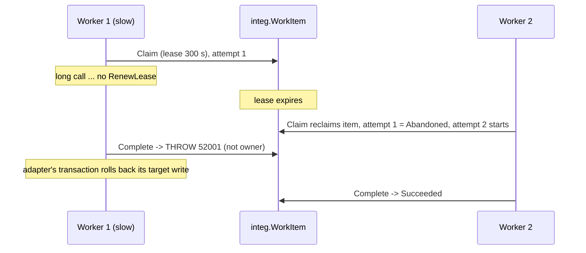

# Work-Item Ledger — Developer Guide

**Audience:** developers building or reusing an integration on the `integ` ledger  
**Companion to:** [OMSI_Integration_Target_Design.md](./OMSI_Integration_Target_Design.md) §5  
**Code:** [01_integ_tables.sql](./01_integ_tables.sql) (`integ.WorkItem`, `integ.WorkItemAttempt`), [02_integ_core_procs.sql](./02_integ_core_procs.sql) (all state transitions), [templates/usp_Adapter_Template.sql](./templates/usp_Adapter_Template.sql) (copy-and-fill adapter)  
**Executable specification:** [tests/40_state_machine_tests.sql](./tests/40_state_machine_tests.sql) covers every transition and guard below.

---

## 1. Mental model

- **One work item = one delivery of one fact to one target system.** A business event routed to two targets produces two work items, which succeed or fail independently.
- **The ledger holds all state; workers hold none.** A worker (SSIS task, SQL Agent job, .NET service, Azure Function) is a loop of *claim → do the work → report*. If a worker dies, nothing is lost: its claim simply expires.
- **Every state change goes through a procedure.** Application code never `UPDATE`s `integ.WorkItem` directly. The procedures enforce the guards, write the attempt log and keep the counters and alerts consistent.
- **The database clock is the only clock.** Leases, backoff and SLAs all use `SYSDATETIME()` on the server, so clock skew between worker hosts doesn't matter.

```
            ┌──────────── integ.usp_Outbox_Publish (or Replay) creates ───────────┐
            ▼                                                                       │
   Pending ──claim──► Leased ──complete──► Dispatched ──ack──► Succeeded             │
      ▲                 │  │                    │                                    │
      │                 │  └─complete (sync)────┼────────────► Succeeded             │
      │                 │                       └──reject────► DeadLetter            │
      │                 ├──fail: retryable────► RetryWait ──claim (when due)──► Leased
      │                 ├──fail: exhausted / non-retryable ──► DeadLetter            │
      │                 └──lease expires──► (reclaimed by next claim)                │
      └──operator Retry── DeadLetter / RetryWait                                     │
   Pending/RetryWait/DeadLetter ──newer snapshot / cancel──► Superseded              │
   Pending/RetryWait/DeadLetter ──operator Cancel──► Cancelled                       │
   Succeeded/Dispatched/Cancelled/Superseded ──operator Replay──► (new item) ────────┘
```

---

## 2. Anatomy of a work item

| Group | Columns | Notes |
|---|---|---|
| **Identity & lineage** | `WorkItemId`, `EventId` or `InboxMessageId`, `ParentWorkItemId` (replay of), `SupersededById` (replaced by) | `CK_WI_Source`: every item comes from an outbox event or an inbox message |
| **Routing** | `OperationCode` → `OperationCatalog`, `TargetSystem` | The catalog row decides the adapter, semantics, priority, whether acknowledgement is required, and retry policy |
| **Ordering** | `OrderingKey` (e.g. `Shipment:4171753`), `Priority` (1 = highest) | FIFO is per (`OrderingKey`, `TargetSystem`); priority applies only *across* entities |
| **State** | `Status`, `StatusReason` | Constrained by `CK_WI_Status` |
| **Lease** | `LeaseOwner`, `LeaseExpiresAt` | Set only while `Leased` |
| **Retry** | `AttemptCount` (lifetime), `RetryBudgetBase`, `NextAttemptAt` | Policy counts `AttemptCount - RetryBudgetBase` (attempts since the last manual retry) |
| **Outcome** | `ExternalRef` (target's id, e.g. OMSI `operation_id`), `LastErrorClass`, `LastErrorMessage`, `LastErrorCatalogId`, `DispatchedAt`, `CompletedAt` | `ExternalRef` correlates asynchronous acknowledgements |
| **Idempotency** | `IdempotencyKey` (unique) | `<Target>\|<Op>\|<EventUid>`; replays add `\|R<n>`. Send it to the target. |
| **Concurrency** | `RowVer` (rowversion) | For optimistic checks in UIs |

**`integ.WorkItemAttempt`** has one row per claim: `AttemptNo`, `RunId`, `LeaseOwner`, start/end, `Outcome` (`Dispatched`/`Succeeded`/`Failed`/`Abandoned`), error details and request/response snapshots. A row with `EndedAt IS NULL` is the attempt currently in flight. **`integ.OperatorAction`** audits every human intervention.

---

## 3. States

| State | Meaning | Open? | Claimable? | Blocks later items of same entity? | Set by |
|---|---|---|---|---|---|
| `Pending` | Ready to be worked | yes | yes, when `NextAttemptAt <= now` | yes | Publish, Replay, operator Retry |
| `Leased` | A worker owns it until `LeaseExpiresAt` | yes | only after the lease expires | yes | Claim |
| `RetryWait` | Failed transiently; waiting for backoff | yes | yes, when `NextAttemptAt <= now` | yes | Fail |
| `Dispatched` | Handed to an **asynchronous** target; awaiting acknowledgement | yes (awaiting ack) | no | **no** (see §8) | Complete (when `RequiresAck = 1`) |
| `DeadLetter` | Needs a human, or a newer snapshot | yes | no | yes | Fail; inbound rejection |
| `Succeeded` | Done | terminal | no | no | Complete (sync), ack, Duplicate classification |
| `Superseded` | Replaced by a newer item (snapshot or cancel) | terminal | no | no | Publish |
| `Cancelled` | Withdrawn by operator, or a cancel that had nothing to cancel | terminal | no | no | Operator Cancel, Publish |

Terminal rows are never changed again. To re-send, **Replay** creates a new, linked item.

---

## 4. Transitions: complete reference

| # | From → To | Trigger (procedure) | Guard (must be true) | Side effects |
|---|---|---|---|---|
| T1 | ∅ → `Pending` | `usp_Outbox_Publish` | Event routed by `EventRoute` to an active `OUT` operation | Idempotency key; may supersede or promote older items (§9) |
| T2 | `Pending`/`RetryWait` → `Leased` | `usp_WorkItem_Claim` | `NextAttemptAt <= now`; no earlier open item for same entity and target; row not locked by another claimer | `AttemptCount + 1`; new `WorkItemAttempt`; `ProcessRun.ItemsClaimed` |
| T3 | `Leased` (expired) → `Leased` (new owner) | `usp_WorkItem_Claim` | `LeaseExpiresAt < now` | Previous attempt closed as `Abandoned`; new attempt |
| T4 | `Leased` → `Leased` (extended) | `usp_WorkItem_RenewLease` | Caller is `LeaseOwner` and lease not yet expired | `LeaseExpiresAt` moved; run heartbeat. Throws `52002` otherwise. |
| T5 | `Leased` → `Dispatched` | `usp_WorkItem_Complete` | Caller is `LeaseOwner`; `RequiresAck = 1` | `ExternalRef`, `DispatchedAt`; attempt `Dispatched`. Throws `52001` if lease lost. |
| T6 | `Leased` → `Succeeded` | `usp_WorkItem_Complete` | Caller is `LeaseOwner`; `RequiresAck = 0` | `CompletedAt`; attempt `Succeeded` |
| T7 | `Leased` → `RetryWait` | `usp_WorkItem_Fail` | Caller is `LeaseOwner`; class retryable; `AttemptCount - RetryBudgetBase < MaxAttempts` | `NextAttemptAt = now + backoff`; attempt `Failed` with error |
| T8 | `Leased` → `DeadLetter` | `usp_WorkItem_Fail` | Not retryable, or budget exhausted | Critical alert `DEADLETTER:WI:<id>` |
| T9 | `Leased` → `Succeeded` | `usp_WorkItem_Fail` | Class = `Duplicate` (target says it already has it) | Recorded as success; return `2` |
| T10 | `Dispatched` → `Succeeded` | `omsi_adp.usp_ProcessInbound` (any inbound processor) | Ack correlates on `ExternalRef`, result OK | `CompletedAt` |
| T11 | `Dispatched` → `DeadLetter` | inbound processor | Ack correlates, result = rejection | Critical alert |
| T12 | `DeadLetter`/`RetryWait` → `Pending` | `usp_WorkItem_Retry` | — | `RetryBudgetBase = AttemptCount` (fresh budget); alert resolved; `OperatorAction` |
| T13 | `Pending`/`RetryWait`/`DeadLetter` → `Cancelled` | `usp_WorkItem_Cancel` | — | Alert resolved; `OperatorAction`; followers released |
| T14 | `Pending`/`RetryWait`(/`DeadLetter`) → `Superseded` | `usp_Outbox_Publish` | Newer snapshot of same op (`SupersedeScope`) or a terminal op (cancel) | `SupersededById`; dead-letter alert resolved |
| T15 | completed → new `Pending` item | `usp_WorkItem_Replay` | Source is `Succeeded`/`Dispatched`/`Cancelled`/`Superseded` | New key `…\|R<n>`, `ParentWorkItemId`; `OperatorAction` |

A transition attempted from the wrong state throws (`52010`–`52012` for operator actions) or returns `-1` (`Fail` without the lease). It never silently corrupts state.

---

## 5. Invariants (assert these in any reuse)

1. `Status = 'Leased'` ⇔ `LeaseOwner IS NOT NULL AND LeaseExpiresAt IS NOT NULL`.
2. At most **one** open attempt (`EndedAt IS NULL`) per work item, and it belongs to the current `LeaseOwner`.
3. Only the current lease owner can move an item out of `Leased`. Everyone else is fenced (`52001`, `52002`, `-1`).
4. For a given (`OrderingKey`, `TargetSystem`), at most one item is `Leased` at a time, and it's the oldest open one.
5. `AttemptCount` = number of `WorkItemAttempt` rows.
6. Terminal states (`Succeeded`, `Superseded`, `Cancelled`) never change.
7. `IdempotencyKey` is unique across the ledger and stable across retries of the same item.

Health check you can schedule (returns no rows when the ledger is consistent):
```sql
SELECT 'lease fields inconsistent with status' AS violation, WorkItemId FROM integ.WorkItem
 WHERE (Status = 'Leased'  AND (LeaseOwner IS NULL OR LeaseExpiresAt IS NULL))
    OR (Status <> 'Leased' AND (LeaseOwner IS NOT NULL OR LeaseExpiresAt IS NOT NULL))
UNION ALL
SELECT 'multiple open attempts', WorkItemId FROM integ.WorkItemAttempt
 WHERE EndedAt IS NULL GROUP BY WorkItemId HAVING COUNT(*) > 1
UNION ALL
SELECT 'AttemptCount differs from attempt rows', w.WorkItemId FROM integ.WorkItem w
 WHERE w.AttemptCount <> (SELECT COUNT(*) FROM integ.WorkItemAttempt a WHERE a.WorkItemId = w.WorkItemId)
UNION ALL
SELECT 'more than one lease per entity and target', MIN(WorkItemId) FROM integ.WorkItem
 WHERE Status = 'Leased' GROUP BY OrderingKey, TargetSystem HAVING COUNT(*) > 1;
```

---

## 6. Claim: internal logic (`usp_WorkItem_Claim`)

```sql
WITH c AS (
    SELECT TOP (@BatchSize) ...
      FROM integ.WorkItem w WITH (UPDLOCK, READPAST, ROWLOCK)
     WHERE ((w.Status IN ('Pending','RetryWait') AND w.NextAttemptAt <= @Now)      -- due work
            OR (w.Status = 'Leased' AND w.LeaseExpiresAt < @Now))                 -- abandoned work
       AND (@TargetSystem IS NULL OR w.TargetSystem = @TargetSystem)
       AND (@OperationCode IS NULL OR w.OperationCode = @OperationCode)
       AND NOT EXISTS (SELECT 1 FROM integ.WorkItem p                            -- per-entity FIFO
                        WHERE p.OrderingKey = w.OrderingKey AND p.TargetSystem = w.TargetSystem
                          AND p.WorkItemId < w.WorkItemId
                          AND p.Status IN ('Pending','Leased','RetryWait','DeadLetter'))
     ORDER BY w.Priority, w.WorkItemId
)
UPDATE c SET Status = 'Leased', LeaseOwner = @LeaseOwner,
             LeaseExpiresAt = DATEADD(SECOND, @LeaseSeconds, @Now), AttemptCount += 1
OUTPUT inserted.WorkItemId, inserted.AttemptCount, deleted.Status INTO @Claimed;
```

| Element | Why it's there |
|---|---|
| **Updatable CTE + `OUTPUT`** | Select and mark in **one statement**. No gap between "find" and "take" in which another worker could take the same row. |
| `UPDLOCK` | Rows being examined get update locks, so two claimers can't both pass the predicate on the same row. |
| `READPAST` | Rows already locked by another claimer are **skipped, not waited on**. Concurrent workers spread across different rows (competing consumers). |
| `ROWLOCK` | Keeps locks at row level so claimers don't block each other with page locks. |
| `NOT EXISTS` (no `READPAST`) | The FIFO check must see *every* earlier open item, including one locked by another claimer at that moment. It waits briefly rather than skipping, which is the safe direction. |
| `deleted.Status` | Tells us which rows were reclaimed from an expired lease, so their previous attempt can be closed as `Abandoned`. |
| `ORDER BY Priority, WorkItemId` | Priority first (cancellations are priority 1), then oldest. FIFO *within* an entity is enforced by `NOT EXISTS`, not by this ordering. |
| Filtered index `IX_WI_Claim` (open states only) | The claim scans only open items, however large the history grows. `IX_WI_Ordering` serves the FIFO subquery. |

**After commit**, the procedure returns the claimed items with everything the worker needs: payload, idempotency key, adapter name, correlation id and entity. If the worker crashes before reading the result, the items wait until the lease expires (T3), then return to the queue.

**Concurrency result:** 8 parallel dispatchers on 400 items processed each item exactly once, with no duplicates and no lost items (design doc §11).

---

## 7. Leases and fencing



- **Fencing** works because `Complete`, `Fail` and `RenewLease` all filter on `LeaseOwner = @LeaseOwner`. A worker that lost its lease can't overwrite the new owner's outcome.
- **Why the target write must be in the same transaction as `Complete`:** when `Complete` throws `52001`, `XACT_ABORT` rolls back the stale worker's target write too, so only the current owner's write survives. That's guaranteed only for targets on the same SQL instance. For external targets (HTTP), the **target** must dedupe by `IdempotencyKey`.
- **Lease sizing:** `@LeaseSeconds` must exceed the worst-case duration of one item. For long steps, call `usp_WorkItem_RenewLease` at about half the lease interval. It refuses (`52002`) once the lease has expired, because the item may already be reclaimed; renewal never resurrects a lost lease.
- **`LeaseOwner` format:** `<ProcessName>#<RunId>`, unique per run, so attempts trace back to an exact SSIS execution (`ProcessRun`).

---

## 8. Complete: sync vs async targets (`usp_WorkItem_Complete`)

| `OperationCatalog.RequiresAck` | Target type | `Complete` sets | Final state reached by |
|---|---|---|---|
| `0` | Synchronous: API call, SQL table with immediate effect | `Succeeded` | `Complete` itself |
| `1` | Asynchronous: OMSI (vendor polls and replies later) | `Dispatched`, `ExternalRef` = target id | Inbound processor (T10 / T11) |

**`Dispatched` does not block** later items of the same entity. Ordering is guaranteed **at hand-off**, not at acknowledgement: a modify can be handed to OMSI before OMSI acknowledges the create. This relies on the target processing hand-offs in order (OMSI: ascending `operation_id`). If a future target can't guarantee that, add `'Dispatched'` to the blocking set in the FIFO predicate for that target.

**No automatic re-send after a missing acknowledgement.** An overdue item raises `AckOverdue` (`vw_AwaitingAck` shows where it's stuck). An operator **Replays** it once the cause is understood. Automatically re-sending to an asynchronous target risks duplicates the target can't detect.

---

## 9. Fail: classification, retry decision, backoff (`usp_WorkItem_Fail`)

**Step 1, classify.** If the caller passes `@ErrorClass`, it's used. Otherwise the first `integ.ErrorCatalog` row (by `MatchOrder`) whose `MatchErrorNumber` and/or `MatchPattern` matches wins. If nothing matches, the class is `Unknown`.

| Class | Retryable | Typical sources | Effect |
|---|---|---|---|
| `Transient` | yes | 1205 deadlock, 1222 lock timeout, −2 timeout, HTTP 5xx | backoff, then retry |
| `Auth` | yes (slow) | HTTP 401 | backoff, then retry |
| `Unknown` | yes (few) | anything uncatalogued | backoff; add a catalog rule |
| `Data` | no | 547 FK, 2627/2601 inside target writes | `DeadLetter`; fix source data (a newer snapshot supersedes it) |
| `Mapping` | no | `No mapping:` prefix | `DeadLetter`; add the `ValueMap` row, then Retry |
| `Contract` | no | `Contract:` prefix, missing adapter | `DeadLetter`; fix code or config |
| `Duplicate` | — | HTTP 409, `Duplicate:` prefix | **`Succeeded`** (already applied) |

**Step 2, policy.** `integ.RetryPolicy` for (operation, class), falling back to the default (operation `NULL`).

**Step 3, decide.** With `budget = AttemptCount - RetryBudgetBase`:
- `Duplicate` → `Succeeded`
- retryable and `budget < MaxAttempts` → `RetryWait`
- otherwise → `DeadLetter`

**Backoff formula:**
```
delay  = min(MaxDelaySeconds, BaseDelaySeconds × BackoffFactor^(budget − 1))
delay += random(0 .. delay/10)                       -- jitter, avoids synchronized retry storms
NextAttemptAt = now + delay
```

Worked example, default `Transient` policy (base 30 s, factor 2, max 1800 s, 10 attempts):

| Attempt that failed | 1 | 2 | 3 | 4 | 5 | 6 | 7 | 8 | 9 | 10 |
|---|---|---|---|---|---|---|---|---|---|---|
| Next try after | 30 s | 1 min | 2 min | 4 min | 8 min | 16 min | 30 min (cap) | 30 min | 30 min | **DeadLetter** |

That's about 2 hours of automatic retrying before a human is involved.

> **Scheduler granularity matters.** `NextAttemptAt` is the *earliest* retry time. With SSIS running every 10 minutes, a 30-second backoff effectively becomes "next run". Size policies to the scheduler, or run the dispatcher more often for operations with tight SLAs (e.g. cancellations).

**Return codes** (the caller decides nothing; this is for logging): `0` RetryWait, `1` DeadLetter, `2` Duplicate→Succeeded, `-1` lease lost (nothing recorded; the new owner's attempt is authoritative).

**Rule:** call `Fail` **after** rolling back your business transaction. If `Fail` ran inside it, the failure record would be rolled back with the work.

---

## 10. Ordering, supersede and promotion (how publish interacts with the queue)

- **Ordering key granularity is your design choice.** It's the unit of "must happen in order". Use the business entity (`Shipment:<n>`). Use a finer key (`Shipment:<n>:Financial`) to keep unrelated streams from blocking each other (design doc §14 item 11).
- **Snapshot operations** (`PayloadSemantics = 'Snapshot'`): a newer item supersedes older undelivered ones according to `SupersedeScope` (`Unsent` or `UnsentAndDeadLetter`). If the create was never delivered, the snapshot can be **promoted** to the create (`PromoteToOperationCode`). This is how a newer LumberTrack revision clears a dead letter without operator action.
- **Event operations** (`'Event'`): nothing is ever superseded. A dead-lettered event blocks later events of the same key until an operator retries or cancels it. Every financial fact is delivered exactly once, in order.
- **Terminal operations** (`IsTerminal = 1`, e.g. cancel) supersede everything still open for that entity. If nothing was ever delivered, the cancel itself is closed as `Cancelled` and not sent.

Details: design doc §4.3 and §13.3.

---

## 11. Operator actions

| Action | Allowed from | Result | Retry budget | Alert |
|---|---|---|---|---|
| `usp_WorkItem_Retry` | `DeadLetter`, `RetryWait` | `Pending`, due now, **same** idempotency key | Fresh (`RetryBudgetBase = AttemptCount`) | Resolved |
| `usp_WorkItem_Cancel` | `Pending`, `RetryWait`, `DeadLetter` | `Cancelled`; followers unblocked | — | Resolved |
| `usp_WorkItem_Replay` | `Succeeded`, `Dispatched`, `Cancelled`, `Superseded` | **New** item, key `…\|R<n>`, `ParentWorkItemId` set | New item, full budget | — |

All three write `integ.OperatorAction` (who, when, why). Use **Retry** when the same delivery should be tried again; the target dedupes by key. Use **Replay** when a completed delivery must deliberately be sent again.

---

## 12. Worker contracts

### 12.1 SQL adapter (target on the same SQL instance)

Copy [templates/usp_Adapter_Template.sql](./templates/usp_Adapter_Template.sql). The skeleton:

```sql
CREATE OR ALTER PROCEDURE <schema>.usp_Send<Thing> @WorkItemId bigint, @LeaseOwner nvarchar(128)
AS BEGIN
  SET NOCOUNT ON; SET XACT_ABORT ON;
  -- 1 read payload from integ.WorkItem + OutboxEvent/InboxMessage
  BEGIN TRY
    -- 2 validate ('Contract: ...') and map ('No mapping: ...') BEFORE touching the target
    BEGIN TRANSACTION;
      -- 3 idempotent target write (upsert for Snapshot; insert-if-key-absent for Event)
      EXEC integ.usp_WorkItem_Complete @WorkItemId, @LeaseOwner, @ExternalRef = <target id>;  -- 4 same tran
    COMMIT; RETURN 0;
  END TRY
  BEGIN CATCH
    IF @@TRANCOUNT > 0 ROLLBACK;                                                             -- 5 rollback first
    EXEC integ.usp_WorkItem_Fail @WorkItemId, @LeaseOwner, ERROR_NUMBER(), ERROR_MESSAGE(), ...;
    RETURN 1;                                                                                -- never re-throw
  END CATCH
END
```

Run it with the generic loop: `EXEC integ.usp_Dispatch @TargetSystem = '<TARGET>', @ProcessName = N'<job name>';`

### 12.2 External worker (HTTP API, file, message broker)

A sketch (C#, not compiled). The same contract applies to an SSIS Script Task.

```csharp
long runId = Db.Exec("integ.usp_Run_Start", processName);              // OUTPUT @RunId
string owner = $"{processName}#{runId}";
try {
  while (true) {
    var items = Db.Query("integ.usp_WorkItem_Claim",
        new { RunId = runId, LeaseOwner = owner, BatchSize = 20, LeaseSeconds = 300, TargetSystem = "LT_API" });
    if (items.Count == 0) break;
    foreach (var it in items) {
      using var heartbeat = StartTimer(every: 120s,                       // < LeaseSeconds / 2
          () => Db.Exec("integ.usp_WorkItem_RenewLease", it.WorkItemId, owner, 300));   // 52002 => cancel work
      try {
        var resp = await http.PostAsync(url, body(it.PayloadJson), headers: new {
            Idempotency_Key = it.IdempotencyKey, X_Correlation_Id = it.CorrelationId });
        if (resp.IsSuccess)
          Db.Exec("integ.usp_WorkItem_Complete", it.WorkItemId, owner, externalRef: resp.TxnId,
                  request: Mask(body), response: Mask(resp.Body));
        else
          Db.Exec("integ.usp_WorkItem_Fail", it.WorkItemId, owner, errorMessage: $"HTTP {(int)resp.Status} {resp.Body}",
                  request: Mask(body), response: Mask(resp.Body));      // ErrorCatalog: 409=Duplicate, 5xx=Transient
      }
      catch (SqlException ex) when (ex.Number is 52001 or 52002) { /* fenced: another worker owns it; do nothing */ }
      catch (Exception ex) { Db.Exec("integ.usp_WorkItem_Fail", it.WorkItemId, owner, errorMessage: ex.Message); }
    }
  }
  Db.Exec("integ.usp_Run_End", runId, "Succeeded");
} catch (Exception ex) { Db.Exec("integ.usp_Run_End", runId, "Failed", ex.Message); throw; }
```

Rules for external workers:
- **Always send `IdempotencyKey`**, and the target must reject repeats. External calls can't share a transaction with the ledger, so a crash between the call and `Complete` *will* cause a retry.
- **Treat `52001`/`52002` as "stop, someone else owns this"**, never as an error to retry.
- Snapshots stored in `RequestSnapshot`/`ResponseSnapshot` must be **masked** (personal data, secrets).

---

## 13. Reuse checklist: onboarding a new integration

1. **Name the entity and its ordering key** (what must stay in order?).
2. **Choose semantics per operation:**
   - Snapshot or Event?
   - `SupersedeScope`?
   - Promotion target?
   - Terminal?
   - Sync (`RequiresAck = 0`) or async?
3. **Register configuration** (no code): `OperationCatalog`, `EventRoute` (outbound) and/or `InboundRoute` (inbound), `ValueMap`, `SlaThreshold`, optionally `RetryPolicy` and `ErrorCatalog` rules with business meaning and owner team.
4. **Write the adapter** from the template (SQL target) or the external-worker contract (HTTP, file, broker).
5. **Publish** from your detector with `usp_Outbox_Publish`, passing the source revision as `@SourceChangeVersion`.
6. **Schedule:**
   - `integ.usp_Dispatch @TargetSystem = '<TARGET>'` (SQL adapters), or your external worker
   - `integ.usp_Monitor_Evaluate` (already scheduled for all targets)
7. **Test:** copy [tests/40_state_machine_tests.sql](./tests/40_state_machine_tests.sql) and run the same cases against your adapter, plus a parallel-dispatch test (design doc §6.3).
8. **Dashboard:** no work needed. `vw_Backlog`, `vw_DeadLetter`, `vw_AwaitingAck` and `vw_EntityTimeline` pick up the new operation automatically.

---

## 14. Developer runbook queries

```sql
-- What is waiting, per operation and state
SELECT * FROM integ.vw_Backlog ORDER BY TargetSystem, OperationCode, Status;

-- Full story of one entity (events, attempts, errors, inbound, state changes)
SELECT * FROM integ.vw_EntityTimeline WHERE SourceKey = N'4171753' ORDER BY At;

-- Attempt history of one work item
SELECT AttemptNo, LeaseOwner, StartedAt, EndedAt, Outcome, ErrorClass, ErrorNumber, ErrorMessage
  FROM integ.WorkItemAttempt WHERE WorkItemId = @id ORDER BY AttemptNo;

-- Why is this item not being picked up? (blocked by an earlier open item of the same entity)
SELECT p.WorkItemId, p.OperationCode, p.Status, p.NextAttemptAt, p.LastErrorMessage
  FROM integ.WorkItem w JOIN integ.WorkItem p
    ON p.OrderingKey = w.OrderingKey AND p.TargetSystem = w.TargetSystem AND p.WorkItemId < w.WorkItemId
 WHERE w.WorkItemId = @id AND p.Status IN ('Pending','Leased','RetryWait','DeadLetter');

-- Leases held right now, and whether the holder is alive
SELECT w.WorkItemId, w.LeaseOwner, w.LeaseExpiresAt, r.HeartbeatAt, r.Status
  FROM integ.WorkItem w
  JOIN integ.WorkItemAttempt a ON a.WorkItemId = w.WorkItemId AND a.EndedAt IS NULL
  JOIN integ.ProcessRun r ON r.RunId = a.RunId
 WHERE w.Status = 'Leased';
```

---

## 15. Edge cases and FAQ

| Situation | What happens |
|---|---|
| Worker crashes **before** the target write commits | Transaction rolls back; item stays `Leased` until the lease expires, then is reclaimed (`Abandoned` attempt recorded). |
| Worker crashes **after** commit, before returning | Already `Dispatched`/`Succeeded` (committed with the target write). Nothing to redo. |
| External call succeeded, worker crashed before `Complete` | Lease expires, item retried with the **same** key, target answers 409 → `Duplicate` → `Succeeded`. Needs target idempotency. |
| Same event published twice | Second publish returns `1` (duplicate key). No second work item. |
| Claim transaction is a deadlock victim | No rows changed; the caller just claims again on the next loop or run. |
| Adapter has a bug that throws before its `TRY` (missing object) | The dispatcher's per-item `TRY/CATCH` records it on that item (`Unknown` → retries → `DeadLetter`); other items continue. |
| Operation misconfigured (no adapter) | `Contract` dead letter for each of its items; visible immediately on the dashboard. |
| An item sits in `RetryWait` with a far-future `NextAttemptAt` | It blocks only its own entity. Operator `Retry` makes it due now with a fresh budget. |
| History grows large | Claim uses filtered indexes on open states only; `usp_Ledger_Purge` removes completed history in batches and never purges open or dead-lettered items. |
| Need stricter ordering (wait for ack) | Add `'Dispatched'` to the FIFO blocking set for that target (§8). |

---

## 16. Test coverage (tests/40_state_machine_tests.sql)

| Test | Transitions and guards verified |
|---|---|
| T1 | T1, T2, T6 through the generic dispatcher; target filter isolates other targets |
| T2 | T15 Replay: new linked item and key; idempotent target write (one row) |
| T3 | T8 on first attempt for a non-retryable class (Mapping) |
| T4 | T4 RenewLease keeps ownership past the original lease; renewal refused after completion (`52002`) |
| T5 | T3 reclaim after expiry, `Abandoned` attempt; stale worker fenced (`52001`), its target write rolled back |
| T6 | T7 → T8 when the budget is exhausted; T12 manual Retry grants a fresh budget |
| T7 | Per-entity FIFO: `RetryWait` blocks only later items of the same entity; other entities proceed |
| T8 | T13 Cancel releases followers; all operator actions audited |
| T9 | The §5 invariant query returns no violations after all of the above |
