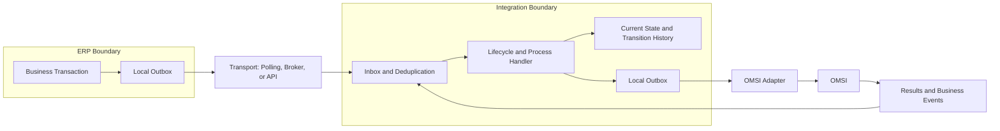
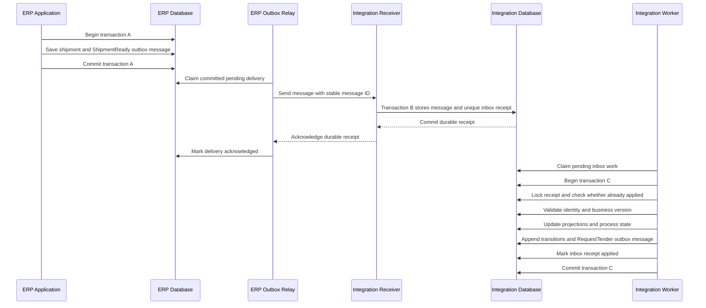

User: This is the middle layer of enterprise application integration implementation - shipment integration between ERP source systems and OMSI shipment procurement/tendering system. You are a master of integration solution architect and specialist. Please critique these two database programming object schema defintion source files: 1) OMSI database transaction processing logs tables; 2) custom stored procedures implementation how the ERP source systems interact with the OMSI - middle layer. Explain the design strategies and methodologies applied in this implementation. Perform a deep, solution design analysis on the effectiveness and practicality (in the real business world) by using this type of application integration pattern and any technical, design gaps you discovered. NOTE: custom stored procedures implementation quality is in questions but hope it provides the insight about how the OMSI middle layer was updated / transacted during the inbound and outbound updates. Always ask questions if needed. Reply with the techical quality and solid recommendation or summary.

GitHub Copilot: I’ll examine the stored procedures alongside the schema to trace inbound commands, outbound events, and transaction boundaries, then assess the integration pattern and its operational risks. I’ll separate confirmed code defects from design assumptions that need clarification.


Searched for files matching `**/*instructions*`, no matches

Read , lines 1 to 260

Read memory

The procedure export is UTF-16, so the file reader is showing bytes instead of SQL. I’ll read it with the correct encoding and identify the procedures that publish shipments and consume OMSI results; the export starts in a separate database, `LTInterforAux`.


Ran terminal command: Select-String -Path .\omsi_stored_proc_defintions.sql -Pattern '^CREATE\s+(PROCEDURE|PROC|TABLE|FUNCTION|TRIGGER|VIEW)|^ALTER\s+(PROCEDURE|PROC)|^USE ' -Encoding Unicode | ForEach-Object { '{0}: {1}' -f $_.LineNumber, $_.Line }

Read 

The custom export contains staging tables and transfer history as well as procedures, suggesting a database-backed integration adapter. I’m now tracing how it publishes complete shipment payloads and acknowledges returned events, since those paths determine retry and recovery behavior.


Ran terminal command: $sql = Get-Content .\omsi_stored_proc_defintions.sql -Encoding Unicode; foreach ($span in @(@(151,215),@(247,377),@(501,548),@(702,725),@(11800,12196))) { foreach ($index in ($span[0]..$span[1])) { '{0}: {1}' -f $index,$sql[$index-1] } }

Ran terminal command: $sql = Get-Content .\omsi_stored_proc_defintions.sql -Encoding Unicode; foreach ($span in @(@(4141,4226),@(4561,4657),@(4705,4741),@(8749,8870),@(9151,9372),@(9630,9729),@(11434,11535))) { foreach ($index in ($span[0]..$span[1])) { '{0}: {1}' -f $index,$sql[$index-1] } }

I’ve located the main shipment staging manager and the procedures for acknowledgements, appointments, tender awards, and payment readiness. I’ll compare their transaction boundaries to distinguish what SQL guarantees from what depends on the external integration service.


Read 

Read 

Two concrete risks are visible: shipment work is selected before its transaction without an atomic claim, and the ready-to-pay reader excludes events older than one hour despite a “24 hours” comment. I’ll check recovery and cleanup paths to see whether they compensate for these conditions.


Ran terminal command: $sql = Get-Content .\omsi_stored_proc_defintions.sql -Encoding Unicode; foreach ($span in @(@(176,193),@(247,377),@(501,548),@(702,725),@(4705,4740),@(12923,13006))) { foreach ($index in ($span[0]..$span[1])) { '{0}: {1}' -f $index,$sql[$index-1] } }

Ran terminal command: $sql = Get-Content .\omsi_stored_proc_defintions.sql -Encoding Unicode; foreach ($span in @(@(4141,4191),@(4561,4611),@(8749,8858),@(13035,13106))) { foreach ($index in ($span[0]..$span[1])) { '{0}: {1}' -f $index,$sql[$index-1] } }

Ran terminal command: $sql = Get-Content .\omsi_stored_proc_defintions.sql -Encoding Unicode; foreach ($span in @(@(2888,3110),@(3270,3434))) { foreach ($index in ($span[0]..$span[1])) { '{0}: {1}' -f $index,$sql[$index-1] } }

The schema separates commands (`operation` and payload tables) from returned events (`log_entry` and detail tables). The adapter also keeps transfer history and ERP flags. I’m checking how those separate records stay consistent, particularly after a failed ERP update or a delayed response.


Read 

Read 

Read 

Several acknowledgement procedures execute `THROW` before their rollback code, and ready-to-pay explicitly inserts `NULL` into a column declared `NOT NULL`. I’ll check the exported defaults and surrounding paths before treating the remaining omissions as defects; the deployment script may supply defaults not shown in the table bodies.


Ran terminal command: $sql = Get-Content .\omsi_stored_proc_defintions.sql -Encoding Unicode; foreach ($span in @(@(800,918),@(4821,4859),@(4972,5035),@(5170,5212),@(6393,6555))) { foreach ($index in ($span[0]..$span[1])) { '{0}: {1}' -f $index,$sql[$index-1] } }

Ran terminal command: $sql = Get-Content .\omsi_stored_proc_defintions.sql -Encoding Unicode; foreach ($span in @(@(8560,8723),@(10369,10593),@(11229,11405))) { foreach ($index in ($span[0]..$span[1])) { '{0}: {1}' -f $index,$sql[$index-1] } }

Ran terminal command: Select-String -Path .\omsi_stored_proc_defintions.sql -Encoding Unicode -Pattern 'CREATE (UNIQUE |NONCLUSTERED |CLUSTERED )*INDEX|sp_getapplock|READPAST|UPDLOCK|HOLDLOCK|snapshot|NOLOCK|READ UNCOMMITTED|begin distributed|openquery|linked|grant |execute as|checksum|hashbytes|watermark|AppointmentDatetimeAdjustment|CREATE.*FUNCTION|ispStageDataManager|StageTablesTruncate' | ForEach-Object { '{0}: {1}' -f $_.LineNumber, $_.Line }

The insurance manager contains application locking and `UPDLOCK`/`HOLDLOCK`, so concurrency safeguards are present in at least one path. I’ll compare that implementation with shipment and payment publishing to see which protections could be reused.


Read , lines 1 to 210

Read , lines 211 to 415

Read , lines 1 to 240

The table definition confirms the ready-to-pay `NULL` insert is invalid. Appointment and award history inserts are valid because `LogDate` has a default. I also found references to unexported functions for eligibility, revision detection, and timezone conversion, which limits what these two files alone can establish.


Ran terminal command: $sql = Get-Content .\omsi_stored_proc_defintions.sql -Encoding Unicode; foreach ($span in @(@(12196,12337),@(12338,12538),@(4859,4921))) { foreach ($index in ($span[0]..$span[1])) { $line = $sql[$index-1]; if ($line.Trim() -ne '' -and $line.Trim() -notlike '--*') { '{0}: {1}' -f $index,$line } } }

Ran terminal command: $sql = Get-Content .\omsi_stored_proc_defintions.sql -Encoding Unicode; foreach ($span in @(@(918,1039),@(2491,2546),@(2649,2746),@(7251,7389),@(9100,9150),@(13347,13376))) { foreach ($index in ($span[0]..$span[1])) { $line = $sql[$index-1]; if ($line.Trim() -ne '' -and $line.Trim() -notlike '--*') { '{0}: {1}' -f $index,$line } } }

Ran terminal command: $sql = Get-Content .\omsi_stored_proc_defintions.sql -Encoding Unicode; foreach ($span in @(@(5360,5637),@(6556,6887))) { foreach ($index in ($span[0]..$span[1])) { $line = $sql[$index-1]; if ($line -match 'decimal|sum\(|round\(|convert\(|cast\(|weight|cube|quantity|1899|early_stop|late_stop|preferred|case|when |timezone|insert |exec |CheckShp|Region|Friday|dateadd|datepart') { '{0}: {1}' -f $index,$line } } }

The mappings clearly account for real operating details: regional rules, equipment translation, pickup windows, contract orders, and invoice adjustments. The main concern is whether that business logic can be recovered reliably when processing fails. I’m finishing the financial and reconciliation checks before setting priorities.


Read , lines 1 to 190

Read , lines 191 to 339

Read , lines 1 to 350

Read 

The highest-risk financial path is now clear: freight-payment publishing has no local transaction and matches staged payments to transfer-log rows by their independent minimum IDs. The “orphan monitor” also changes unread commands after five minutes, even without checking for a missing payload. Both could cause problems during an outage, though their production impact depends on the caller and OMSI’s flag semantics.


Ran terminal command: $sql = Get-Content .\omsi_stored_proc_defintions.sql -Encoding Unicode; foreach ($span in @(@(4399,4447),@(6143,6174),@(6580,6608),@(7370,7389),@(9100,9150),@(13347,13376),@(11290,11355))) { foreach ($index in ($span[0]..$span[1])) { $line = $sql[$index-1]; if ($line.Trim() -ne '' -and $line.Trim() -notlike '--*') { '{0}: {1}' -f $index,$line } } }

Ran terminal command: Select-String -Path .\omsi_db_schema.sql -Pattern 'CREATE TABLE \[dbo\]\.\[(operation|log_entry|shipment|stop|commodity|freight_bill_log_entry|carrier_registration|SHIPMENT_CLIENT_VALUE)\]|\[contact_password\]|\[amount\] \[decimal\]\(10, 4\)|\[weight\] \[decimal\]\(18, 0\)|CREATE.*INDEX|FK_OPERATION2SHIP_CLIENT_VALUE' | ForEach-Object { '{0}: {1}' -f $_.LineNumber, $_.Line }

Ran terminal command: $sql = Get-Content .\omsi_stored_proc_defintions.sql -Encoding Unicode; foreach ($span in @(@(9372,9435),@(9436,9530),@(7679,7768))) { foreach ($index in ($span[0]..$span[1])) { $line = $sql[$index-1]; if ($line.Trim() -ne '' -and $line.Trim() -notlike '--*') { '{0}: {1}' -f $index,$line } } }

The payment reader also excludes a shipment once any payment has been exported, which conflicts with the manager’s stated support for invoice adjustments. The final review will separate defects visible in these files from guarantees that may exist in the missing SSIS jobs or OMSI processor.


Read 

**Assessment**
**Retain the database-interface pattern, but harden its delivery guarantees before extending it.** This is a practical legacy integration architecture with substantial business knowledge embedded in it. However, the supplied implementation has defects that can leave shipments unprocessed, misrepresent acknowledgements, or mishandle financial updates.

This is a static review of `omsi_db_schema.sql` and `omsi_stored_proc_defintions.sql`, focused on the principal integration paths. The SSIS packages, scheduled jobs, referenced functions, ERP constraints, and OMSI consumer are not supplied. Consequently, some end-to-end guarantees remain unverified. No files were changed or database operations executed.

**Priority Findings**
1. **Critical: a ready-to-pay procedure violates its own table contract.** `ispShipmentRecordReadyToPay` explicitly inserts `NULL` into `ShipmentTransferLogInbound.Operation`, declared `NOT NULL`. If invoked against this DDL, that insert fails, preventing the intended completion. Correct the operation value and test the entire transaction. See `omsi_stored_proc_defintions.sql:8837` and `omsi_stored_proc_defintions.sql:359`. Whether production invokes this procedure needs confirmation.

2. **Critical: payment publication is not locally atomic.** `ispStageFreightPaymentsManager` creates an already-ready operation, inserts its payload, deletes staging, and updates transfer history without a local transaction. Without an enclosing caller transaction, a failure can expose an incomplete command or leave an exported payment without matching history. It also pairs the minimum payment ID with the minimum transfer-log ID independently: equal row counts do not prove correspondence. Use an explicit payment-to-command key and one transaction per publication. `omsi_stored_proc_defintions.sql:12196`.

3. **High: subsequent payment adjustments can be excluded.** `ispShipmentsReadFreightPayments` treats any previously exported payment for a shipment as sufficient to exclude that shipment. That conflicts with the manager’s stated support for invoice adjustments. The integration identity should include the invoice/payment line and adjustment revision, not just shipment number. `omsi_stored_proc_defintions.sql:9490`.

4. **High: shipment dequeueing is concurrency-unsafe and can block unrelated work.** `ispStageDataManager` selects a pending row before starting its transaction, without claiming it. Concurrent workers can select the same row. Additionally, `MIN(id)` is calculated across operation types, with the requested type filtered afterward: a pending row of another type can make the manager return despite eligible work. Claim eligible work atomically inside the transaction. `omsi_stored_proc_defintions.sql:11846`.

5. **High: transaction and exception handling are inconsistent.** Several acknowledgement procedures execute `THROW` before their rollback code, making that cleanup unreachable. The shipment manager commits until `@@TRANCOUNT` reaches zero, potentially committing a caller’s transaction. The acknowledgement retry procedure can also exit without propagating an error after transaction-aborting failures or exhausted deadlock retries. Standardize transaction ownership, rollback-before-rethrow, and bounded retries with explicit final failure. Examples: `omsi_stored_proc_defintions.sql:4174`, `omsi_stored_proc_defintions.sql:12172`, `omsi_stored_proc_defintions.sql:8778`.

6. **High: outage handling can strand or suppress legitimate work.** Ready-to-pay selection accepts events approximately one minute to one hour old, despite a “24 hours” comment. Older unread events fall outside this reader. Separately, `ispOrphanOperationsMonitor` changes `is_read` to `2` after five minutes without checking payload completeness. If OMSI processes only `is_read = 0`, a normal outage could suppress valid commands. Aging should trigger alerts or controlled quarantine, not imply successful consumption. `omsi_stored_proc_defintions.sql:11465`, `omsi_stored_proc_defintions.sql:7251`.

7. **High: some acknowledgements are correlated too broadly.** Appointment acknowledgement updates all operation-2200 transfer rows for a shipment. The repair procedure likewise matches shipment and operation rather than a specific request. An older appointment can therefore acknowledge newer work. Payment acknowledgement also lacks a success-result filter. Correlate technical responses by exact command ID; do not infer acceptance merely from a related business event. `omsi_stored_proc_defintions.sql:4167`, `omsi_stored_proc_defintions.sql:13035`, `omsi_stored_proc_defintions.sql:13082`.

8. **High: sequencing is handled through heuristics rather than durable dependencies.** The appointment reader documents a race between market completion and carrier appointments, then uses delays and ERP flags as guards; those guards are not uniform across its `UNION` branches. The POD-date update joins all POD history for a shipment without selecting a particular event, allowing ambiguous results when multiple rows exist. Persist event identity, applicable shipment version, and prerequisite state. `omsi_stored_proc_defintions.sql:9220`, `omsi_stored_proc_defintions.sql:4885`.

9. **High: cleanup can destroy recovery evidence or pending payloads.** Inbound and outbound cleanup select by age without requiring successful terminal processing. Stage truncation clears shared payload tables but leaves `StageShipmentTransferLog`, potentially retaining work references whose payloads disappeared. Cleanup must distinguish completed, failed, quarantined, and pending work, with coordinated archival and restart behavior. `omsi_stored_proc_defintions.sql:2904`, `omsi_stored_proc_defintions.sql:3282`, `omsi_stored_proc_defintions.sql:12973`.

**Architecture**
The implementation is best understood as **asynchronous, database-backed messaging with a SQL adapter**, rather than simply transaction logging.

ERP-to-OMSI flow: eligibility/revision queries → vendor-shaped staging → operation plus shipment aggregate → OMSI processing → technical acknowledgement. Return flow: OMSI event envelope and detail → polling readers → ERP updates and transfer history → read acknowledgement. External orchestration appears to supply parts of both flows.

Several recognizable strategies are applied:
- **Store-and-forward and temporal decoupling:** durable database rows allow the producer and consumer to run at different times.
- **Command/event separation:** `operation` represents requested actions; `log_entry` represents results and notifications. Shipment detail tables belong to a particular operation, not necessarily the current business shipment.
- **Anti-corruption adapter:** equipment, transportation modes, addresses, regional rules, and ERP-specific fields are translated into OMSI’s vocabulary.
- **Metadata-driven routing:** eligibility, priorities, revision categories, and effective dates are partly configurable rather than entirely hard-coded.
- **Reconciliation and operational repair:** transfer history, integrity checks, orphan detection, and acknowledgement alerts acknowledge real production failure modes.

These are sensible choices. However, this is **not a demonstrated transactional outbox at the ERP source**, because atomic capture with the originating ERP transaction is not shown. Nor is it event sourcing: the logs are mutable, consumption flags change, and history is deleted. Delivery semantics are currently mixed, with both replay and omission risks.

**Schema Quality**
The strongest feature is the operation-scoped aggregate. Foreign keys preserve shipment/stop relationships, including commodity pickup and delivery references. Separate event envelopes and detail tables also make heterogeneous OMSI notifications manageable.

The principal structural gaps are:
- **Identity and isolation:** custom staging generally uses shipment number without a source-system namespace, immutable message ID, batch ID, or shipment revision key. Multiple ERPs or overlapping revisions could collide; deleting staging by shipment number could remove another run’s data.
- **Integrity and lifecycle:** foreign keys cannot ensure every ready operation has its required payload. Publication needs operation-specific validation and an explicit ready transition. Existing flags need documented semantics, especially values other than `0` and `1`.
- **Precision and meaning:** `decimal(10,4)` allows only six integer digits; weights and quantities frequently use scale zero despite fractional calculations upstream. Currency is deliberately blanked in one mapping, and package counts populate `number_of_pallets`. Confirm these choices against rail, consolidated loads, cross-border billing, and reporting requirements. `omsi_stored_proc_defintions.sql:6470`.
- **Performance and security:** the supplied exports show no persistent secondary indexes supporting the major queue/history access paths. Validate filtered queue and correlation indexes using actual plans. The password-capable carrier field requires explicit protection; the DDL alone does not establish whether plaintext is stored. `omsi_db_schema.sql:206`.

**Business Practicality**
This pattern is appropriate when OMSI officially supports database integration, volumes are manageable, SQL operations are mature, and seconds-to-minutes latency is acceptable. A broker is not automatically more reliable: moving the same acknowledgement and identity defects into messaging infrastructure would preserve the defects.

The trade-off is strong database coupling. Direct ERP writes, including financial inserts, can bypass application validations, audit behavior, or supported extension points unless the ERP vendor explicitly permits them. `omsi_stored_proc_defintions.sql:955`. Multiple independent reads and extensive `NOLOCK` usage also permit inconsistent shipment snapshots; revision detection is not equivalent to capturing a coherent payload.

The business rules show operational experience, but hard-coded branches, weekday arithmetic dependent on session settings, sentinel dates, and missing timezone functions make behavior difficult to certify. Appointment scheduling needs facility-local time and calendar semantics; integration audit timestamps should use a consistent UTC convention.

**Recommendations**
1. **Stabilize first:** repair the confirmed defects, establish caller transaction behavior, disable destructive timeout-based suppression pending investigation, and replace shipment-level payment deduplication.
2. **Formalize delivery:** add an adapter-owned message ledger with immutable IDs, source identity, business revision, explicit states, attempts, leases, retry timing, and structured errors. Enforce unique processing identities. Commit ERP effects and inbound receipt together where supported.
3. **Preserve boundaries:** retain the vendor interface as the final adapter. Publish complete, validated aggregates atomically; avoid changing vendor-owned contracts without approval. Use vendor-supported ERP APIs or extension procedures where required.
4. **Make recovery provable:** test concurrent workers, duplicate events, failures between publication steps, multi-hour outages, reordered award/appointment events, cancellation races, invoice adjustments, and daylight-saving transitions. Reconcile business outcomes, not merely row counts.

The target should be **at-least-once delivery with idempotent business effects**, explicit ordering where required, and no silent abandonment of pending work. The existing insurance manager’s locking is a useful local precedent, although its global timestamp cutoff also deserves review. `omsi_stored_proc_defintions.sql:12338`.

**Questions**
1. Which procedure variants are actually invoked by SSIS/jobs, and do callers supply transactions or enforce single-worker execution?
2. Are all three databases on one SQL Server instance, and are direct OMSI/ERP writes vendor-supported?
3. What do OMSI flag values `0`, `1`, and `2` mean, and what isolation level does its consumer use?
4. Must the solution support multiple ERPs, partial payments, invoice corrections, multi-stop shipments, and extended outages?

**Bottom line:** the integration pattern is defensible; its current reliability contract is not yet sufficiently explicit or consistently implemented for enterprise-critical shipment and financial processing. Harden that contract before considering a platform replacement.

User: Expand further on "Schema Quality" technically - by its design: what are the good parts? Why you call them solid? Explain their technical re-useability in the current business world. What are the lagging parts? Why? Your audience is solution integration designers and developers who understand CQRS - data modeling... who are trying to research on an effective integration solution among ERP business applications.

GitHub Copilot: I’ll ground the expanded critique in the schema’s keys, relationships, and lifecycle fields, then distinguish reusable integration patterns from limitations of this particular data model.


Ran terminal command: Select-String -Path .\omsi_db_schema.sql -Pattern '^CREATE TABLE|^ALTER TABLE|\[operation_id\]|\[log_entry_id\]|\[is_ready\]|\[is_read\]|\[result_code\]|\[creation_timestamp\]|\[process_time\]' | ForEach-Object { '{0}: {1}' -f $_.LineNumber, $_.Line }

The key distinction is that `operation_id` identifies an integration request, not the long-lived shipment. I’ll use that distinction to explain why the operation-scoped payload model is useful, and why it does not by itself provide versioning, idempotency, or CQRS guarantees.


Ran terminal command: $sql = Get-Content .\omsi_db_schema.sql; foreach ($span in @(@(849,867),@(1017,1035),@(1562,1575),@(1790,1810),@(1977,1998))) { foreach ($index in ($span[0]..$span[1])) { '{0}: {1}' -f $index,$sql[$index-1] } }

**Design Verdict**
The strongest interpretation of this schema is **a relational integration contract with operation-scoped payloads**, not an operational shipment database and not merely a logging database.

That distinction matters. Much of its apparent denormalization is appropriate for integration. Its weaknesses lie primarily in identity semantics, lifecycle modeling, versioning, and recovery support, rather than in using relational tables.

Here, “solid” means that a design choice establishes a useful invariant, reduces coupling, or enables reliable processing. It does **not** mean the entire implementation is production-safe.

**CQRS Position**
The schema separates requested actions in `omsi_db_schema.sql:1017` from results and notifications in `omsi_db_schema.sql:849`. This is compatible with CQRS, but is not sufficient to establish CQRS: neither side is necessarily a business read model, and the schema does not demonstrate separate domain models or projection management.

Four identities should be distinguished:

| Identity | Existing representation | Meaning |
|---|---|---|
| Business identity | `client_key_1..4` | Which source-system shipment this concerns |
| Command instance | `operation_id` | Which integration request was submitted |
| Result/event instance | `log_entry_id` | Which returned occurrence was recorded |
| Business version | No explicit universal representation | Which shipment revision the request or event describes |

The first three are useful foundations. The missing fourth becomes important when revisions, retries, cancellations, and delayed events overlap.

**Strong Parts**
1. **Operation-scoped aggregates preserve the submitted representation.** Each `omsi_db_schema.sql:1453` belongs to an operation; its stops and commodities are scoped to that operation too. A new shipment revision can therefore be represented under a new operation rather than overwriting the earlier request. This supports investigation of “what did we send?” independently of “what does ERP contain now?” It is reusable for purchase orders, invoices, inventory movements, and other document integrations. However, immutable retention is a processing discipline here, not a schema-enforced guarantee.

2. **The envelope/payload split separates transport concerns from business content.** Operation code, readiness, result, and timestamps reside in a common envelope; shipment-specific fields reside elsewhere. Dispatchers can inspect pending work without reading hundreds of business columns. Different command families can share scheduling and diagnostic infrastructure. Technically, this resembles relational subtype modeling with shared primary keys. It remains useful today, whether the next transport is SQL polling, an API, or a broker.

3. **Composite keys establish meaningful aggregate-local uniqueness.** Keys such as `(operation_id, sequence_number)` identify stop and commodity lines within a request. More importantly, commodity foreign keys reference stops using both operation and sequence: a commodity cannot accidentally reference a stop from another request. Because operation is the leading clustered-key column, retrieving one request’s children also has useful physical locality. This is stronger than merely assigning every row an unrelated surrogate ID.

4. **Payload snapshots appropriately duplicate external master data.** Addresses, contacts, carrier identifiers, and commodity descriptions are embedded rather than resolved exclusively through live ERP master records. That is often correct: a supplier-address change tomorrow should not reinterpret yesterday’s shipment submission. Such duplication reduces temporal coupling and makes messages more self-contained. The requirement is that these values form a coherent captured snapshot; several independent live queries do not automatically provide one.

5. **Command and result identities accommodate asynchronous business interaction.** A result has its own identity rather than being represented solely by a status overwrite on the command. That permits multiple recorded outcomes and distinguishes a technical response from later business notifications. Nullable `log_entry.operation_id` can also accommodate unsolicited events. This is useful in tendering, where acceptance of a request, carrier award, appointment, and delivery are different occurrences. Their relationships still need an explicit contract.

6. **Optional capabilities and extension values avoid one universal mega-table.** Ocean-specific information and client values are separated from the principal shipment payload. The `omsi_db_schema.sql:1562` also prevents duplicate names within an operation. This supports customer-specific additions without constantly altering the core table. Reuse is strongest when extensions remain peripheral; required financial, routing, or state-transition data should not disappear into untyped name/value attributes.

These choices are valuable because they combine **document-style integration semantics with relational integrity and SQL operability**. Their usefulness is not dependent on whether the architecture is called “modern.”

**Lagging Parts**
1. **Transport identity is not business idempotency.** An identity-generated `operation_id` guarantees a unique inserted row, not a unique intended action. Retrying the same ERP revision can generate another operation and another tender. Likewise, a local event-row ID may not identify a duplicated external occurrence. A durable contract needs a producer-issued message identity or deterministic action key, with enforced uniqueness. `SourceSystem + DocumentId + Revision + Action` may suit shipment commands; financial adjustments usually need their own transaction identity.

2. **Business correlation is structurally available but semantically underspecified.** Four client keys provide flexibility, but the schema does not explain their namespace, ownership, normalization, or uniqueness scope. Shipment `12345` is not globally meaningful across multiple ERPs or legal entities. Define those semantics before adding more systems. Existing key fields may carry the necessary namespace if the vendor contract permits; extra columns are not automatically required. Also preserve the distinction between source identity, OMSI identity, and integration message identity.

3. **Lifecycle flags do not describe a complete processing protocol.** Nullable `is_ready`, `is_read`, and result fields permit ambiguous combinations without visible checks. “Read” can mean fetched, validated, applied, rejected, or deliberately ignored, but those meanings are operationally different. This is manageable for one carefully controlled consumer; it becomes fragile with retries and multiple workers. Model publication, processing, acceptance, and business completion separately, with attempts, lease ownership, retry eligibility, and terminal disposition where needed.

4. **Foreign keys protect references, not aggregate completeness.** They establish that a stop’s shipment exists, but do not require a ready shipment command to contain appropriate stops and commodities. Nor do they prove that a referenced pickup stop has `is_pickup = 1`, or that exactly the correct payload subtype exists for an operation code. The discriminator and payload tables can disagree. Use declarative checks for local invariants and an operation-specific validation/publish boundary for cross-row requirements. A trigger-heavy universal solution would usually make this harder to maintain.

5. **Versioning and temporal semantics are insufficiently explicit.** A revision timestamp is not necessarily a reliable ordered business version. Creation time, occurrence time, observation time, publication time, and processing time answer different questions. Their absence makes stale-event rejection and causal ordering difficult. Technical timestamps should follow a consistent UTC convention; appointments need facility-local time, timezone identity, and daylight-saving interpretation. The existing generic `datetime` columns do not express those distinctions themselves.

6. **The model mixes durable facts with consumer progress.** Payloads and returned occurrences are valuable records; `is_read` is consumer state. A single shared flag can work for one consumer but cannot independently track ERP updates, analytics, audit, and notifications. For fan-out, retain an immutable message record and separate consumer receipts keyed by `(ConsumerId, MessageId)`. This is not an argument for event sourcing: a durable integration journal and consumer checkpoints can exist without making events the domain system of record.

7. **Some data types encode legacy interface constraints rather than domain precision.** Exact decimals are appropriate for financial values, but `decimal(10,4)` tops out at `999999.9999`; scale-zero weights and quantities can lose fractional detail. Generic strings obscure currency and unit validation. Conversely, `decimal(18,0)` identifiers may be deliberate vendor interoperability choices, not mistakes. Validate boundary ranges, rounding, conversion, and requiredness against real loads. Do not mechanically replace vendor types with preferred internal types.

8. **Operational identity and access paths need strengthening.** Some repeating result-detail tables lack an explicit primary key. That may reflect legitimate one-to-many payloads, but without a stable line identity it is difficult to distinguish duplicate ingestion from legitimate repeated charges. The supplied DDL also shows no persistent secondary queue/history indexes. Index actual claim and correlation predicates, and design retention around terminal processing states. Wide indexes or indiscriminate indexing of every foreign key would not be a substitute for workload analysis.

**Reuse Boundary**
The schema is more reusable as a **design pattern** than as a universal enterprise data model. Its field vocabulary is strongly OMSI-shaped. Requiring every ERP and future procurement platform to adopt that vocabulary would spread vendor coupling rather than remove it.

For multiple applications, separate three responsibilities: source adapters interpret ERP semantics; a governed integration contract carries stable identities and business meaning; the OMSI adapter translates that contract into the vendor’s tables. With only one ERP and one OMSI installation, that middle contract can be modest. A large canonical model is not a prerequisite.

The same applies to normalization. Keep message envelopes and relationships relationally rigorous, preserve necessary business snapshots, and expose convenient views or projections for consumers. Do not force downstream readers to reconstruct complex messages through undocumented joins.

**Recommended Evolution**
Preserve the vendor-owned schema where compatibility requires it. Add missing reliability semantics in an adapter-owned ledger and controlled publication procedures rather than casually changing OMSI’s contract.

The most important invariants are:
- One logical source action has one durable integration identity, even after retries.
- A published command contains a complete, validated payload from a defined business version.
- Applying an inbound event and recording its receipt are atomic where the ERP supports that transaction boundary.
- A stale event cannot silently overwrite a newer accepted state.
- Pending or failed work cannot disappear merely because it became old.
- Acknowledgements identify the exact request and state what was acknowledged: receipt, acceptance, or completion.

**Bottom line:** retain the operation-scoped aggregates, explicit relationships, snapshots, and envelope/payload separation. Strengthen identity, versioning, lifecycle, and recovery around them. Those additions turn a useful database interface into a dependable enterprise integration contract; CQRS or a message broker does not supply them automatically.

User: Let me ask you this way: what is the ideal database modeling you would recommend for ERP business application process integrations? how would you model it to catch the business entity (transactions) lifecycle effectively? Explain further technically if possible present the system diagrams and data process flows to illustrate your design patterns and methodologies. 

GitHub Copilot: **Recommended Model**
I recommend **a business lifecycle model supported by an immutable integration journal, transactional inbox/outbox, and explicit process state**. Do not make a message queue, transaction log, or single shipment-status column represent all four concerns.

This is a hybrid: normalized business identities and relationships, versioned message snapshots, append-only transition history, and mutable current-state projections. Full event sourcing is optional, not a prerequisite.

**System Architecture**

Each boundary commits its own database transaction. There is no assumption of one transaction spanning ERP, middleware, and OMSI. When the ERP cannot participate in an outbox transaction, use supported change tracking, CDC, or revision extraction with reconciliation; acknowledge that this has different capture guarantees.

**Separate The Lifecycles**
A shipment integration contains several independently evolving lifecycles:

| Concern | Example states | Authority |
|---|---|---|
| Shipment execution | Planned, Ready, Dispatched, Delivered, Cancelled | Agreed field/state ownership across ERP and TMS |
| Tender | Requested, Offered, Awarded, Rejected, Expired | Procurement/TMS |
| Freight invoice | Received, Audited, Approved, Disputed | Agreed finance/audit system |
| Payment | Scheduled, Paid, Reversed | ERP/finance |
| Integration delivery | Pending, Leased, Delivered, RetryScheduled, Quarantined | Integration runtime |
| Cross-system process | AwaitingAward, AwaitingERPUpdate, Completed, RequiresIntervention | Process coordinator |

**Delivery success is not business acceptance; business acceptance is not process completion.** A shipment can be delivered while its invoice is disputed. Model those as related entities or state dimensions, not competing values in one status column.

**Core Data Model**
The following are logical responsibilities, not necessarily one table each:

| Model | Important fields and constraints | Purpose |
|---|---|---|
| `BusinessEntity` | `EntityId`, tenant, entity type; unique source-system/company/type/external-key mapping | Stable identity independent of transport and vendor IDs |
| `EntityRelationship` | Parent, child, relationship type; optional effective dates | Orders-to-shipments, shipments-to-tenders, invoices-to-payments |
| `EntityState` | Entity, state dimension, current value, authority, version, last applied message | Fast current-state projection |
| `IntegrationMessage` | Message ID, command/event type, schema version, producer, correlation/causation IDs, occurrence/receipt times, immutable payload | What was requested or observed |
| `MessageEntity` | Message, entity, role, source version | Many-to-many correlation for consolidated shipments and split orders |
| `LifecycleTransition` | Entity/dimension, from/to, version, triggering message, actor, reason, rule version, effective/recorded times | Explainable business history |
| `ProcessInstance` and history | Process type, business key, state, concurrency version, deadline, triggering message | Durable cross-system workflow |
| `InboxReceipt`, `OutboxDelivery`, `DeliveryAttempt` | Consumer/message uniqueness; destination, lease, retry time, attempt result | Reliable delivery and processing progress |

Use typed columns for identity, states, amounts, currency, quantities, units, and indexed decision fields. Keep versioned payload snapshots for fidelity and evolution, using relational details or JSON as appropriate. Do not bury essential business invariants in generic name/value fields.

**Capture Business Meaning**
Prefer explicit commands such as `RequestShipmentTender` and facts such as `TenderAwarded`, `ShipmentDelivered`, or `PaymentReversed`. A generic `ShipmentUpdated` snapshot is still useful for synchronization, but does not explain business intent.

For example, `TenderAwarded` should identify the tender and shipment, carrier, agreed amount/currency, applicable version, occurrence time, and originating authority. Applying it can append an award transition, update the tender projection, advance a process, and enqueue an ERP-update command. Those local effects should commit together.

**Transactional Processing**
```mermaid
sequenceDiagram
    participant ERP
    participant Relay
    participant Handler
    participant DB as Integration Database
    ERP->>ERP: Commit business change and local outbox
    Relay->>Handler: Deliver message; duplicates are possible
    Handler->>DB: Begin local transaction
    Handler->>DB: Insert unique consumer/message receipt
    Handler->>DB: Validate authority, version, and transition
    Handler->>DB: Update state; append history; enqueue next command
    Handler->>DB: Commit
    Handler-->>Relay: Acknowledge durable processing
```
A duplicate receipt must suppress repeat effects. A committed transaction followed by a lost acknowledgement is therefore recoverable. Business rejection should also produce a durable disposition, rather than masquerading as an infrastructure retry.

**Concurrency And Ordering**
Use optimistic concurrency for business and process state: update using `WHERE Version = @ExpectedVersion`, verify the affected-row count, and increment the version atomically. Use atomic claims and expiring leases for delivery workers. These solve different problems.

Do not use timestamps or database identity values as universal business ordering. Preserve producer-owned entity versions where available; define ordering within the relevant entity/authority stream. Defer events with missing prerequisites, reconcile gaps, and reject or record stale updates according to explicit rules. A stale snapshot and a late financial adjustment do not deserve the same treatment.

**Process Coordination**
Use a durable process coordinator when completion requires several systems: request tender → receive award → validate carrier → update ERP → confirm completion. Persist deadlines and recovery decisions, not just successful steps.

Failures may require a compensating business action, not rollback: withdrawing a tender or reversing an accrual creates a new auditable transaction. An already dispatched shipment may require manual intervention. Neither database rollback nor automatic retry resolves that business decision.

**Practical Priorities**
Enforce unique producer/message and consumer/message identities, legal state values, valid entity relationships, and business-specific idempotency keys. Index pending-delivery eligibility, exact correlations, and entity history. Retain unresolved work independently of completed-history retention.

For OMSI, keep its operation/payload tables as the **vendor adapter contract**. Add the lifecycle, identity, process, and reliability models around that contract. The architectural objective is an explainable business history and recoverable business effects, regardless of whether transport uses SQL tables, APIs, or messaging.

User: Regenerate "Transactional Processing" mermaid diagram - it has a parse error.

GitHub Copilot: ```mermaid
sequenceDiagram
    participant ERP as ERP System
    participant Relay as Message Relay
    participant Handler as Integration Handler
    participant DB as Integration Database

    ERP->>ERP: Commit business change and outbox record
    Relay->>Handler: Deliver message
    Note over Relay,Handler: Duplicate delivery is possible

    Handler->>DB: Begin local transaction
    Handler->>DB: Check unique consumer and message identity

    alt Message already processed
        DB-->>Handler: Return recorded outcome
        Handler->>DB: End transaction without repeating effects
    else New message
        Handler->>DB: Insert inbox receipt
        Handler->>DB: Validate authority and business version
        Handler->>DB: Update lifecycle and process state
        Handler->>DB: Append transition history
        Handler->>DB: Insert outgoing commands into outbox
        Handler->>DB: Commit transaction
    end

    Handler-->>Relay: Acknowledge durable processing
```

The deduplication check and receipt insertion must be concurrency-safe, backed by a unique constraint. A transaction failure must roll back and leave the delivery unacknowledged for retry.

User: Expand further on "Event" and "Operation" (or "Message") handling and processing logic flows technically. How "transactional inbox/outbox" fits in this process flow design? How does it interact with ERP system and Message Relay for example.

You said: "Do not make a message queue, transaction log, or single shipment-status column represent all four concerns." How would you accomplish this design goal in this "Transactional processing" process flows.

GitHub Copilot: **Separate The Concepts**
An **event** is a fact, a **command** requests an action, and a **message** is the envelope carrying either. An **operation** is an execution of a requested action. These should be related, but not interchangeable.

| Concept | Shipment example | Processing meaning |
|---|---|---|
| Event | `ShipmentReady`, `TenderAwarded` | Record an occurrence and react according to business rules |
| Command | `RequestTender`, `ApplyCarrierAward` | Validate and attempt a specific action |
| Message | Envelope containing either | Identify, correlate, version, deliver, and deduplicate |
| Operation | OMSI operation `12345` | Track a particular target-side execution |
| Process | Procurement for shipment `S100` | Coordinate multiple commands and events over time |

An event is not automatically a valid state transition. A delayed `TenderAwarded` event might describe a tender that has since been withdrawn. Preserve the fact, then decide its applicability using identity, authority, version, and business rules.

**Four Separate Concerns**
The design goal is accomplished through separate records with separate owners and transition rules:

| Concern | Persisted model | What changes it |
|---|---|---|
| Business lifecycle | Shipment/tender entities, current-state projections, transition history | Accepted business commands and authoritative events |
| Cross-system process | Process instance, steps, deadlines, compensation history | Business outcomes, timeouts, and explicit recovery decisions |
| Communication history | Immutable message envelope and payload | Append new messages rather than rewriting previous meaning |
| Processing and delivery | Inbox receipts, outbox deliveries, operation executions, attempts | Claims, commits, acknowledgements, failures, retries |

For example, `Shipment.ExecutionState = Ready`, `Tender.State = Awarded`, `Process.State = AwaitingERPConfirmation`, and `OutboxDelivery.State = Delivered` can all be true simultaneously. None implies that the others are complete.

**Transactional Boundaries**
The inbox and outbox solve two different atomicity problems:
- **Outbox:** commit a local business/process change and the obligation to communicate it together.
- **Inbox:** commit message deduplication and its local effects together, or first durably receive the message and process it in a subsequent local transaction.
- **Relay:** move committed messages between boundaries. It does not own business decisions and cannot make separate databases one transaction.

The following flow uses **durable receipt followed by asynchronous processing**. This clarifies that acknowledging receipt is not the same as applying a business update.



No database transaction remains open across the network call. With a broker, the relay normally acknowledges publication to the broker; the consumer separately acknowledges durable receipt or processing. Those are different delivery boundaries.

**Detailed Processing**
1. **ERP produces the event.** When shipment `S100` becomes ready, ERP commits its business update and `ShipmentReady` outbox entry together. The envelope contains a stable message ID, producer, entity identity, source version, schema version, occurrence time, correlation ID, and optional causation ID. Retries reuse the message ID. When ERP cannot support this transaction, a supported CDC/revision adapter must provide capture and reconciliation instead; middleware cannot retroactively make ERP capture atomic.

2. **The relay delivers, but does not execute the business process.** It atomically leases eligible outbox deliveries, sends outside the claim transaction, and records the acknowledgement using the lease token. A crash after sending but before recording success causes redelivery. Therefore, a relay offers at-least-once delivery, not proof of exactly-once business execution. Delivery attempts are separate records, not new business messages.

3. **The receiver records durable responsibility.** Transaction B persists the immutable message and an inbox receipt uniquely identified by consumer, producer, and message ID. Duplicate delivery returns the existing receipt without creating another work item. Only committed receipt earns an acknowledgement in this design. That acknowledgement means “we have responsibility for this message,” not “the ERP or OMSI business action succeeded.”

4. **The worker applies local effects atomically.** Transaction C serializes access to the receipt, resolves business identities, validates ownership/version/prerequisites, and evaluates transition rules. It updates the local business projection and process, appends transition history, inserts outgoing commands, and marks the receipt applied in one commit. A pre-commit crash rolls back those effects. A post-commit retry sees the applied receipt and does not repeat them.

5. **The next command crosses another boundary.** An integration relay sends `RequestTender` to the OMSI adapter. For this application, the adapter can atomically write the OMSI operation and complete payload with adapter correlation records where the database topology permits. Committing that mailbox means the request was published to OMSI, not that a tender was awarded. The process remains `AwaitingTenderOutcome`.

6. **Results and events advance different records.** A correlated technical response may mark an operation accepted or rejected. A later `TenderAwarded` event updates the tender projection, appends its business transition, advances the procurement process to `AwaitingERPConfirmation`, and creates `ApplyCarrierAward`. ERP applies that command through a supported boundary and returns an outcome. Only the required outcome completes the process.

**Failure Semantics**
Infrastructure failure schedules processing retries without inventing a shipment-state change. Missing prerequisites can defer work. Business rejection records a durable rejected disposition and an appropriate outcome. An expired deadline advances the process into recovery or intervention, not the message into “success.”

At an ERP API boundary without an inbox, require a supported idempotency key or durable external reference. A timeout after submission creates an **unknown outcome**: query/reconcile before retrying a non-idempotent financial action. The integration database’s inbox alone cannot prevent duplicate effects in a remote ERP.

Finally, keep **delivery receipts, operation outcomes, and business events distinct**. The outbox establishes a durable obligation to send; the inbox establishes durable responsibility to process; lifecycle and process records explain what the business actually did. That separation is what prevents a queue flag or shipment-status column from carrying four incompatible meanings.

User: Given your updated in Detailed Processing - solidify and expand (dive in) your previous "Core Data Model" section with samples in details. We want to understand further of your design methodologies (in modeling): separate concerns, such as "separate the lifecycles", "Business lifecycle", "Communication history", "Processing and delivery", "Cross-system process"

GitHub Copilot: **Modeling Approach**
Use **four related submodels**, each answering a different question:

| Submodel | Question |
|---|---|
| Business lifecycle | What is true about the shipment, tender, invoice, or payment? |
| Communication history | What exactly was requested or reported, by whom, and why? |
| Processing and delivery | Has each consumer applied the message, and has each destination received it? |
| Cross-system process | What business outcome are we coordinating, and what must happen next? |

The methodology is to identify **business identities, authoritative facts, legal transitions, and atomic boundaries first**. Tables follow those decisions. Avoid starting with one generic transaction table and progressively adding flags.

Consider shipment `S100`, ERP reference `ERP-A/US01/45678`, tender `T900`, and procurement process `P700`. The following is an illustrative design, not a proposed change to OMSI’s vendor schema.

**1. Business Lifecycle**
Prefer typed domain tables for important entities. Shared identity infrastructure is useful, but a universal `EntityState(Name, Value)` table should not replace meaningful domain constraints.

| Table | Illustrative columns | Example |
|---|---|---|
| `Shipment` | `ShipmentId PK`, `ExecutionState`, `LocalVersion` | `S100, Ready, 8` |
| `ExternalEntityIdentity` | `EntityId FK`, `SourceSystem`, `Company`, `EntityType`, `ExternalKey` | `S100, ERP-A, US01, Shipment, 45678` |
| `Tender` | `TenderId PK`, `ShipmentId FK`, `State`, `CarrierId`, `AwardAmount`, `Currency`, `LocalVersion` | `T900, S100, Awarded, C50, 1800.00, USD, 3` |
| `LifecycleTransition` | Entity, lifecycle, version, previous/new state, triggering message, reason, actor, effective/recorded times | `T900, Tender, 3, Open, Awarded, M3, ...` |

Enforce uniqueness on the external identity tuple. For consolidated and split documents, add typed relationship tables such as `ShipmentOrderAllocation`, including allocated quantities. Relationships are business facts, not merely message correlations.

A tender award updates `Tender`, not `Shipment.ExecutionState`. A subsequent delivery updates shipment execution; invoice approval and payment settlement update their own entities. This avoids an impossible status enumeration containing combinations such as `DeliveredButInvoiceDisputed`.

Current state and history serve different access patterns. Update the typed current row and append its transition in the same transaction. Enforce uniqueness on entity/lifecycle/version. Preserve producer-owned versions separately from `LocalVersion`: local optimistic concurrency and external event ordering are not the same counter.

**2. Communication History**
`IntegrationMessage` records the immutable communication, independently of whether it has been processed. A logical envelope might be:

```json
{
  "messageId": "M3",
  "producer": "OMSI-Adapter",
  "messageType": "TenderAwarded",
  "schemaVersion": 1,
  "correlationId": "P700",
  "causationId": "M2",
  "entityId": "T900",
  "sourceVersion": 12,
  "payload": { "shipmentId": "S100", "carrierId": "C50", "amount": 1800.00, "currency": "USD" }
}
```

Persist occurrence and receipt timestamps as well. Enforce a unique producer/message identity within the relevant tenant scope. An adapter may assign a stable identity from an OMSI log-entry ID, but must not generate a different identity every time it rereads that entry.

`CorrelationId` groups the conversation; `CausationId` identifies the immediately triggering message. Neither replaces explicit process foreign keys or business relationships. Populate causation only when known, not by guessing from the most recent shipment message.

Use `MessageEntity(MessageId, EntityId, Role, SourceVersion)` when a message concerns several entities. For example, `M3` references tender `T900` as its subject and shipment `S100` as context. Retain the original payload; changing its interpretation creates a new message or versioned projection, not a historical rewrite.

**3. Processing And Delivery**
These records are mutable operational state surrounding the immutable message:

| Table | Key and important fields | Example |
|---|---|---|
| `InboxReceipt` | Unique consumer/producer/message, state, received/applied times, lease, retry eligibility | `ProcurementHandler, OMSI-Adapter, M3, Applied` |
| `OutboxDelivery` | Delivery ID, message FK, destination, state, lease token, next attempt, acknowledgement time | `D4, M4, ERP-A, Pending` |
| `DeliveryAttempt` | Delivery FK, attempt number, start/end, transport result, error, remote receipt | `D4, 1, ..., Timeout, OutcomeUnknown` |
| `OperationExecution` | Unique target/command identity, external operation ID, execution state, outcome message | `OMSI, M2, 12345, Accepted, ...` |

One message can have multiple destination deliveries and multiple consumer receipts. Therefore, a single `Message.IsRead` or `Message.Status` cannot accurately represent its progress. Attempts repeat delivery of the **same message**; they do not create new business commands.

For inbox processing, distinguish `Received`, `Applied`, `Deferred`, and `Rejected`; record technical retries separately from business rejection. Outbox `Acknowledged` means the agreed transport boundary accepted responsibility. `OperationExecution.Accepted` means the target accepted the command. Neither proves tender award or ERP business completion.

**4. Cross-System Process**
The process model coordinates outcomes without becoming a second shipment master.

| Table | Illustrative columns | Example |
|---|---|---|
| `ProcessInstance` | `ProcessId PK`, type, definition version, business identity, state, concurrency version, deadline | `P700, ShipmentProcurement, 2, S100, AwaitingERPConfirmation, 4, ...` |
| `ProcessStep` | Process FK, step identity, logical command FK, state, expected outcome | `P700, ApplyAward, M4, AwaitingOutcome, CarrierAwardApplied` |
| `ProcessTransition` | Process FK, sequence, from/to, triggering message, decision/reason, recorded time | `P700, 4, AwaitingTenderOutcome, AwaitingERPConfirmation, M3, ...` |

Do not assume one procurement process per shipment forever. Retendering may create a new tender and process run. Define a business key such as shipment plus procurement cycle, and enforce “one active run” only where that is a genuine business rule.

Persist deadlines and the process-definition version so a restart or software deployment does not silently reinterpret an existing workflow. A timeout can require reconciliation, compensation, or intervention. It does not automatically mean shipment cancellation.

**How They Interact**
The following sequence shows the separate models evolving together:

| Trigger | Business effect | Process effect | Communication and operational effect |
|---|---|---|---|
| `M1: ShipmentReady` | Update shipment projection from authoritative ERP data | Create `P700` awaiting tender outcome | Apply M1 receipt and create `M2: RequestTender` plus OMSI delivery |
| Publish M2 | No award recorded | Continue waiting | Atomically create OMSI operation/payload and map M2 to operation `12345` where supported |
| OMSI technical acceptance | No award recorded | Continue waiting | Mark operation accepted without treating procurement as complete |
| `M3: TenderAwarded` | Award T900 and append transition | Await ERP confirmation | Apply M3 receipt and create `M4: ApplyCarrierAward` plus ERP delivery |
| ERP receives M4 | ERP performs its supported business update | Still await authoritative outcome | Transport acknowledgement does not complete P700 |
| `M5: CarrierAwardApplied` | Update the relevant ERP-confirmation projection | Complete P700 | Apply M5 receipt and retain the evidence chain |

Processing M3 commits its inbox disposition, tender update, lifecycle transition, process transition, and M4 outbox obligation **in one local transaction**. Failure rolls back all five. Sending M4 happens afterward, outside that transaction. ERP needs its own idempotency boundary; middleware’s receipt cannot prevent duplicate remote financial effects by itself.

**Design Test**
The separation is successful when you can answer independently: “What is the business state?”, “Which facts established it?”, “Which systems have received or applied them?”, and “What outcome remains outstanding?” Each answer uses explicit identities and relationships, rather than interpreting a shared status flag.

User: Let's take a moment here: go over your design assessment, design verdict, assessment (against CQRS Position) , transactional boundary and model (Core Data model), separate of concerns, and cross-system process handling (different layler interaction); to summarize technically what (key design consideration) you just covered. Your audience: Business analysts (to document your ideal design and modeling), developers, solution architects.

GitHub Copilot: ## Technical Summary

The recommended design treats ERP-to-OMSI integration as a set of **related but independently managed models**. Each model answers a different question:

- **Business lifecycle:** What is true about the shipment, tender, invoice, or payment?
- **Communication history:** What command was sent or event observed, and what was its exact content?
- **Processing and delivery:** Which consumers have received or applied each message? Which destinations have acknowledged delivery?
- **Cross-system process:** What business outcome is still outstanding, and what action should happen next?

Do not make one message queue, transaction log, or shipment status field represent all of these concerns.

## Design Verdict

The existing OMSI schema has useful foundations: operation-scoped payloads, shipment/stop/commodity relationships, business-data snapshots, and separate command and result records. These concepts can remain as the **OMSI adapter contract**.

The recommended design adds clearer identities, versions, delivery state, and process history around that contract. It does not require replacing OMSI, adopting full event sourcing, or using a message broker. The same guarantees can be implemented with database tables and relays, provided the transaction boundaries and recovery behavior are explicit.

## CQRS Position

The schema’s separate `operation` and `log_entry` records resemble command and result separation, but that alone does not make the implementation CQRS. CQRS is a separation of command handling and query models; here, the more important design objective is to keep **business state, communication facts, processing progress, and workflow state distinct**.

Model them as:

- A command requests an action, such as `RequestTender`.
- An event records a fact, such as `TenderAwarded`.
- A message is the identified, versioned envelope carrying a command or event.
- An OMSI operation records a target-side execution.
- A process instance coordinates multiple commands, events, and business outcomes.

A technical acknowledgement is not proof of business completion. Likewise, a successful delivery is not an accepted tender.

## Core Data Model

Use typed business entities and explicit relationships for important domain concepts:

- `Shipment`, `Tender`, `Invoice`, and `Payment` each have their own lifecycle state and version.
- `ExternalEntityIdentity` maps an entity to source-system keys, such as `(ERP-A, US01, Shipment, 45678)`.
- `LifecycleTransition` records each meaningful state change, its reason, time, actor, and triggering message.
- `IntegrationMessage` stores an immutable message identity, type, schema version, producer, entity references, correlation/causation identifiers, source version, timestamps, and payload.
- `InboxReceipt`, `OutboxDelivery`, and `DeliveryAttempt` record consumer and destination progress.
- `ProcessInstance`, `ProcessStep`, and `ProcessTransition` record cross-system workflow state, deadlines, outcomes, and recovery decisions.

A shipment can be `Ready`, its tender `Awarded`, its procurement process `AwaitingERPConfirmation`, and its outgoing delivery `Acknowledged` at the same time. Those states describe different things and should not be collapsed into one status.

## Transaction Boundaries

Each system owns its own local transaction. Do not rely on a distributed database transaction spanning ERP, integration, and OMSI.

1. **ERP transaction:** Commit the ERP business change and its outbox record together, where ERP supports this.
2. **Relay:** Deliver committed outbox messages. A network timeout can cause a repeat delivery, so the relay should reuse the same message identity.
3. **Integration receipt:** Persist the incoming message and a unique inbox receipt before acknowledging durable receipt.
4. **Integration processing:** In one local transaction, deduplicate, validate the business version and transition, update projections, append history, advance the process, create outgoing messages, and mark the receipt applied.
5. **Target interaction:** Send outgoing commands after the transaction commits. Record transport acknowledgement separately from the target operation result and later business event.

The intended guarantee is **at-least-once delivery with idempotent business effects**, not assumed exactly-once delivery. Remote ERP actions need their own idempotency key or reconciliation procedure.

## Cross-System Process

A procurement workflow may look like:


The process advances on **business outcomes**, not merely on successful message transport. Timeouts should lead to retry, reconciliation, compensation, or intervention according to business rules. They should not silently mark work complete or discard it.

## Key Decisions To Document

Business analysts should define entities, authoritative systems, legal state transitions, and process completion criteria. Developers should implement unique identities, transaction boundaries, retries, and concurrency controls. Architects should decide source-system boundaries, retention, routing, and the OMSI adapter contract.

The design is sound when each lifecycle transition can be traced to its source fact; duplicate messages cannot repeat business effects; pending work remains recoverable; and the team can distinguish “sent,” “received,” “applied,” “accepted,” and “business process completed.”

User: Let's use Claude Opus 5.5 to go over this chat session entirely and perform another technical critique here (on the subjects). Reply with technical details.

GitHub Copilot: 

User: @agent Try Again

GitHub Copilot: 